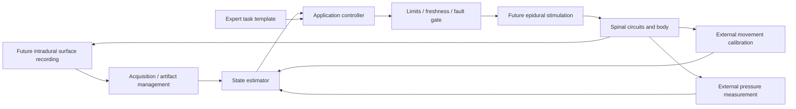

# Architecture and interfaces

## Two layers of SCCI_RH

**Future implanted concept:** intradural surface spinal measurement; separate epidural stimulation; optional external movement and arterial-pressure feedback; computation that translates task state into a calibrated intervention. Eight recording and eight stimulation contacts are an illustrative scalable proposal. No cortical recording is required. Long-term human recording, anatomical placement, biocompatibility, power delivery and selective recruitment are unresolved.

**Completed digital reference:** generated signals and reduced-order plants feed software controllers. A representative acquisition channel and biphasic test-load circuit are documented alongside an editable reference PCB and desktop enclosure. Native design files and exports are provided. No signal comes from a person or animal and no circuit has been physically fabricated.

This is a functional block diagram. The digital model substitutes artificial signal generators and numerical plants for the biological blocks. It does not imply that all the illustrated modules have been integrated in vivo.

## Application A: expert-informed practice

An expert template encodes a desired task trajectory or timing relationship, rather than a transferable electrode voltage. Four artificial calibration inputs estimate learner response gain; estimator delay compensation is handled separately. The estimator reads synthetic quadrature channels to estimate movement phase. Assistance is computed relative to this phase and the calibrated learner. Unassisted probe trials measure the intrinsic learner state separately from active assistance. Delay and noise alter estimator quality; a separate plasticity parameter controls whether the assisted practice produces retained gain.

## Application B: pressure feedback

The observation is externally measured mean arterial pressure. The numerical actuator is a normalized pressor command, not a human stimulation voltage. The controller compares pressure with a synthetic target, integrates error with saturation handling, and inhibits output for missing or stale observations. A simulated stand-like disturbance challenges the loop. Lower thoracic epidural stimulation is the proposed biological access route for this application, whereas the motor route is lumbosacral; a single common anatomical placement is not asserted.

## Electronics and timing

The reference circuit separates artificial input acquisition from test-load output. Biphasic phase timing, delivered charge, compliance and abnormal command handling are independently verifiable electrical/software quantities. Application-level commands do not automatically become validated stimulation prescriptions. Artifact blanking/recovery must sit between stimulation and recording in a future system; the simple synthetic decoder does not demonstrate immunity to a real stimulation artifact.

## Mechanical coordinate contract

Dimensions are millimetres. The reference PCB is 80 x 50 x 1.6 mm, with four 3.2 mm mounting holes at board coordinates (10,10), (70,10), (10,40), (70,40). Its centre is the enclosure's XY origin, giving hole centres (+/-30,+/-15). The enclosure has nominal outer dimensions 100 x 70 x 32 mm, a 2 mm floor, 2.5 mm walls and PCB mounting plane at z=8 mm. Editable source determines final port/lid details. The illustrative lead geometry is a concept drawing with no anatomical fit or implant-ready material claim.

## Claim boundaries at interfaces

| Interface | Digital evidence available | Evidence still needed for implantation |
|---|---|---|
| Neural state to estimator | Error on artificial quadrature data | Human observability, independent data splits, motion/artifact robustness |
| Expert template to learner | Calibrated surrogate policy comparison | Causal transfer, individual variability, retained skill and transfer |
| Pressure sensor to control | Numerical freshness/fault behaviour | Reliable physiological measurement and clinical fault response |
| Command to electrical output | Test-load waveform, charge and compliance calculations | Tissue interface, electrochemistry, adverse effects and qualification |
| Circuit to enclosure | CAD dimensions, source and exports | Physical tolerance, assembly, EMI and thermal measurements |

These interfaces make SCCI_RH expandable while preventing a result from one layer being used as validation of another.
