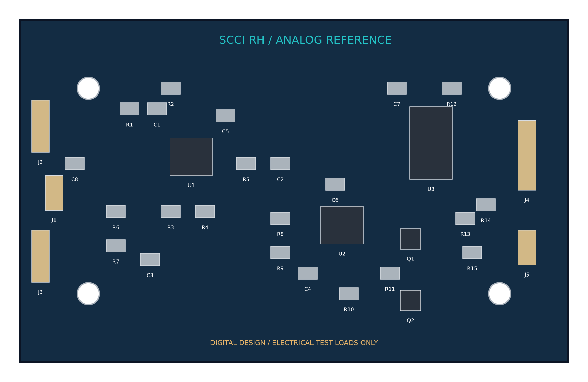

# SCCI_RH electrical reference and digital verification

The electronics give part of the future architecture a concrete, inspectable
mechanism. The board amplifies a small **artificial** voltage and reverses a
regulated current through an **electrical dummy load**. It neither records a
spinal cord nor establishes that a stimulation pattern can create a skill or
regulate pressure. Both application studies remain separate synthetic models.

## Native design and external interfaces

The editable [KiCad project](../electronics/scci_rh_reference.kicad_pro) has an
80 x 50 x 1.6 mm two-layer board. Four 3.2 mm mounting holes are at board
coordinates (10,10), (70,10), (10,40), (70,40) mm. The native schematic and PCB
derive from the same [connectivity manifest](../electronics/connectivity.json).
All functional chip pins are exposed. Local symbols use datasheet pin numbers;
analog switch ports have passive ERC types because they switch a supplied
voltage rather than drive a logic output. Mounting holes are explicitly
board-only footprints.

| Connector | Pin order | Purpose |
|---|---|---|
| J1 | 1 +5 V, 2 ground | Externally regulated 5 V supply |
| J2 | 1 artificial signal, 2 ground, 3 midpoint | Signal-generator input and midpoint monitor |
| J3 | 1 analog recording output, 2 ground, 3 midpoint | External high-impedance ADC or oscilloscope |
| J4 | 1 PHASE, 2 INHIBIT, 3 +5 V, 4 ground | External 5 V CMOS sequencer |
| J5 | 1 DUT_A, 2 DUT_B | External electrical test load |

The ADC, MCU, variable-current DAC, current monitor, patient isolation, electrode
protection, implant power supply and wireless telemetry are **not populated**.
The firmware elsewhere in the repository is a host-tested abstract sequencer;
it does not execute on this board. A future external sequencer would need a
5 V logic interface: a 3.3 V high is not guaranteed to meet the 74HC4053's input
threshold. No pressure-controller output is calibrated to a physical pulse.
J5's modeled dummy load is floating and differential. Grounding either terminal
through an earth-referenced instrument would add a return path and invalidate
the reversal model; the modeled 1 GΩ fixture leakage is not an oscilloscope
ground connection.



## Artificial-signal channel

U1 is a Texas Instruments OPA2333AID dual zero-drift op-amp. U1B buffers the
10 kΩ / 10 kΩ midpoint divider; its 10 μF bypass reduces divider noise. U1A
receives a signal through R1 = 10 kΩ and C1 = 1 μF, with R2 = 1 MΩ returning
the input to the buffered 2.5 V midpoint. R4 = 20 kΩ and R3 = 1 kΩ set the
noninverting gain to 21. R5 = 1 kΩ and C2 = 47 nF provide output filtering
and isolate a small capacitive load. The output needs a high-impedance receiver.

Using an ideal midpoint and the specified typical 350 kHz gain-bandwidth:

\[
H(s)=\frac{R_2}{R_1+R_2}\frac{s(R_1+R_2)C_1}{1+s(R_1+R_2)C_1}
\frac{21}{1+s\,21/(2\pi\,350000)}\frac{1}{1+sR_5C_2}.
\]

The input corner is 0.15758 Hz; the output RC corner is 3386.28 Hz; the
one-pole op-amp abstraction has a 16666.67 Hz closed-loop pole. The calculated
voltage gains are 20.7544 at 200 Hz and 20.3437 at 700 Hz. The deterministic
example adds 100 μV at 200 Hz and 40 μV at 700 Hz, centered by the AC-coupled
input. This is a signal-chain exercise; these amplitudes/frequencies are chosen
test signals, not established spinal recordings.

The noise estimate integrates white op-amp voltage noise and Johnson noise of
input/gain resistors at 298.15 K over 0.01–100000 Hz. It gives 79.03 μV RMS at
the output. The generated trace is bandwidth-limited by its 100 kHz sampling
rate and therefore represents a slightly smaller integration range. This
model omits 1/f noise, chopping ripple, midpoint-buffer noise, microphonics,
ADC noise, electrode impedance uncertainty, biological background and
stimulation artifact. It does not certify a neural signal-to-noise ratio.


The [OPA2333 manufacturer specification](https://www.ti.com/product/OPA2333)
supports a 1.8–5.5 V supply, typical 350 kHz GBW, typical 55 nV/√Hz at 1 kHz
and maximum 10 μV input offset at 25°C. These support a plausible low-voltage
reference choice; they do not replace a device macromodel or bench stability
test. The small fixed gain is intentional for this reference channel.

## Current sink and polarity reversal

U2A buffers R8 = 49.9 kΩ / R9 = 1.02 kΩ. U2B compares the reference to the
voltage across R10 = 1 kΩ and drives the 2N7002 Q1 gate through R11 = 1 kΩ:

\[
V_{ref}=5\frac{1020}{49900+1020}=100.157109\;\mathrm{mV},\qquad
I_{sink}\simeq V_{ref}/R_{10}=100.157109\;\mu\mathrm{A}.
\]

U3 is a Nexperia 74HC4053D triple SPDT analog switch. Its A/B sections are
cross-connected between +5 V and the same regulated SINK node. PHASE controls
both sections: PHASE = 0 connects A to +5 V and B to SINK; PHASE = 1 reverses
them. The unused C section and its control are grounded. INHIBIT = 1 isolates
the A/B terminals. R12 = 100 kΩ pulls INHIBIT high by default; R13 = 100 kΩ
defines PHASE low when disconnected.

Q2 is another 2N7002. With INHIBIT high, it forms a source-follower bypass from
+5 V to SINK, maintaining a supply for the 100 μA servo while the load ports
are isolated. This avoids the idealized servo being driven into saturation
by a completely open tail. When INHIBIT is low, Q2 is off. In revision B,
R14/R15 = 12 kΩ are inserted between each switch output and the dummy-load
connector to reduce the switching transient found in the first digital model.
These resistors consume compliance voltage and do not replace independent
current measurement.

The [74HC4053 datasheet](https://assets.nexperia.com/documents/data-sheet/74HC_HCT4053.pdf)
defines the pin routing and enable behavior. A 70 Ω per-switch on-resistance
is a **nominal modeling choice**, not a worst-case guarantee across voltage,
signal common mode and temperature. The model also assumes 0.3 V sink headroom;
this is not a manufacturer-guaranteed compliance floor for this complete servo.
The analytical current is clipped when its load voltage plus two switch drops
would exceed the remaining 5 V supply headroom.

The demonstration sequence is 200 μs positive, 50 μs inhibited, 200 μs reverse,
then inhibited for the rest of a 20 ms period. The firmware abstraction's
100.000 μA nominal corresponds to 20.000 nC/phase; the resistor-selected
circuit is 0.157% higher before calibration, giving 20.03142 nC/phase. This
small distinction is retained rather than silently reporting one setpoint
for two different models.
The external sequencer must assert INHIBIT before changing PHASE, allow settling,
then enable the next phase. The generic SPICE changes PHASE halfway through its
inhibited gap; the abstract adapter changes it at gap entry. Both assume the
load is already inhibited. GPIO write order and settling are not physically tested.

## Electrical load, faults and limits

The test load is a 1 kΩ series resistor plus a parallel 20 kΩ / 100 nF branch.
It is a convenient lumped electrochemical-style load; it is not a measured
electrode/tissue equivalent. Its polarization voltage obeys:

\[
\dot V_{dl}=I/C_{dl}-V_{dl}/(R_{ct}C_{dl}),\qquad
V_{load}=I R_s+V_{dl}.
\]

The exact constant-current RC update is used at 1 μs intervals. Nominal
integrated charge is +20.03142 / −20.03142 nC; net charge is zero in this
analytical abstraction. Peak terminal voltage is 0.289875 V. Polarization
immediately after the reverse phase is −22.3989 mV. Equal injected charges
therefore **do not imply zero instantaneous electrode polarization** when
charge leaks through Rct during the sequence.

| Analytical case | Result |
|---|---|
| Nominal 1 kΩ series load | 100.157 μA; no compliance clipping |
| 50 kΩ series load | Compliance clips both phases; −0.29430 nC net charge and 2.352% imbalance; 64.960 μA peak |
| Reverse phase shortened to 190 μs | +1.00157 nC net charge; 5% imbalance |
| Reverse phase missing | +20.03142 nC net charge; 100% imbalance |
| Supply reduced to 4.75 V | 95.1493 μA: the current reference follows the supply |
| Cdl reduced to 10 nF | −903.45 mV end-of-pulse polarization despite balanced injected charge |

With ±5% supply, ±0.1% divider/sense resistors and ±10 μV servo offset, the
calculated corner current is 94.8581–105.4868 μA. Precision resistors cannot
remove the supply dependence of this architecture. A future implant would
need a stable reference, programmable calibrated drivers, independent current
measurement, compliance detection and fault accounting.


## ngspice cross-check and design revision

The included [netlist](../electronics/simulation/current_sink_generic.cir) was
executed with **ngspice 46**, using the installed KiCad shared library. It
models the same divider/sense/gate/output resistors, Q1/Q2 topology and A/B switch
connections. Op-amp behavior is an ideal finite-bandwidth voltage servo;
MOSFETs use a generic level-1 model, not a manufacturer 2N7002 macromodel.
Switches have ideal on/off behavior with 70 Ω on-resistance. Chosen 50 pF
gate-source and 5 pF gate-drain capacitances and 1 GΩ fixture leakage are
explicit simulation assumptions, not measured parasitics.

Revision A's full 6 ms transient predicted a brief reverse-enable peak of
**1361.36 μA**, despite approximately 100.143 μA settled current. This digital
finding motivated revision B's actual schematic/PCB change: two 12 kΩ series
output resistors. The [revision A circuit and data](../electronics/revisions/revA/)
are archived rather than discarded.

Revision B's nominal 6 ms transient contains 12138 solver points. Settled current
is +100.14176 / −100.14146 μA; integrated charges are +20.02666 and −20.02759 nC,
leaving −0.0009261 nC. The modeled peak falls to **102.5784 μA**. Thus the revision
reduces the modeled transient while preserving the nominal phase charge within
1% of the analytical setpoint, at the cost of 24 kΩ additional series resistance.

Four additional generic-device SPICE cases completed the full transient:

| Declared SPICE case | Peak current |
|---|---|
| Cdl = 10 nF | 116.890 μA |
| Initial capacitor polarization +2 V at t = 0 | 127.231 μA |
| Initial capacitor polarization −2 V at t = 0 | 123.268 μA |
| 5.25 V supply, Cdl = 10 nF, 11.88 kΩ per output leg | 128.384 μA |

The precharge decays during the 1 ms before the first pulse with the 2 ms RC time
constant, so it is about ±1.213 V at first enable. The high-supply case has its
own 105.165 μA expected setpoint, since the reference follows the supply. These
are selected synthetic cases, not a full component, parasitic or fault envelope.

For a discharged shorted load and 5.25 V supply, conservative 1% low output
resistors yield 5.25 / (2 × 11880) = 220.96 μA, even without credit for switch
resistance. The BOM specifies 0.1% resistors; the 1% figure is an intentionally
looser envelope. Stored capacitor polarization can add to the driving voltage:
(5.25 + |Vpol|) / 23760. A 250 μA passive bound therefore requires |Vpol| ≤ 0.69 V;
2 V polarization yields a conservative fault estimate of 305.13 μA. This last
number is a bound calculation, not an observed SPICE peak. No universal analog
current cap or biological safety threshold is claimed.


Extending this result would require realistic vendor models, supply and
switch-charge injection/parasitic studies, servo compensation, calibrated
current monitoring and a bench investigation. The project documents a tested
digital revision; it does not treat the ideal or generic waveform as validated
hardware. The board is not justified for biological connection or fabrication
as a validated stimulator.

## Design-rule verification and reproduction

KiCad 10.0.6 reports **zero ERC violations, zero PCB DRC violations, zero
unconnected items and zero schematic parity issues** at the supplied default
constraints; reports include all severities and no excluded violations. The
two-layer routing uses 0.25 mm tracks, 0.65 mm vias with 0.3 mm drills, no hidden
copper zones, and the ordinary 0.2 mm net-class clearance. Board geometry,
Gerbers, drill and STEP exports are native KiCad outputs. This is electrical
connectivity/layout verification, not signal-integrity or biological validation.

Rebuild with KiCad's Python and its library directory, then run the numerical
model with Python plus NumPy/Matplotlib. Paths below are examples for your own
installation; the repository stores no absolute installation dependency.

```powershell
$env:KICAD_SHARE = '<KiCad>/share/kicad'
$env:KICAD_CLI = '<KiCad>/bin/kicad-cli.exe'
& '<KiCad>/bin/python.exe' scripts/build_electronics.py
$env:NGSPICE_DLL = '<KiCad>/bin/ngspice.dll'  # optional SPICE cross-check
python scripts/simulate_electronics.py
```

Numerical data, parameters and seed 260107 are retained in
[`electronics/simulation/`](../electronics/simulation/). Build failures or
rule violations stop the generator. KiCad may regenerate UUIDs/timestamps;
reproducibility means the geometry, connections and model results, not
byte-identical native files. Local KiCad library copies retain their separate
[license and attribution](../electronics/THIRD_PARTY_LICENSES.md).
