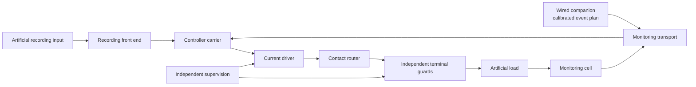
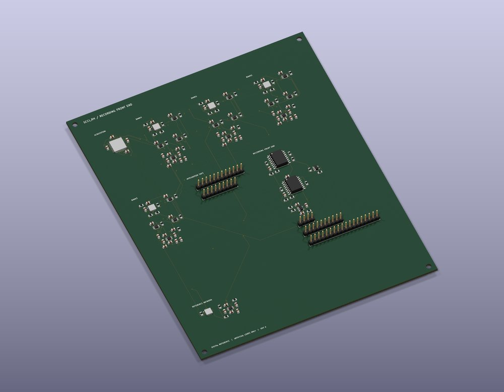
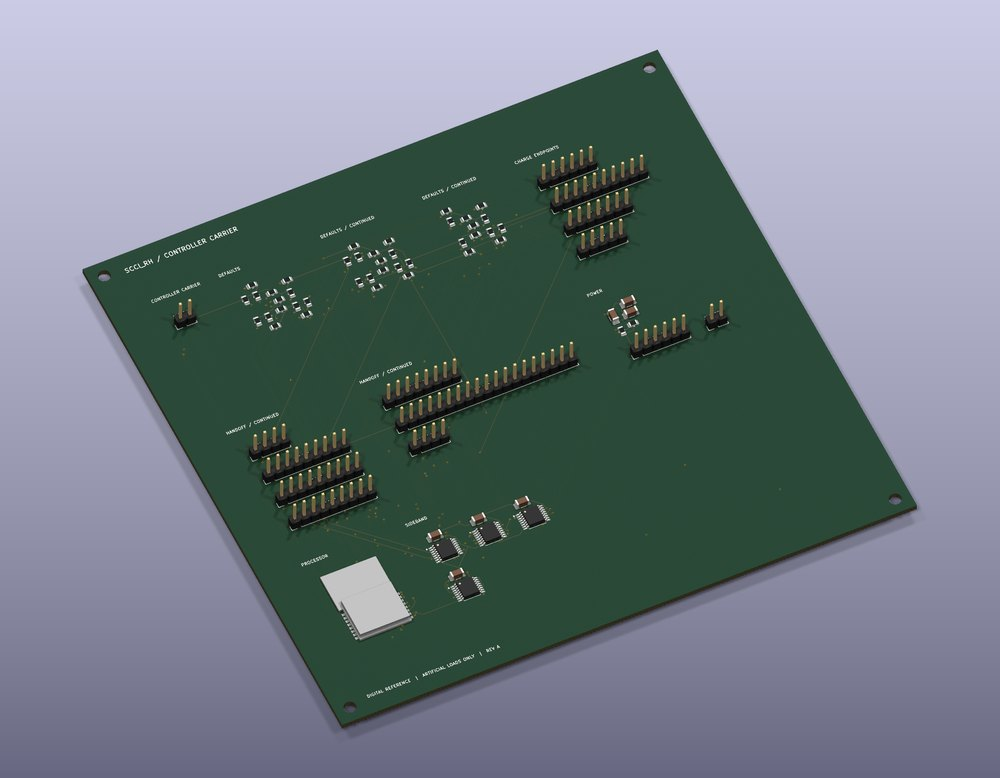
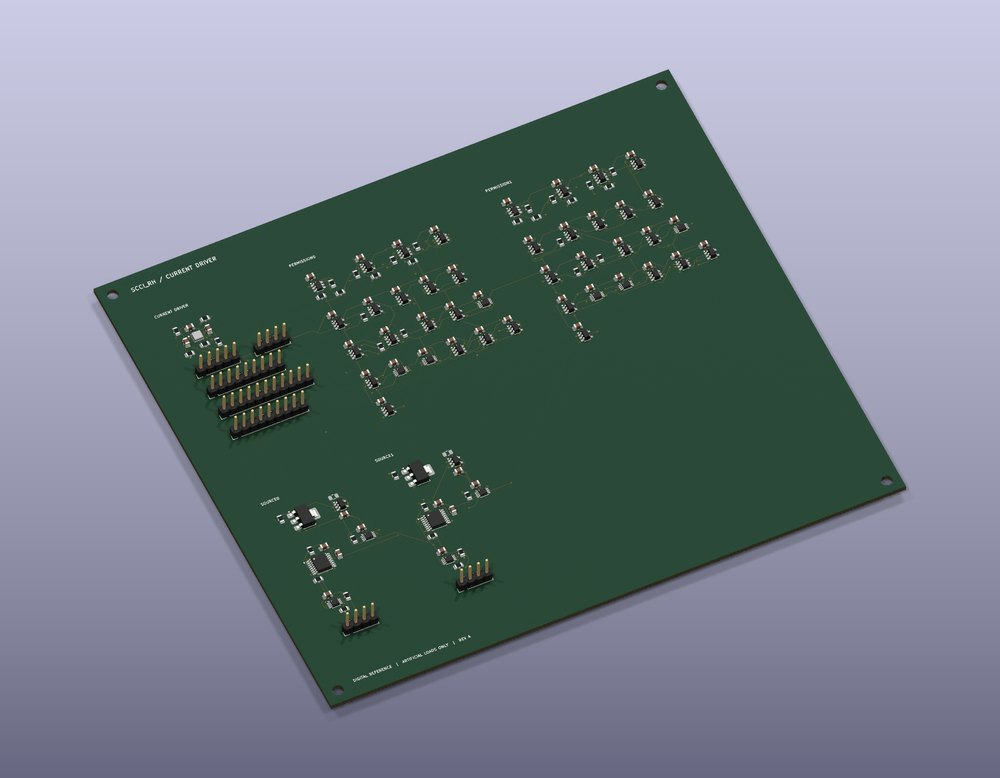
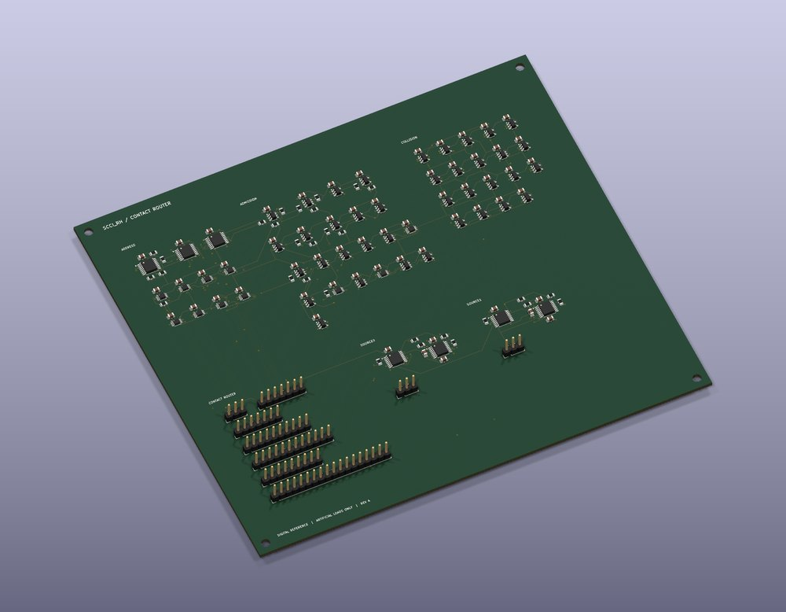
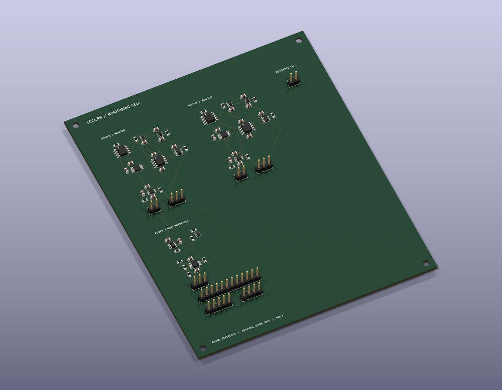
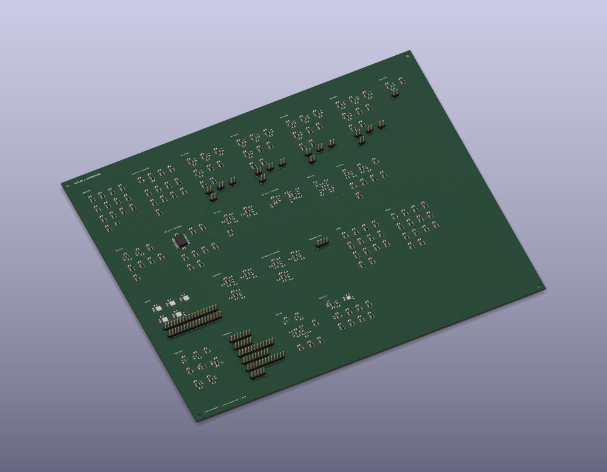
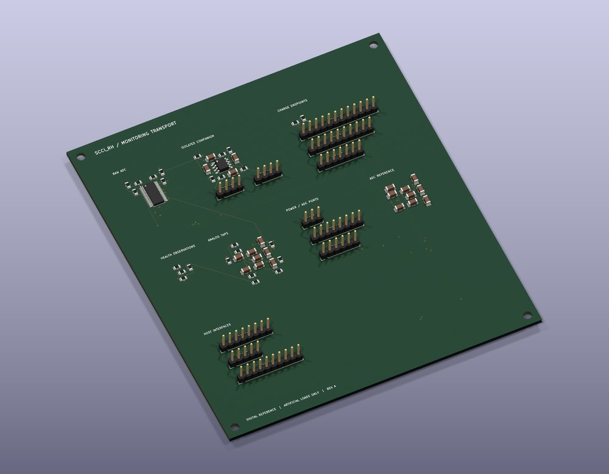
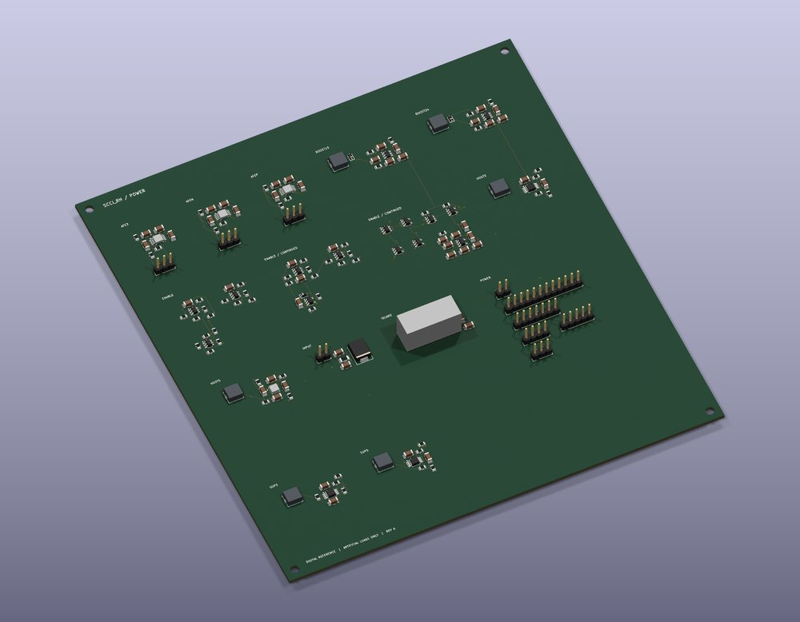

[Explore](README.md) · [Theory](theory.md) · [CAD](cad.md) · **Electronics** · [Firmware](firmware.md)

# Electronics: from spinal interface to an inspectable circuit system

SCCI_RH gives its future spinal recording–interpretation–stimulation concept a concrete **eight-board electrical reference**. Start with the pictures, follow the signal path, then open the native circuits behind any board. The boards are full-size digital engineering designs for artificial signals and loads; the separate compact implanted package is a future concept.

**No KiCad needed:** [read the complete 80-sheet schematic PDF](../../electronics/stage4/integrated-pcb/integration/master/SCCI_RH_integrated.pdf).

**Editable source:** [master KiCad project](../../electronics/stage4/integrated-pcb/integration/master/SCCI_RH_integrated.kicad_pro) · [root schematic](../../electronics/stage4/integrated-pcb/integration/master/SCCI_RH_integrated.kicad_sch) · [board index and launchers](../../electronics/stage4/integrated-pcb/BOARD_INDEX.md).

**Inspect without KiCad:** [browser PCB/component viewer](https://pratham-cloud-ctrl.github.io/Project-SCCI-RH/?design=recording-front-end&view=pcb) · [all four copper layers](https://pratham-cloud-ctrl.github.io/Project-SCCI-RH/?design=recording-front-end&view=copper) · [80 current schematic sheets](https://pratham-cloud-ctrl.github.io/Project-SCCI-RH/?view=schematic).
Choose any board, search a reference or value, select a footprint and highlight
its nets. The interactive BOM covers outer copper; the separate layer drawings
include F.Cu, In1.Cu, In2.Cu and B.Cu. Each board also has a source-derived 3D view.

**Open in engineering software:** [complete current KiCad ZIP](https://pratham-cloud-ctrl.github.io/Project-SCCI-RH/downloads/KiCad-SCCI_RH-native-projects.zip).
Extract it with its libraries and hierarchy. KiCad 10's standard model library
is required for stock 3D packages; local custom models are included. Individual
populated STEP files are available in each board's inspector download panel.

## Follow one loop



The recording front end supplies sixteen differential streams, with a shared reference and separate body-bias interface. A future learner-specific controller would turn useful observations into bounded assistance; retained learning is evaluated after assistance ends. For the physiological example, a companion additionally supplies external pressure measurements and a function-specific plan. The current [firmware](firmware.md) records neural streams in **OBSERVE only**; while armed, it uses external prequalified plans. Simultaneous live spinal decoding during stimulation remains future work.

The output path has two stimulation sources, sixteen selectable stimulation contacts and two separate returns. The monitoring cell observes delivered current and phase-charge endpoints. Independent supervision can withdraw permission without waiting for the main processor. The power board supplies the distinct host, supervisor and recording domains. The [mechanism and wiring review](../../docs/stage4/integrated-pcb-design.md) explains how these interfaces join.

## Eight boards, eight jobs

Click a rendering to enlarge it. **Inspect 3D / PCB / Circuit** opens the browser
view; **Native circuit / Native PCB** links to editable engineering files that
GitHub may offer only as downloads. **Source PDF** is the earlier circuit-slice
drawing, with local reference numbers; the current master PDF above and browser
schematic sheets include integrated numbering, added taps and reviewed corrections.

<table>
<tr>
<td width="50%" valign="top">
<h3>Recording front end</h3>
<a href="https://raw.githubusercontent.com/pratham-cloud-ctrl/Project-SCCI-RH/main/electronics/stage4/integrated-pcb/exports/recording-front-end/isometric.png"></a>
<p>Sixteen recording streams, protection, blanking and host communication. <b>155 × 190 mm; 153 fitted components.</b></p>
<p>Inspect: <a href="https://pratham-cloud-ctrl.github.io/Project-SCCI-RH/?design=recording-front-end&amp;view=model">3D</a> · <a href="https://pratham-cloud-ctrl.github.io/Project-SCCI-RH/?design=recording-front-end&amp;view=pcb">PCB</a> · <a href="https://pratham-cloud-ctrl.github.io/Project-SCCI-RH/?design=recording-front-end&amp;view=schematic">Circuit</a></p>
<p><a href="../../electronics/stage4/integrated-pcb/boards/recording-front-end/recording_front_end.kicad_sch">Native circuit</a> · <a href="../../electronics/stage4/integrated-pcb/boards/recording-front-end/recording_front_end.kicad_pcb">Native PCB</a> · <a href="../../electronics/stage4/recording-front-end/recording_front_end.pdf">Source PDF</a><br>
<a href="../../electronics/stage4/integrated-pcb/exports/recording-front-end/populated.step">STEP</a> · <a href="../../electronics/stage4/integrated-pcb/exports/recording-front-end/top-copper.svg">Copper</a> · <a href="../../electronics/stage4/integrated-pcb/exports/recording-front-end/fabrication-reference/bom.csv">BOM</a> · <a href="../../electronics/stage4/integrated-pcb/exports/recording-front-end/fabrication-reference/README.md">Fabrication</a></p>
</td>
<td width="50%" valign="top">
<h3>Controller carrier</h3>
<a href="https://raw.githubusercontent.com/pratham-cloud-ctrl/Project-SCCI-RH/main/electronics/stage4/integrated-pcb/exports/controller-carrier/isometric.png"></a>
<p>BT40F/nRF5340, commissioning, policy execution and observed address/health inputs. <b>155 × 150 mm; 68 fitted.</b></p>
<p>Inspect: <a href="https://pratham-cloud-ctrl.github.io/Project-SCCI-RH/?design=controller-carrier&amp;view=model">3D</a> · <a href="https://pratham-cloud-ctrl.github.io/Project-SCCI-RH/?design=controller-carrier&amp;view=pcb">PCB</a> · <a href="https://pratham-cloud-ctrl.github.io/Project-SCCI-RH/?design=controller-carrier&amp;view=schematic">Circuit</a></p>
<p><a href="../../electronics/stage4/integrated-pcb/boards/controller-carrier/controller_carrier.kicad_sch">Native circuit</a> · <a href="../../electronics/stage4/integrated-pcb/boards/controller-carrier/controller_carrier.kicad_pcb">Native PCB</a> · <a href="../../electronics/stage4/controller-carrier/controller_carrier.pdf">Source PDF</a><br>
<a href="../../electronics/stage4/integrated-pcb/exports/controller-carrier/populated.step">STEP</a> · <a href="../../electronics/stage4/integrated-pcb/exports/controller-carrier/top-copper.svg">Copper</a> · <a href="../../electronics/stage4/integrated-pcb/exports/controller-carrier/fabrication-reference/bom.csv">BOM</a> · <a href="../../electronics/stage4/integrated-pcb/exports/controller-carrier/fabrication-reference/README.md">Fabrication</a></p>
</td>
</tr>
<tr>
<td valign="top">
<h3>Current driver</h3>
<a href="https://raw.githubusercontent.com/pratham-cloud-ctrl/Project-SCCI-RH/main/electronics/stage4/integrated-pcb/exports/current-driver/isometric.png"></a>
<p>Two restricted current sources, polarity switching, duration cutoff and sticky inhibition. <b>175 × 155 mm; 154 fitted, two DNP.</b></p>
<p>Inspect: <a href="https://pratham-cloud-ctrl.github.io/Project-SCCI-RH/?design=current-driver&amp;view=model">3D</a> · <a href="https://pratham-cloud-ctrl.github.io/Project-SCCI-RH/?design=current-driver&amp;view=pcb">PCB</a> · <a href="https://pratham-cloud-ctrl.github.io/Project-SCCI-RH/?design=current-driver&amp;view=schematic">Circuit</a></p>
<p><a href="../../electronics/stage4/integrated-pcb/boards/current-driver/current_driver.kicad_sch">Native circuit</a> · <a href="../../electronics/stage4/integrated-pcb/boards/current-driver/current_driver.kicad_pcb">Native PCB</a> · <a href="../../electronics/stage4/current-driver/current_driver.pdf">Source PDF</a><br>
<a href="../../electronics/stage4/integrated-pcb/exports/current-driver/populated.step">STEP</a> · <a href="../../electronics/stage4/integrated-pcb/exports/current-driver/top-copper.svg">Copper</a> · <a href="../../electronics/stage4/integrated-pcb/exports/current-driver/fabrication-reference/bom.csv">BOM</a> · <a href="../../electronics/stage4/integrated-pcb/exports/current-driver/fabrication-reference/README.md">Fabrication</a></p>
</td>
<td valign="top">
<h3>Contact router</h3>
<a href="https://raw.githubusercontent.com/pratham-cloud-ctrl/Project-SCCI-RH/main/electronics/stage4/integrated-pcb/exports/contact-router/isometric.png"></a>
<p>Two-source contact selection with separate preload, active latch and address observations. <b>175 × 155 mm; 155 fitted.</b></p>
<p>Inspect: <a href="https://pratham-cloud-ctrl.github.io/Project-SCCI-RH/?design=contact-router&amp;view=model">3D</a> · <a href="https://pratham-cloud-ctrl.github.io/Project-SCCI-RH/?design=contact-router&amp;view=pcb">PCB</a> · <a href="https://pratham-cloud-ctrl.github.io/Project-SCCI-RH/?design=contact-router&amp;view=schematic">Circuit</a></p>
<p><a href="../../electronics/stage4/integrated-pcb/boards/contact-router/contact_router.kicad_sch">Native circuit</a> · <a href="../../electronics/stage4/integrated-pcb/boards/contact-router/contact_router.kicad_pcb">Native PCB</a> · <a href="../../electronics/stage4/contact-router/contact_router.pdf">Source PDF</a><br>
<a href="../../electronics/stage4/integrated-pcb/exports/contact-router/populated.step">STEP</a> · <a href="../../electronics/stage4/integrated-pcb/exports/contact-router/top-copper.svg">Copper</a> · <a href="../../electronics/stage4/integrated-pcb/exports/contact-router/fabrication-reference/bom.csv">BOM</a> · <a href="../../electronics/stage4/integrated-pcb/exports/contact-router/fabrication-reference/README.md">Fabrication</a></p>
</td>
</tr>
<tr>
<td valign="top">
<h3>Monitoring cell</h3>
<a href="https://raw.githubusercontent.com/pratham-cloud-ctrl/Project-SCCI-RH/main/electronics/stage4/integrated-pcb/exports/monitoring-cell/isometric.png"></a>
<p>Signed current monitoring, continuous charge integrators and endpoint converters. <b>120 × 145 mm; 71 fitted.</b></p>
<p>Inspect: <a href="https://pratham-cloud-ctrl.github.io/Project-SCCI-RH/?design=monitoring-cell&amp;view=model">3D</a> · <a href="https://pratham-cloud-ctrl.github.io/Project-SCCI-RH/?design=monitoring-cell&amp;view=pcb">PCB</a> · <a href="https://pratham-cloud-ctrl.github.io/Project-SCCI-RH/?design=monitoring-cell&amp;view=schematic">Circuit</a></p>
<p><a href="../../electronics/stage4/integrated-pcb/boards/monitoring-cell/monitoring_cell.kicad_sch">Native circuit</a> · <a href="../../electronics/stage4/integrated-pcb/boards/monitoring-cell/monitoring_cell.kicad_pcb">Native PCB</a> · <a href="../../electronics/stage4/monitoring-cell/monitoring_cell.pdf">Source PDF</a><br>
<a href="../../electronics/stage4/integrated-pcb/exports/monitoring-cell/populated.step">STEP</a> · <a href="../../electronics/stage4/integrated-pcb/exports/monitoring-cell/top-copper.svg">Copper</a> · <a href="../../electronics/stage4/integrated-pcb/exports/monitoring-cell/fabrication-reference/bom.csv">BOM</a> · <a href="../../electronics/stage4/integrated-pcb/exports/monitoring-cell/fabrication-reference/README.md">Fabrication</a></p>
</td>
<td valign="top">
<h3>Independent supervision</h3>
<a href="https://raw.githubusercontent.com/pratham-cloud-ctrl/Project-SCCI-RH/main/electronics/stage4/integrated-pcb/exports/supervision/isometric.png"></a>
<p>Terminal guards, watchdog, duration and health windows independent of processor policy. <b>300 × 250 mm; 479 fitted.</b></p>
<p>Inspect: <a href="https://pratham-cloud-ctrl.github.io/Project-SCCI-RH/?design=supervision&amp;view=model">3D</a> · <a href="https://pratham-cloud-ctrl.github.io/Project-SCCI-RH/?design=supervision&amp;view=pcb">PCB</a> · <a href="https://pratham-cloud-ctrl.github.io/Project-SCCI-RH/?design=supervision&amp;view=schematic">Circuit</a></p>
<p><a href="../../electronics/stage4/integrated-pcb/boards/supervision/supervision.kicad_sch">Native circuit</a> · <a href="../../electronics/stage4/integrated-pcb/boards/supervision/supervision.kicad_pcb">Native PCB</a> · <a href="../../electronics/stage4/supervision/supervision.pdf">Source PDF</a><br>
<a href="../../electronics/stage4/integrated-pcb/exports/supervision/populated.step">STEP</a> · <a href="../../electronics/stage4/integrated-pcb/exports/supervision/top-copper.svg">Copper</a> · <a href="../../electronics/stage4/integrated-pcb/exports/supervision/fabrication-reference/bom.csv">BOM</a> · <a href="../../electronics/stage4/integrated-pcb/exports/supervision/fabrication-reference/README.md">Fabrication</a></p>
</td>
</tr>
<tr>
<td valign="top">
<h3>Monitoring and companion transport</h3>
<a href="https://raw.githubusercontent.com/pratham-cloud-ctrl/Project-SCCI-RH/main/electronics/stage4/integrated-pcb/exports/monitoring-transport/isometric.png"></a>
<p>Raw electrical sampling, endpoint readout and the isolated wired UART connection. <b>125 × 140 mm; 60 fitted.</b></p>
<p>Inspect: <a href="https://pratham-cloud-ctrl.github.io/Project-SCCI-RH/?design=monitoring-transport&amp;view=model">3D</a> · <a href="https://pratham-cloud-ctrl.github.io/Project-SCCI-RH/?design=monitoring-transport&amp;view=pcb">PCB</a> · <a href="https://pratham-cloud-ctrl.github.io/Project-SCCI-RH/?design=monitoring-transport&amp;view=schematic">Circuit</a></p>
<p><a href="../../electronics/stage4/integrated-pcb/boards/monitoring-transport/monitoring_transport.kicad_sch">Native circuit</a> · <a href="../../electronics/stage4/integrated-pcb/boards/monitoring-transport/monitoring_transport.kicad_pcb">Native PCB</a> · <a href="../../electronics/stage4/monitoring-transport/monitoring_transport.pdf">Source PDF</a><br>
<a href="../../electronics/stage4/integrated-pcb/exports/monitoring-transport/populated.step">STEP</a> · <a href="../../electronics/stage4/integrated-pcb/exports/monitoring-transport/top-copper.svg">Copper</a> · <a href="../../electronics/stage4/integrated-pcb/exports/monitoring-transport/fabrication-reference/bom.csv">BOM</a> · <a href="../../electronics/stage4/integrated-pcb/exports/monitoring-transport/fabrication-reference/README.md">Fabrication</a></p>
</td>
<td valign="top">
<h3>Power</h3>
<a href="https://raw.githubusercontent.com/pratham-cloud-ctrl/Project-SCCI-RH/main/electronics/stage4/integrated-pcb/exports/power/isometric.png"></a>
<p>Battery-input architecture, supply domains, isolated recording rails and power-fault observation. <b>175 × 185 mm; 156 fitted.</b></p>
<p>Inspect: <a href="https://pratham-cloud-ctrl.github.io/Project-SCCI-RH/?design=power&amp;view=model">3D</a> · <a href="https://pratham-cloud-ctrl.github.io/Project-SCCI-RH/?design=power&amp;view=pcb">PCB</a> · <a href="https://pratham-cloud-ctrl.github.io/Project-SCCI-RH/?design=power&amp;view=schematic">Circuit</a></p>
<p><a href="../../electronics/stage4/integrated-pcb/boards/power/power.kicad_sch">Native circuit</a> · <a href="../../electronics/stage4/integrated-pcb/boards/power/power.kicad_pcb">Native PCB</a> · <a href="../../electronics/stage4/power/power.pdf">Source PDF</a><br>
<a href="../../electronics/stage4/integrated-pcb/exports/power/populated.step">STEP</a> · <a href="../../electronics/stage4/integrated-pcb/exports/power/top-copper.svg">Copper</a> · <a href="../../electronics/stage4/integrated-pcb/exports/power/fabrication-reference/bom.csv">BOM</a> · <a href="../../electronics/stage4/integrated-pcb/exports/power/fabrication-reference/README.md">Fabrication</a></p>
</td>
</tr>
</table>

Together: **1,298 electrical positions, 1,296 fitted components, 80 schematic sheets and 258 explicit wiring rows**. Two optional driver capacitors retain pads but are not fitted. Use the [complete component BOM](../../electronics/stage4/integrated-pcb/integration/populated-bom.csv), [wiring table](../../docs/stage4/integrated-pcb-wiring.csv) and [physical harness record](../../electronics/stage4/integrated-pcb/integration/harness.json) to trace a component or connection across boards.

## Open and inspect in KiCad

1. **Clone or download the whole repository**, preserving its folders. Individual downloaded boards lose their sibling schematics and local libraries.
2. Use **KiCad 10**; the native review used 10.0.6. Open the master `.kicad_pro` for the complete hierarchy. Double-click a module sheet to descend into its circuit.
3. For one layout, open its `.kicad_pro` in `electronics/stage4/integrated-pcb/boards/<board>/`. The PCB and matching integrated schematic are siblings. Open PCB Editor, then **View → 3D Viewer** to compare copper, footprints and packages.
4. On Windows, the [explicit launchers](../../electronics/stage4/integrated-pcb/BOARD_INDEX.md) avoid file-association problems. Set `SCCI_RH_KICAD_BIN` to your own KiCad 10 `bin` directory if the original installation path differs. Other systems can open the files through KiCad directly.
5. Keep the supplied project library tables and relative model folders. Inspect a clean copy; save intentional design changes as a separate revision.

## What the verification establishes

The [v2.0.1 native review](../../docs/review-v2.0.1/electronics-review.md) records zero DRC violations, unconnected items and schematic-parity findings across all eight saved boards, plus zero master ERC findings. No check category was omitted. Independent audits also compare actual pad/net identities, references and population flags to the schematic graph.

From the repository root, with the [reproduction environment](reviewer-guide.md#reproduce-the-current-engineering):

```text
python scripts/verify_integrated_pcb.py
python electronics/stage4/integrated-pcb/integration/verify_integration.py
python electronics/stage4/integrated-pcb/integration/verify_populated_boards.py
python electronics/stage4/integrated-pcb/verify_exports.py
```

These source/export audits replay saved evidence; they do not invoke fresh physical measurements. The [layout review](../../docs/stage4/pcb-layout-review.md) documents four-layer routing, nominal geometry and manufacturing premises. In particular, five BT40F lands require a filled/capped via-in-pad process. Analog settling, current accuracy, isolation, thermal performance and assembly remain unqualified. Fabrication exports support inspection; they are not manufacturing approval. The reference boards retain their real dimensions and **do not fit the proposed compact can**.

**Next:** [inspect the packaging around these boards](cad.md) or [follow their current control software](firmware.md).
