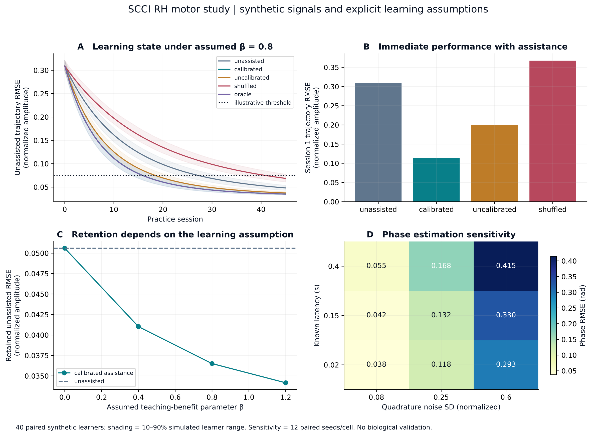
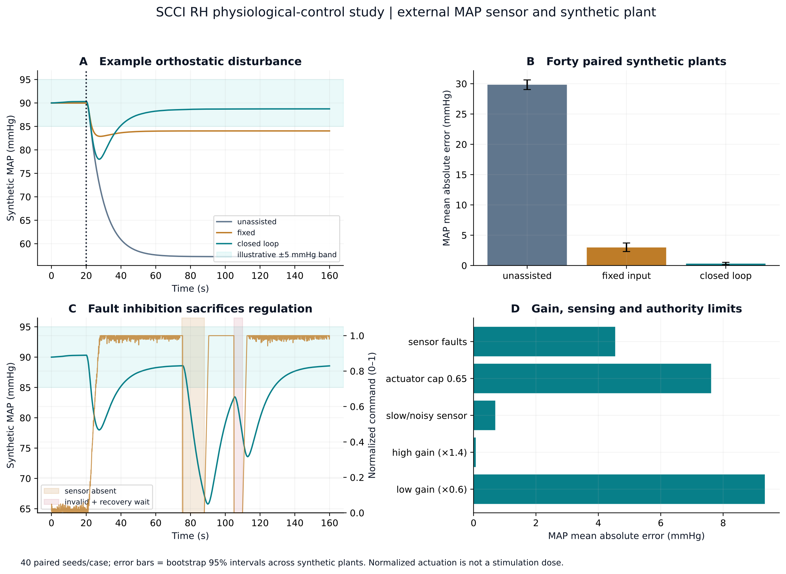

# Project SCCI RH: A Digital Engineering Study of Spinal Recording, Expert-Informed Practice and Physiological Feedback

**Pratham Varma — AI-assisted student research and engineering project**  
**Version 1.0 | 7 October 2026 | Digital proof of concept**

## Abstract

Project SCCI RH investigates how a future invasive spinal cord–computer interface could combine task-relevant measurements, calibrated stimulation and feedback. Two motivating applications are examined: expert-informed assistance during rhythmic practice and regulation of mean arterial pressure after a postural disturbance. The project connects a targeted primary-source review to executable models, circuit documentation, fault handling, editable CAD and a reproducible digital demonstration. The proposed future architecture separates intradural surface recording from epidural stimulation and includes external body measurements where the observation requires them. No cortical recording is used. The motor study distinguishes performance with assistance from unassisted retention and explicitly exposes an assumed plasticity-benefit parameter. The pressure study uses a reduced-order synthetic plant, actuator bounds and sensor-freshness checks. Electrical studies evaluate artificial signals, biphasic pulse charge and test-load compliance; CAD provides a desktop enclosure and illustrative lead identity. All newly generated results are computational or geometric, with no original human, animal or fabricated-hardware data. The contribution is a bounded, inspectable engineering argument rather than evidence that skills can be copied or that a new implant works. The project identifies measurable failure conditions and shows which biological assumptions would require separate experiments before translation.

**Keywords:** spinal cord–computer interface; SCCI; spinal recording; neuromodulation; motor learning; physiological feedback; digital engineering; reproducibility.

## 1. Purpose and contribution

An ambitious interface concept becomes useful when the information it can observe, the outputs it can influence and the mechanism linking the two are specified. Project SCCI RH began with two questions. Could activity recorded during expert performance help construct a learner-specific training policy? Could feedback through spinal pathways maintain a particular physiological variable after ordinary regulation is disrupted? These questions share a computational structure, but they have different biological targets and success criteria.

The spinal cord is relevant because it carries ascending and descending pathways and contains local circuitry involved in movement, reflexes and selected autonomic functions. Access at this site does not supply arbitrary access to all cognition or every organ. A useful SCCI must operate through pathways relevant to its named task. SCCI_RH uses “invasive” to mean implanted access, which can include a surface placement without penetration into neural tissue. The term SCCI is an operational project label; related research appears under spinal neuroprostheses, epidural electrical stimulation, spinal recording and closed-loop neuromodulation.

The project's direct engineering inspiration is AstroSam's [Making a Brain Computer Interface in My Garage](https://www.youtube.com/watch?v=5YxrpcqkTYA) and [Mind-Link repository](https://github.com/sam-astro/Mind-link). Their visible progression from future concept through boards, communication, visualization and an enclosure makes a complex idea inspectable. SCCI_RH adopts this progression and develops its own spinal architecture and evidence. It does not claim invention of spinal interfaces. A source review of Mind-Link at commit `a391eb851ee624be675057380f4e3b701ebf6ee8` found binary-state firmware and a corresponding display, rather than a biological neural decoder. This distinction motivated explicit scope and verification at each layer of SCCI_RH.

The completed project is entirely digital. It includes models that can be rerun, generated numeric records, circuit and PCB files, editable mechanical source, visual assets and documentation. These artifacts address different questions: a controller trajectory evaluates a control law under a chosen plant; a pulse waveform evaluates an electrical model; a CAD assembly evaluates defined geometry. They do not collectively become biological validation merely because they share a device name.

SCCI_RH contributes an original integration and a falsifiable analysis of its assumptions. Its principal design argument is that expert information should enter as task structure and a calibrated intervention policy, while retained improvement must be assessed independently of assistance. Its physiological argument is limited to pressure feedback, with external measurement and an explicit actuator. Its engineering argument connects these mechanisms to documented signal paths, fault states and a coherent physical identity. The release is an educational engineering proof of concept.

## 2. Evidence and interpretation

### 2.1 Review method

Primary publisher pages, PubMed records, accessible manuscripts and Europe PMC article XML were checked on 7 October 2026. Sources were selected for direct relevance to recording, stimulation, plasticity, movement timing and blood-pressure control. This is a targeted narrative review. It is not a registered systematic search, meta-analysis or claim that every publication through that date was examined. The machine-readable evidence matrix records study scope and the inference allowed by each source. Bibliographic identifiers are supplied in `docs/references.bib`.

The supplied 28-page hypothesis paper served as a starting map and reports no original experiments. One factual correction was necessary: its page 7 describes five freely moving rats in the 2026 circumferential recording study. The primary article reports 15 rats overall, with a five-rat motor-decoding subset. SCCI_RH retains that distinction and does not pool related research cohorts into an invented large sample.

### 2.2 Reading spinal activity

El Hadwe and colleagues demonstrated short-term intradural circumferential surface recordings in freely moving rats, with rodent implantation lasting up to three days. Their motor decoder used recordings from five animals; sensory and acute pig experiments were separate analyses. These findings motivate spinal state estimation, while leaving chronic human stability and cross-person transfer unresolved. [1](https://doi.org/10.1038/s41467-026-75128-z)

A predictive recording is not necessarily a command. The same movement-associated potential could contain descending drive, sensory consequences, local processing or artifact. This is a causal-identification problem: predicting a trajectory from a mixture does not tell a stimulator which intervention will produce that trajectory in another nervous system. SCCI_RH therefore calls its artificial inputs “spinal-like” signals, and its decoded variable “phase”; it does not call them measured motor intent or neural recordings.

### 2.3 Influencing movement and adaptation

Computational and experimental work by Capogrosso and colleagues supports the role of recruited afferents in epidural modulation of spinal sensorimotor circuits. This motivates a calibrated response map rather than literal waveform replay. [2](https://doi.org/10.1523/JNEUROSCI.1688-13.2013) Wagner and colleagues demonstrated targeted, timed stimulation combined with rehabilitation in three participants with chronic spinal cord injury, including gains assessed without active stimulation. [3](https://doi.org/10.1038/s41586-018-0649-2) Rowald and colleagues extended task-specific spatial and temporal stimulation in a small clinical cohort. [4](https://doi.org/10.1038/s41591-021-01663-5)

These studies do not establish accelerated healthy novice acquisition. Rehabilitation after injury, immediate assistance, reflex modification and expert-informed skill training are different interventions. Thompson and colleagues found persistent reflex modification and associated functional improvement in responding participants with incomplete injury. [5](https://doi.org/10.1523/JNEUROSCI.3968-12.2013) Nishimura and colleagues demonstrated timing-dependent modification of primate corticospinal connections using cortical spikes to trigger spinal stimulation. That experiment supports a timing-sensitive plasticity hypothesis but contains a cortical input absent from SCCI_RH. [6](https://doi.org/10.1016/j.neuron.2013.08.028)

Biological feedback also imposes constraints. Formento and colleagues examined interference between epidural stimulation and proprioceptive signals and the importance of stimulation patterns that preserve useful sensory information. [7](https://doi.org/10.1038/s41593-018-0262-6) SCCI_RH accordingly does not equate larger stimulation with better learning. Practice-related adaptation and its aftereffects must be distinguished, as illustrated by human force-field reaching experiments. [8](https://doi.org/10.1523/JNEUROSCI.14-05-03208.1994)

### 2.4 A named physiological function

The neuroprosthetic baroreflex work of Squair and colleagues provides a direct foundation for feedback-mediated spinal pressure regulation after injury. [9](https://doi.org/10.1038/s41586-020-03180-w) Phillips and colleagues subsequently reported a purpose-built implantable system and lower thoracic targeting in 14 participants across four trials. Survey cohorts in that publication are separate from implanted participants, and endpoint-specific sample sizes differ. [10](https://doi.org/10.1038/s41591-025-03614-w)

This application offers an explicit output, an accessible intervention route and a disturbance to reject. It does not imply universal control of involuntary physiology. SCCI_RH models externally observed mean arterial pressure and a normalized pressor command. It does not infer pressure from a spinal potential or use clinical stimulation settings as its digital reference.

### 2.5 Hybrid interfaces as comparisons

Lorach and colleagues' brain–spine interface combined implanted cortical recording and spinal stimulation in one participant. [11](https://doi.org/10.1038/s41586-023-06094-5) It is a relevant comparison for intent-driven intervention, but it is a hybrid architecture. SCCI_RH requires no brain recording. Any future revision that adds cortical measurement must be described accordingly.

## 3. SCCI_RH system architecture

### 3.1 The future concept

SCCI_RH proposes two separate implanted functions: intradural surface spinal recording and epidural spinal stimulation. They are presented as distinct modules because supporting evidence and physical coupling differ. An illustrative eight-contact recording module and eight-contact stimulation module communicate with acquisition, computation and supervised output circuitry. This count organizes the design; it is not a claim that eight channels suffice for all tasks or identify eight independent neural populations.

The movement application considers a lumbosacral target. The pressure application considers lower thoracic pathways. Segmental neural anatomy must be distinguished from vertebral geometry. A shared computation platform does not mean one universal electrode placement. Neither lead model is an anatomical prescription: patient geometry, recruitment mapping, mechanical tolerance and chronic compatibility would require independent development.

The architecture admits external body measurements. Kinematic information can calibrate a motor response and label a task template. Pressure sensing observes the regulated variable directly. These measurements are disclosed instead of being attributed to neural decoding. A claim that an invasive recording adds value would eventually require comparison against an external-sensor-only estimator at the same task.

### 3.2 The digital reference

The release substitutes artificial inputs and numerical plants for biology. Software performs task estimation, computes an intervention and evaluates bounds and faults. Representative acquisition and test-load circuits express how such signal paths could be implemented electronically. The enclosure presents a coherent desktop reference device and the conceptual leads show the division between read and write access.

The software, circuit model and mechanical assembly are linked by interfaces and parameters; this is not a transistor-level simulation of every sample moving through an implanted system. In particular, a two-channel quadrature model and a single representative acquisition circuit serve different levels of abstraction. Scaling the circuit to a complete multichannel implant would involve bandwidth, crosstalk, power and artifact-recovery requirements that are not established here.

### 3.3 State, action and limits

For a general nonlinear plant, write its evolution as x_dot = f(x,u,d), and measurements as y = h(x) + v. Here x is state, u is intervention, d is a disturbance and v is measurement noise. An estimator produces x_hat from available measurements. A controller computes a requested input, after which a supervisor checks freshness, magnitude, timing and output constraints before releasing it. Observability of a task state and controllability of the desired output are separate conditions; a well-estimated state can still lie outside the actuator's useful authority.

Invasive stimulation and sensitive recording also create an artifact problem. A future implementation needs blanking, recovery and quality checks before stimulated traces are treated as neural measurements. SCCI_RH's simple signal generator does not demonstrate recovery from real electrode polarization or amplifier saturation. This unresolved interface is recorded explicitly instead of being concealed by an idealized decoder.

## 4. Computational methods

### 4.1 Synthetic phase observation

The motor model represents a rhythmic task by phase phi(t). Its two artificial observation channels have the form y1 = cos(phi) + n1 and y2 = sin(phi) + n2, with controlled observation noise. Quadrature is chosen because it makes the underlying state and circular-error interpretation inspectable. It is not a proposed biological law, nor a claim that real spinal contacts will produce exact sinusoids.

A phase estimate must be assessed modulo a cycle. Circular error can be expressed as e_phi = atan2(sin(phi_hat - phi), cos(phi_hat - phi)). Delay creates a phase discrepancy proportional to frequency: for approximately constant angular velocity omega, an uncompensated delay delta contributes roughly omega times delta radians. This relation identifies why small timing errors become meaningful for fast movement and supplies a reference against which software behaviour can be checked.

Noise and delay are separate challenges. Noise makes the measured phase uncertain; delay can make a confident estimate stale. Delay prediction is therefore a modelling choice, not evidence that the sensor has measured the future. Frequency changes or a wrong delay model can invalidate extrapolation. SCCI_RH records both nominal and challenged conditions rather than selecting only a clean illustrative waveform.

### 4.2 Expert information and learner calibration

The expert representation supplies a target trajectory or timing relationship in task coordinates. The learner has an intrinsic performance state and a stimulation response that can differ in gain from the template source. Four artificial calibration inputs estimate that gain. Delay compensation aligns the phase estimate separately. A policy then chooses a bounded intervention intended to reduce task error at the estimated phase. An uncalibrated template policy is a comparison, not the assumed solution.

This translation captures the project's original intuition while removing its unjustified implication: recording an expert's voltage and replaying it cannot be assumed to teach a novice. Body mechanics, contact placement, recruitment and prior learning differ. A calibrated policy can use expert structure without asserting that expert state has been transplanted.

### 4.3 Assistance and retained learning

Let w_k denote intrinsic learner state on practice trial k. The simulated unassisted trajectory is q(phi,w) = [1 - 0.45 exp(-w)] sin[phi - 0.35 exp(-w)]. The target is sin(phi). The policy requests 0.65 times their difference, evaluated at estimated phase and divided by estimated learner gain; its command is clipped to +/-0.8 normalized units. Actual learner gain multiplies this input when computing assisted performance. These constants define the chosen surrogate, rather than values fitted from spinal experiments.

The state update is w_(k+1) = w_k + r (1 - w_k/3.2) (1 + beta A_k), where r is a randomized ordinary-practice rate and A_k = clip[(E0 - E1)/E0, -1, 1] measures assistance alignment through noise-free mean-square trajectory errors. E0 is unassisted error and E1 is assisted error on scored samples. Thus positive beta explicitly increases learning when assistance reduces error and can slow it when assistance worsens error. Zero beta removes that extra effect. The sign and magnitude of beta are hypotheses, not estimates from tissue.

Two outcomes are essential. Online error is measured with assistance active. Retention error is assessed on unassisted probes that read intrinsic state. A policy can improve online performance while leaving unassisted learning unchanged. Conversely, a retained benefit is meaningful within this model only if the specified update rule produces it. An improvement at positive beta is conditional by construction and cannot independently confirm that the biological beta is positive.

Controls include ordinary practice, assistance lacking the extra learning benefit, an unmatched template and a calibrated policy. Paired stochastic trials reduce the chance that a noise realization is mistaken for policy value. Sensitivity studies vary noise, delay and assumed learning coupling. Trial counts, seeds, numerical distributions and thresholds are recorded in generated results. A threshold is a synthetic acquisition criterion, not a university, sporting or clinical proficiency standard.

### 4.4 Pressure regulation

The pressure model is reduced order. Pressure p tends toward a synthetic baseline, is perturbed by a postural disturbance and responds to a normalized bounded pressor input. Its two states follow tau_p times p_dot = p_target - p - d(t) + g a and tau_a times a_dot = u - a, where a is delayed actuator response, g is gain and d is a positive pressure-lowering disturbance. Explicit Euler integration uses 0.05 s steps. Synthetic gain varies from 28 to 42 mmHg per normalized input, pressure time constant from 6 to 10 s, actuator time constant from 1 to 2.5 s, and disturbance magnitude from 26 to 34 mmHg. None is fitted to participant data.

A proportional-integral controller compares pressure measurement with a selected target: e = p_target - p_measured; u_requested = Kp times e + Ki times integral(e). The nominal target is 90 mmHg, Kp is 0.045 per mmHg and Ki is 0.008 per mmHg-second. Command range is 0 to 1 with a nominal slew limit of 0.4 per second. Conditional integration limits windup. Nominal observation delay is 0.30 s with 0.60 mmHg noise standard deviation. The target and gains are synthetic experimental settings; they are not clinical prescriptions.

External pressure measurement closes the loop. Each observation carries validity and freshness information. Missing or stale data cause output inhibition in the digital supervisor. Removing output under a fault can let pressure fall; this is a declared consequence rather than an assertion that zero output is the clinically optimal response. A clinical system would require patient-specific risk analysis and independently validated fallback behaviour.

Controller success depends on authority. If the available pressor response is too small to offset the disturbance, no tuning can hold the target. Large gain, long delay or unmodelled dynamics can instead cause overshoot or oscillation. SCCI_RH challenges gain assumptions, saturation and sensing instead of describing one nominal trace as general stability.

### 4.5 Reproducibility and validation

The model sources generate machine-readable trajectories, summaries and figures using recorded seeds. Tests check invariants and failure behaviours relevant to claims: circular-phase logic, assisted versus unassisted outcomes, bounds, freshness and deterministic reruns. Reported distributions describe synthetic trials and their parameter uncertainty. They are not participant confidence intervals or estimates of a clinical population effect.

The use of separate artifact types is deliberate. CSV data permit reanalysis; summary JSON ties headline values to a run; figures display their interpretation; tests expose implementation mistakes. Reproducibility increases confidence that the program did what was specified. It does not establish that the specified plant is biologically complete.

## 5. Results

### 5.1 Motor study

Forty paired synthetic learners were run with seeds 24000–24039. Each completed 45 simulated practice sessions; each phase trace spans 12 s with 0.01 s steps, and the first 2 s are excluded from phase and online-error scores as estimator warm-up. Nominal observation noise standard deviation is 0.16 normalized units and delay is 0.08 s. Retention is evaluated after multiplying final intrinsic state by a presumed 0.97 retention fraction; no elapsed time or measured forgetting rate is represented.

| Policy | First-session online RMSE | Retained unassisted RMSE | Learners reaching criterion |
|---|---:|---:|---:|
| Ordinary practice | 0.3092 | 0.05060 | 40/40 |
| Calibrated assistance | 0.1139 | 0.03651 | 40/40 |
| Uncalibrated assistance | 0.2005 | 0.03914 | 40/40 |
| Shuffled timing | 0.3672 | 0.07185 | 29/40 |
| Oracle phase/response | 0.1107 | 0.03645 | 40/40 |

All errors are in normalized trajectory-amplitude units. At the deliberately favourable beta=0.8 assumption, calibrated assistance reduced retained error by a paired mean 27.61%, with a bootstrap 95% interval of 26.73–28.50%. Mean sessions to the illustrative unassisted RMSE criterion of 0.075 were 27.65 for ordinary practice and 16.425 for calibration. The mean paired threshold ratio was 1.685 (95% interval 1.674–1.696), using the 40 pairs in which both policies reached the criterion. This ratio describes the chosen update law; it is not a predicted human acquisition multiplier.

The decisive control is beta=0: calibrated assistance still changes online performance, but its retained-error difference from ordinary practice is exactly zero across paired learners. The learning effect at positive beta is therefore conditional on an assumption built into the model. The shuffled policy also shows that inappropriate timing can worsen immediate performance and reduce the modelled benefit. Its threshold summary uses only the 29 successful learners; the other 11 are censored rather than assigned an invented acquisition time.

Sensitivity records vary noise standard deviation across 0.08, 0.25 and 0.60, and known delay across 0.02, 0.15 and 0.40 s with 12 paired seeds per cell. A separate mismatch case sets actual delay to 0.40 s while compensation assumes 0.08 s; phase RMSE rises to 2.012 radians and retained RMSE to 0.16293, worse than ordinary practice's 0.05060. The beta sweep uses 0, 0.4, 0.8 and 1.2. These records expose assumptions instead of defining a single best-case result as feasibility. The uncalibrated policy changes both response-gain calibration and delay compensation, so that comparison does not isolate the effect of gain calibration alone.

*Figure 1. Synthetic motor study. Online assistance, unassisted learning state, assumed teaching benefit and phase-estimation sensitivity are shown separately. Shaded learner ranges and bootstrap intervals concern the chosen simulation population; they exclude biological model uncertainty.*

### 5.2 Physiological-control study

Forty paired synthetic pressure plants were run for 160 s. A stand-like pressure disturbance begins at 20 s and ramps over 2 s. Mean absolute error is scored only over 40 <= t < 159 s, so it excludes the initial transient. The +/-5 mmHg band is an illustrative scoring criterion around the synthetic 90 mmHg target.

| Policy | Mean absolute error (mmHg) | Fraction in target band | Mean minimum across entire trace (mmHg) |
|---|---:|---:|---:|
| No intervention | 29.835 | 0.000 | 59.98 |
| Fixed normalized input | 2.978 | 0.755 | 85.20 |
| Closed-loop PI | 0.309 | 0.999 | 79.40 |

The closed-loop scored-window MAE had a bootstrap 95% interval of 0.140–0.521 mmHg. Its mean paired reduction relative to no intervention was 99.02% within this simple plant. The entire-trace minimum shows why this should not be advertised as perfect regulation: pressure drops during the initial response before approaching the target. The fixed input is switched on at the known disturbance time and has a smaller mean initial dip than feedback, despite poorer steady-state accuracy. The selected scoring window and actuator authority contribute to the large reduction.

When gain was reduced by a factor of 0.6, closed-loop MAE rose to 9.337 mmHg and the command was saturated for a mean 98.6% of scored time. Capping output at 0.65 produced 7.616 mmHg MAE and 95.6% saturation. These failures expose insufficient control authority. A slower, noisier sensor produced 0.696 mmHg MAE; this particular challenge did not destabilize the simple model and does not establish tolerance to arbitrary delays.

Sensor-fault studies included an absent-observation interval from 75 to 88 s and an invalid interval from 105 to 108 s, followed by a 2 s valid-data recovery wait for the latter. Forty fault cases produced zero nonzero commands while the supervisor marked the sensor stale or invalid. Their mean MAE nevertheless rose to 4.540 mmHg: output inhibition sacrifices regulation. This is software behaviour under a declared fallback rule, not evidence that the rule is clinically optimal.

*Figure 2. Synthetic physiological feedback. External MAP observation drives a bounded PI command. Paired nominal cases are compared with gain, actuator and sensing challenges. Fault inhibition is visible together with its pressure consequence.*

### 5.3 Result provenance

Values above were read from `results/summary.json` and its corresponding CSV records. `results/study_metadata.json` records configurations, runtime versions, seeds and 2,000 bootstrap replicates with seed 20261007. Bootstrap intervals express Monte Carlo variability under prescribed synthetic distributions. They do not include uncertainty about whether a human satisfies the learning rule or pressure equations. `docs/model-methods.md` supplies the executable-method cross-reference. Electrical and geometry checks are reported in their respective validation artifacts and remain separate from these application results.

### 5.4 Application-to-pulse digital integration

An adapter reads the example application traces and calls the actual compiled C pulse state machine through a shared-library binding. Its pressure rule requests 50 times the normalized command in hertz, holding the command between samples; its motor rule requests a pulse at each increasing surrogate phase crossing after warm-up. The motor's signed trajectory correction is recorded separately and is not converted into current. These are declared demonstration mappings, with no biological calibration.

The generated adapter report records 5,704 accepted pressure pulses and 10 motor pulses, all starting from the disabled state and passing checks for sensor validity, nominal segment bounds, balanced ideal pulses, maximum 50 Hz frequency and consistent polarity/inhibit commands. Stale requests are rejected. The C host validator separately passes 23 assertions with warnings treated as errors. An already scheduled balancing phase can complete after a software sensor fault; the code does not demonstrate balance after power loss or hardware failure. The compiled integration makes the protocol inspectable while leaving actual analog current, electrode response and physiological dose relationships unvalidated.

## 6. Electronics as an inspectable reference

The electronic design expresses artificial-input acquisition and test-load stimulation through native circuit/PCB files and exports. Its power domain is a 5 V desktop reference. ADC conversion and a 5 V sequencer are external interfaces; no populated MCU or ADC is claimed on this reference board. It is not a complete implant electronic system: isolated patient interfacing, hermetic feedthroughs, wireless power/telemetry, certified fault containment and implant qualification are outside this digital design.

The acquisition path receives an artificial electrical signal. OPA2333 stages provide a buffered 2.5 V midpoint and gain of 21 using a 20 kilohm/1 kilohm ratio. A 1 microfarad coupling capacitor and 1 megohm bias resistance place the nominal high-pass corner near 0.158 Hz; a 1 kilohm/47 nanofarad stage supplies a low-pass corner near 3.39 kHz. These are idealized circuit values, not measured noise or artifact recovery. A low-frequency phase model does not establish the bandwidth or noise performance needed for every electrophysiological signal. External ADC range and amplifier recovery require attention because stimulation artifacts can be much larger than the signal of interest.

The nominal test-load waveform is biphasic, with 100 microampere amplitude and 200 microsecond duration per phase. Charge per phase follows Q = I times t = 20 nanocoulombs. Across a 1 kilohm purely resistive load, the ideal resistive drop is 0.1 V. An electrode interface introduces additional impedance and polarization, so the resistive calculation alone cannot establish compliance. The model includes load and fault cases to make that distinction visible.

The reference regulated sink uses a roughly 100 mV reference and 1 kilohm sense resistor with a 2N7002 device. Two sections of a 74HC4053 polarity switch route 5 V and the sink across the dummy load; an inhibit pull-up defaults the switch to off. A bypass path supplies the sink during inhibition to limit servo windup in the reference architecture. Revision B adds a 12 kilohm resistor in each output leg. The external sequence uses a 50 microsecond gap between opposite 200 microsecond phases. Component and load idealizations, including switching resistance and current-source headroom, are specified in the electrical study rather than assumed away.

### 6.1 Electrical model results and design revision

The deterministic analytical model gives 100.157 microamperes and 20.0314 nanocoulombs per nominal phase from the selected resistor ratios. For a 1 kilohm series load with a 20 kilohm charge-transfer resistance in parallel with 100 nanofarads, peak load voltage is 0.2899 V. Signed net delivered charge is zero in that ideal current abstraction, but residual polarization is -22.40 mV at pulse end. Equal phase charge therefore does not imply a discharged electrode model.

| Analytical challenge, Revision B | Signed net charge | Imbalance | Interpretation |
|---|---:|---:|---|
| Nominal RC load | 0 nC | 0% | Ideal balance with residual polarization |
| 50 kilohm series impedance | -0.2943 nC | 2.352% | Compliance clipping affects phases unequally |
| Reverse phase shortened to 190 microseconds | 1.0016 nC | 5.000% | Timing error produces nonzero net charge |
| Reverse phase missing | 20.0314 nC | 100% | Command failure defeats balancing |

The recording model gives gain 20.754 at 200 Hz and 20.344 at 700 Hz. Its estimated integrated output noise is 79.03 microvolts RMS over 0.01 Hz–100 kHz using white/Johnson terms. It omits chopper ripple, 1/f noise, midpoint noise, switching pickup and stimulation artifact, so it is not a measured neural signal-to-noise specification. A supply/resistor/offset corner calculation spans about 94.86–105.49 microamperes and exposes the supply-dependent reference.

A second circuit implementation was run in ngspice using generic MOSFET, behavioural amplifier and switch models. The initial Revision A showed a brief 1.361 mA reversal peak, substantially above the 100 microampere nominal command. That model finding prompted the two output-leg resistors rather than being ignored in favour of integrated charge. The archived initial design and trace remain in `electronics/revisions/revA/`.

Revision B's 6 ms study generated 12,138 transient points. Peak current fell to 102.578 microamperes, settled values were approximately +100.1418/-100.1415 microamperes, and phase charges were +20.02666/-20.02759 nanocoulombs, with signed net charge -0.000926 nanocoulombs. Additional generic-model studies gave a peak of 116.890 microamperes with 10 nanofarads of double-layer capacitance; initial +2 V and -2 V polarization cases gave 127.231 and 123.268 microamperes respectively. The combined 5.25 V supply, 10 nanofarad capacitance and conservative 11.88 kilohm-per-leg case reached 128.384 microamperes. These are simulated conditions, not vendor-model or measured-device guarantees.

The resistor revision trades transient reduction for compliance margin. Under a discharged short-load assumption, 5.25 V divided by two conservative 11.88 kilohm resistances gives a 220.96 microampere estimate. Although the selected resistors specify 0.1% tolerance, this calculation conservatively uses 1% low values. Stored electrode polarization can add to the driving voltage: a 2 V precharge raises the corresponding estimate to 305.13 microamperes. That latter number is a conservative fault estimate, not the peak observed in the stated SPICE runs. A 250 microampere estimate would require polarization magnitude no greater than 0.69 V under these assumptions. Therefore the passive resistance is not a universal analog current cap.

Raw traces, parameters and metrics are retained in `electronics/simulation/`. The nominal integrated charge and settled current predictions are within 1% of the analytical abstraction, while the remaining overshoot, stored-charge conditions and reduced high-impedance authority require further investigation. ERC, DRC, captured connectivity parity and unconnected-board checks report zero findings at declared default constraints, with no excluded violations. Those structural checks do not validate analog transients, electrochemistry or physical assembly.

Balanced phase areas are an electrical design goal. Equal command durations do not guarantee equal delivered charge if one phase clips, a switch fails or a phase is missed. Output limits, timing supervision and current/load observations therefore belong beside the waveform generator. SCCI_RH treats charge balance and compliance as quantities to audit. The 20 nanocoulomb value is not labelled safe for tissue: electrochemistry depends on area, material, waveform history and the surrounding biological interface, none of which is validated by a resistor model.

Circuit review and PCB design-rule checks answer whether the captured design has specified connections and meets selected layout constraints. They do not replace physical measurement of component tolerance, noise, leakage, timing, thermal rise or interference. Manufacturing exports are included to make the geometry reviewable; no board was ordered or tested.

## 7. Mechanical identity and visual communication

The desktop enclosure has nominal outer dimensions 100 x 70 x 32 mm. It accommodates an 80 x 50 x 1.6 mm reference PCB with four 3.2 mm mounting holes at (+/-30,+/-15) mm relative to the board centre. The floor is 2 mm thick, the wall is nominally 2.5 mm and the PCB mounting plane is z=8 mm. These shared coordinates link circuit and enclosure development instead of allowing visually attractive but incompatible assets.

Editable CAD source accompanies export meshes and solids. Rendered views show an assembled identity and expose internal organization where useful. The styling uses a navy/charcoal body, teal signals, ivory annotations and amber caution/status elements. This visual system helps a reader distinguish modules without encoding an unvalidated biological claim into the product's appearance.

The enclosure represents a display and desktop reference device. It is not the proposed size, manufacturing material, seal or implanted location of a clinical system. The lead geometries illustrate contact organization and the distinction between sensing and intervention, with no claim of anatomical fit. The proposed read lead is an eight-contact intradural surface cuff and the proposed write lead is a separate eight-contact epidural paddle; their parametric dimensions are illustrative. A clinical housing and leads would require different mechanical analyses, including tissue motion, fixation, sterilization, fluid ingress, material compatibility and fatigue.

CAD checks establish valid positive-volume solids and STEP round-trip geometry for the supplied parts. The actual KiCad-exported PCB/component assembly was imported into FreeCAD and registered by the substrate bottom at the z=8 mm mounting plane. Numerical intersection volumes between that assembly and the base/lid are zero in the final geometry checks. Physical tolerances, connector strain, printed fit and assembly order remain unmeasured because the project is digital. Making source editable is therefore part of the contribution: a future revision can test a new board outline or port placement and see the consequences without reconstructing the design from a render.

## 8. Discussion

### 8.1 What the models establish

SCCI_RH demonstrates that a stated engineering mechanism can be implemented, inspected and challenged. A controller can estimate phase from chosen artificial measurements, translate a template through a learner model and distinguish active assistance from intrinsic change. A pressure loop can respond to a chosen disturbance within available authority and expose the effect of faults. A pulse model can reveal charge and compliance limitations that are invisible in a high-level block diagram. These are useful digital results.

The motor-learning hypothesis remains scientifically open. Its hardest missing link is the sign, magnitude and durability of the extra learning coupling. Favourable parameter values do not make the sign favourable in a person. Assistance might reduce meaningful error, impair attention to a task, recruit an unhelpful synergy or interfere with sensation. A negative result would be informative if it identified which link failed. The project's use of zero benefit prevents immediate improved performance from being misreported as proof of accelerated acquisition.

The pressure model has stronger direct application precedent but is intentionally simplified. A real vascular system is nonlinear, time-varying and coupled to posture, activity, medication and other physiology. A scalar gain cannot summarize every adverse response. External observation is essential to the demonstrated loop; substituting a supposed neural pressure decoder would require new evidence and a new observability analysis.

### 8.2 Falsifiable next steps

The expert-informed proposal can fail in several separable ways. Spinal measurements may add no predictive information beyond kinematics. A fitted stimulation map may not generalize across postures or sessions. Assistance may improve task execution but leave retention unchanged. Expert templates may perform no better than participant-specific task targets or ordinary practice. Generalization to an untrained condition may fail despite improvement on a practiced rhythm.

A future biological study would therefore need distinct comparisons: practice alone, sham or appropriate control intervention, an unmatched template, a calibrated nonexpert policy and an expert-informed policy. Primary outcomes should be assessed with assistance removed and followed by retention and transfer testing. The present project supplies the logic and synthetic analysis; it does not supply an approved experiment or justify implanting healthy experts for data collection.

The physiological proposal can fail if sensor freshness is inadequate, the stimulus has insufficient control authority or the pressure response differs from the identified model. Translation would require uncertainty bounds established from real data and validated fallback states. A test-load current waveform is evidence about electronics, not pressure regulation; pressure control in a numerical plant is evidence about that model, not delivered stimulation in tissue.

### 8.3 Limits of this release

No original biological datasets were collected. Artificial quadrature is much cleaner structurally than real spinal measurement. No real electrode artifact, chronic drift or anatomical variability was identified. The motor update is a low-dimensional surrogate, not a model of cognition, fatigue, musculoskeletal injury or all skills. The pressure plant does not represent the full autonomic network. The electronics are a reference design with idealized device models, remaining transient/polarization uncertainty and reduced compliance margin; the mechanical assembly is numerical.

The application studies share an architecture but are not evidence that simultaneous motor and pressure interventions would be compatible. Stimulation of one pathway can influence other functions, and combined target placements create additional power, sensing and interaction demands. A future multifunction system must investigate such cross-effects instead of adding independent positive results together.

The repository's private status follows the user's instruction. The source-based presentation supports review, but no external peer review, clinical approval, laboratory certification or institutional endorsement has occurred. “Complete” here means the declared digital engineering release has deliverables and reproducible evidence, not that every biological uncertainty is resolved.

### 8.4 Contributions and responsible attribution

Pratham Varma supplied the project motivation, its spinal focus, the two application interests, the AstroSam-inspired tangible-engineering goal and the digital/private scope. AI assistance contributed literature investigation, mathematical formulation, implementation, circuit/CAD development, writing and integration. Generated work should be represented as AI-assisted, with source history and revision records retained. A student portfolio must not imply that every component was independently devised or already understood by the student.

The included learning guide makes this a starting point for ownership: explain equations, rerun experiments, predict parameter changes, inspect circuit paths and defend a limitation before presenting the project. Understanding is demonstrated through those actions, not inferred from possession of polished files. AstroSam is credited as inspiration, and primary studies are credited for the mechanisms they actually establish.

### 8.5 Future translation and ethics

The digital scope avoids collecting participant data or administering interventions. It does not make future invasive experiments acceptable by itself. Expert recordings would involve consent, the purpose and burden of implanted access, and protection of potentially sensitive behavioural data. A future learner system would need meaningful control by the user and clear distinction between assistance and lasting modification. Physiological feedback would require accountable decisions about sensor loss and unintended responses. These are conditions for a later translation programme, not tests performed or approvals obtained in this release.

## 9. Conclusion

Project SCCI RH gives a future spinal interface a scientific and engineering identity while preserving the distinction between evidence and hypothesis. Its digital studies turn broad ambitions into bounded questions about estimation, timing, learner calibration, retained change, pressure feedback and electrical limits. Native sources, generated records and explicit failure conditions make the result inspectable. The project supports further investigation of expert-informed practice and a selected physiological regulator; it does not establish skill copying, a universal body controller or an effective implant. Its strongest result is a reproducible framework in which those claims can be tested separately and revised when evidence changes.

## References

1. El Hadwe S, Ruiz-Mateos Serrano R, Psaltakis G, et al. Surface circumferential spinal cord recording in freely moving rodents. *Nature Communications*. 2026;17:8610. [doi:10.1038/s41467-026-75128-z](https://doi.org/10.1038/s41467-026-75128-z).
2. Capogrosso M, Wenger N, Raspopovic S, et al. A computational model for epidural electrical stimulation of spinal sensorimotor circuits. *Journal of Neuroscience*. 2013;33:19326–19340. [doi:10.1523/JNEUROSCI.1688-13.2013](https://doi.org/10.1523/JNEUROSCI.1688-13.2013).
3. Wagner FB, Mignardot JB, Le Goff-Mignardot CG, et al. Targeted neurotechnology restores walking in humans with spinal cord injury. *Nature*. 2018;563:65–71. [doi:10.1038/s41586-018-0649-2](https://doi.org/10.1038/s41586-018-0649-2).
4. Rowald A, Komi S, Demesmaeker R, et al. Activity-dependent spinal cord neuromodulation rapidly restores trunk and leg motor functions after complete paralysis. *Nature Medicine*. 2022;28:260–271. [doi:10.1038/s41591-021-01663-5](https://doi.org/10.1038/s41591-021-01663-5).
5. Thompson AK, Pomerantz FR, Wolpaw JR. Operant conditioning of a spinal reflex can improve locomotion after spinal cord injury in humans. *Journal of Neuroscience*. 2013;33:2365–2375. [doi:10.1523/JNEUROSCI.3968-12.2013](https://doi.org/10.1523/JNEUROSCI.3968-12.2013).
6. Nishimura Y, Perlmutter SI, Eaton RW, Fetz EE. Spike-timing-dependent plasticity in primate corticospinal connections induced during free behavior. *Neuron*. 2013;80:1301–1309. [doi:10.1016/j.neuron.2013.08.028](https://doi.org/10.1016/j.neuron.2013.08.028).
7. Formento E, Minassian K, Wagner F, et al. Electrical spinal cord stimulation must preserve proprioception to enable locomotion in humans with spinal cord injury. *Nature Neuroscience*. 2018;21:1728–1741. [doi:10.1038/s41593-018-0262-6](https://doi.org/10.1038/s41593-018-0262-6).
8. Shadmehr R, Mussa-Ivaldi FA. Adaptive representation of dynamics during learning of a motor task. *Journal of Neuroscience*. 1994;14:3208–3224. [doi:10.1523/JNEUROSCI.14-05-03208.1994](https://doi.org/10.1523/JNEUROSCI.14-05-03208.1994).
9. Squair JW, Gautier M, Mahe L, et al. Neuroprosthetic baroreflex controls haemodynamics after spinal cord injury. *Nature*. 2021;590:308–314. [doi:10.1038/s41586-020-03180-w](https://doi.org/10.1038/s41586-020-03180-w).
10. Phillips AA, Gandhi AP, Hankov N, et al. An implantable system to restore hemodynamic stability after spinal cord injury. *Nature Medicine*. 2025;31:2946–2957. [doi:10.1038/s41591-025-03614-w](https://doi.org/10.1038/s41591-025-03614-w).
11. Lorach H, Galvez A, Spagnolo V, et al. Walking naturally after spinal cord injury using a brain–spine interface. *Nature*. 2023;618:126–133. [doi:10.1038/s41586-023-06094-5](https://doi.org/10.1038/s41586-023-06094-5).

**Engineering inspiration:** AstroSam / sam-astro, *Mind-Link*, repository and accompanying video. No Mind-Link implementation source is required by SCCI_RH's original models or geometry.
