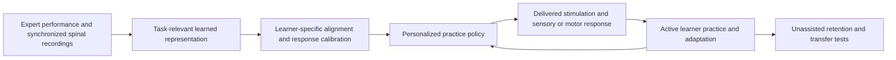
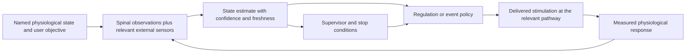
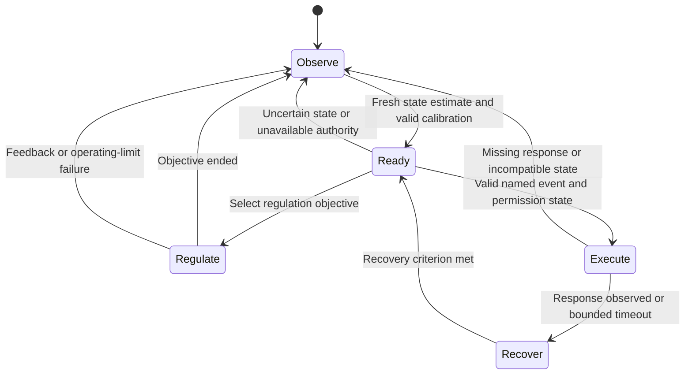

# Project SCCI RH: application mechanisms and evidence boundaries

Stage 1 design study · 8 October 2026 · status: proposals for review, with no settled electrode placement

Project SCCI RH proposes a complete implanted spinal interface and its computing/control system. Its two central ambitions remain **expert-informed motor learning** and **selected physiological automation**. Piano performance, football footwork, bodily feedback and future consumer uses remain motivating applications. A worked reference case develops part of this platform; it does not redefine the entire platform as a gait phase estimator or blood-pressure controller.

The starting 28-page paper is a narrative review and hypothesis paper, with an evidence cutoff of **30 September 2026**, not an experimental report. This document audits selected decision-relevant primary sources on **8 October 2026**. Sources below were published before that cutoff; the access date is separate. Published evidence is marked **E**, a proposed engineering operation **P**, an unproved biological link **H**, and an explicitly assumed interface property **I**. These labels describe the link in the argument, not the prestige of a source.

Stable source IDs refer to [source-audit.csv](source-audit.csv). DOI links beside claims lead to the primary articles. A primary article's author-written abstract can verify an abstract-level claim; it cannot verify an unseen parameter table or subgroup result. Access limitations are recorded in the audit.

## 1. What the device would have to achieve

The motor ambition requires this complete chain:

The physiological ambition requires a different chain:

Both are proposed system flows. The arrows from delivered stimulation to a useful response, and from assisted practice to superior retained learning, require biological mechanisms. A complete electronic design can implement acquisition, conversion, timing, computation, stimulation, monitoring, power and communication. It cannot establish those biological arrows merely by implementing the boxes.

For each application, distinguish four quantities: the state that matters, the contact signal actually recorded, the neural population actually recruited, and the outcome actually measured. A neural correlate is not automatically a sufficient state estimate; an evoked muscle response is not automatically a learned skill.

## 2. What implanted spinal recording evidence permits us to assume

Two primary examples support useful spinal observations, with substantially different access and experimental scope:

| Evidence | Direct result relevant to SCCI_RH | Limit that the design must retain |
|---|---|---|
| **E · S1-REF-001**, surface circumferential recording, 2026 | Fifteen freely moving rats overall; five contributed to pooled motor decoding. Three pigs were studied acutely. | Short-term rat recording, up to three days. The bidirectional recurrent decoder predicts kinematics offline; it does not establish causal online human intent decoding or expert-to-learner transfer. |
| **E · S1-REF-002**, penetrating hyperflexible recording, 2023 | Five mice in the nine-week recording cohort; movement decoding in two mice. | Local ventral-horn access and mouse wheel-running cannot establish a chronic human multi-function interface. |
| **E · S1-REF-003**, circumferential recording/stimulation, 2024 | Rat electrical experiments and a spinal bypass proof of concept; separate chronic dummy-implant assessment and human cadaver placement. | Active recording, passive mechanical implantation, and cadaver feasibility answer different questions. Their durations and access planes cannot be pooled. |

[S1-REF-001](https://doi.org/10.1038/s41467-026-75128-z), [S1-REF-002](https://doi.org/10.1002/advs.202303377), [S1-REF-003](https://doi.org/10.1126/sciadv.adl1230).

**P:** Treat spinal samples as mixtures of descending activity, local circuit activity, ascending sensory signals, motion-related contamination and stimulation artifacts. Candidate features may include population activity, band-limited power, evoked responses or propagation estimates. Their usefulness is a test, rather than a property assigned by the application label.

**I:** An ideal biological interface may be explored, provided its contract names:

1. Which populations or signal components can be observed, with what noise, ambiguity and drift.
2. Which recruited populations can be influenced, with what spatial selectivity and unwanted recruitment.
3. Recording and stimulation latency, recovery periods and simultaneous-operation limits.
4. Whether commands increase excitability, evoke output, convey a sensory cue, or provide a separate inhibitory influence.
5. Which relevant states remain hidden or require external sensors.
6. Whether expert and learner observations admit a common representation, and how that correspondence is identified.

An ideal electrode does not supply a musical score, strategic judgment, subjective pleasure, positive plasticity, or unlimited physiological authority. If a modeled observation contains these variables, their availability becomes an explicit additional hypothesis.

## 3. Expert recording to retained skill: the missing links

The intended process is to learn **what distinguishes effective performance**, then determine how an individual learner can practice toward it. Expert voltage is not a portable command file.

| Link | Proposed operation | Required evidence or digital test |
|---|---|---|
| Expert acquisition → annotated episodes | **P:** Synchronize spinal samples with motion, force, muscle activity, task events and success/error labels. | Declare whether the data are recorded, openly sourced or synthetic. Synthetic expert recordings must be generated from a declared neural/electrode model, not disguised as measured biology. |
| Episodes → representation | **H/P:** Extract features predicting coordination or useful corrections: release timing, co-contraction, force sequencing, contact transitions or error susceptibility. | Compare neural-plus-external observations with external observations alone on held-out performances. Spinal data must demonstrate incremental value if that value is claimed. |
| Representation → learner alignment | **H/P:** Normalize task events and identify correspondence across anatomy, strength, neural organization, tempo and posture. | Test incorrect correspondence, multiple plausible mappings, missing channels and drift. High within-expert prediction does not establish cross-person alignment. |
| Learner alignment → intervention | **H/P:** Calibrate which stimulation configurations change the learner's useful outputs or perceptions; estimate uncertainty and side effects. | Infer the response from accessible calibration observations. A controller cannot inspect the model's hidden true state or use an inverse response map supplied without calibration. |
| Intervention → better practice | **H:** Assist a deficient movement component, shape a sensory cue, or pair relevant activity with a circuit intervention. | Measure online performance and active learner contribution. Include assistance dependence, disrupted sensation and inappropriate recruitment. |
| Better practice → adaptation | **H:** Useful practice changes future unaided behavior through a declared adaptation mechanism. | Evaluate favorable, zero and harmful coupling. Improvement is not guaranteed by having a decoder, accurate timing or an ideal interface. |
| Adaptation → retained learning | **H:** Improvement persists when assistance is removed and transfers to a specified task variation. | Use matched unassisted tests, a declared post-assistance interval and transfer tests. Report retained outcome separately from performance during stimulation. |

**P:** Represent an expert policy as conditional information, for example

\[
z_E = f_E(y_E, q_E, F_E, c_E),\qquad
u_L = \pi(\hat z_L, z_E, \hat\theta_L, c_L).
\]

Here \(y\) denotes observable spinal samples, \(q\) task motion, \(F\) task force, \(c\) context, and \(\hat\theta_L\) the learner response estimated by calibration. Neither \(z_E\) nor \(u_L\) is an expert's recorded voltage. The representation may identify useful timing or coordination without identifying every underlying synapse. All information presented to \(f_E\) or \(\pi\) must have an observable source.

The fair alternatives are ordinary practice, an adaptive learner-only controller, an expert trajectory/force policy without neural recordings, and an expert-informed neural-plus-external policy. Keep practice, expert data, learner calibration, stimulation and tuning budgets comparable. Shuffling expert labels or substituting a mismatched expert helps test whether useful expert information explains a difference.

No reviewed source establishes a 1.5× or 2× improvement in healthy novice skill acquisition from an expert's spinal recordings. Such a multiplier remains a target. A digital model may estimate a conditional ratio under its assumptions, including no gain or harm.

## 4. Piano and footwork are complementary design cases

This is an application comparison, not a final anatomical or hardware selection.

| Decision dimension | Piano / upper limb and fingers | Football footwork / lower limb coordination |
|---|---|---|
| Bounded motor component | Timing a short finger sequence; release timing; force consistency; unwanted co-contraction. | Foot placement, stance-to-swing transitions, bilateral timing and direction changes in a declared drill. |
| Full skill beyond that component | Reading music, auditory evaluation, expression, memory and planning remain beyond the selected motor mechanism. | Tactical choice, visual anticipation, opponent prediction and ball strategy remain beyond the selected motor mechanism. |
| External observations | Instrument key events/velocity, fingertip force, hand motion and EMG where available. | Foot contact/pressure, limb and trunk motion, ball events and EMG where available. |
| Candidate spinal representation | Upper-limb activity correlated with digit/arm coordination and sensory feedback; separability of finger-related populations remains a design question. | Lower-limb task state and coordination features; locomotor recording precedent is closer, but fast cutting and agility add balance and load dependence. |
| Candidate intervention | Personalized facilitation of a deficient synergy or an informative sensory cue; sufficient selectivity for independently timed fingers must be established or assumed explicitly. | Personalized state-dependent facilitation/cueing for a phase or contact error; no assumption that a single sinusoid represents all footwork. |
| Anatomical question to resolve | Cervical enlargement/upper-limb pathways are a candidate target family. Recording site and stimulation site need separate rationales. | Lumbosacral motor/root targets are a candidate target family. A proximal recording site may be a different anatomical location. |
| Outcome definition | Unassisted sequence error, timing variability and force error at fixed tempo; transfer to a new sequence/tempo. | Unassisted contact/placement error, coordination and stability at fixed drill difficulty; transfer to a new pace or direction. |
| Main extrapolation risk | Clinical assistance for impaired arm/hand function is not proof of healthy fine finger learning or expert skill transfer. | Restoration of SCI locomotion is not proof of enhanced athletic learning, balance, power or endurance in an intact person. |

**E:** The 2026 cervical stimulation feasibility study implanted seven people with chronic stroke for four weeks. Hand/finger assistance depended on residual connectivity in a subset. This supports an upper-limb intervention precedent, with important person-specific limits. **E:** Rowald 2022 tested activity-specific trunk/leg stimulation in three people with complete sensorimotor paralysis; Wagner 2018 studied three people with SCI and reported rehabilitation-related changes including voluntary control without stimulation. Neither experiment involved transferring an expert's skill to a healthy novice. [S1-REF-005](https://doi.org/10.1038/s41591-026-04435-1), [S1-REF-006](https://doi.org/10.1038/s41591-021-01663-5), [S1-REF-007](https://doi.org/10.1038/s41586-018-0649-2).

**Conditional recommendation:** Develop lower-limb coordination as the first detailed motor reference because recording and targeted stimulation precedents meet more closely there. Keep the upper-limb finger-sequence case in the system requirements and architecture comparison. If upper-limb information/selectivity assumptions become defensible, it can instead become the first reference. This recommendation selects neither final electrode placement nor the legacy rhythmic surrogate. The first detailed task should retain multiple observable events, output dimensions and an unassisted endpoint.

## 5. Three candidate learning mechanisms, with different evidence

| Mechanism | Evidence relevant to plausibility | Unproved SCCI_RH extension |
|---|---|---|
| Activity-dependent circuit conditioning | **E:** McPherson 2015 used forelimb muscle activity to trigger intraspinal stimulation during rat SCI retraining; gains persisted three weeks after stimulation. Nishimura 2013 showed timing-dependent corticospinal changes in two monkeys using cortical spikes to trigger spinal stimulation. | **H:** Spinal observations alone can supply the required learner activity signal; expert-derived information improves that conditioning beyond learner-only timing; changes support the desired intact skill. |
| Assistance during active practice | **E:** Human spinal stimulation studies show movement assistance and, in selected rehabilitation contexts, stimulation-off changes. | **H:** Assistance increases useful error-driven practice rather than reducing active participation, masking errors or creating dependence. |
| Sensory feedback and pathway learning | **E:** Peripheral H-reflex conditioning altered a specific spinal pathway in people with SCI. Implanted lateral cervical stimulation conveyed useful tactile information in amputees. | **H:** Personalized spinal sensory cues improve retained motor learning in intact learners; a cue remains informative without disrupting natural sensation. |

[S1-REF-008](https://doi.org/10.1073/pnas.1505383112), [S1-REF-009](https://doi.org/10.1016/j.neuron.2013.08.028), [S1-REF-010](https://doi.org/10.1523/JNEUROSCI.3968-12.2013), [S1-REF-016](https://doi.org/10.7554/eLife.54349), [S1-REF-017](https://doi.org/10.1038/s41598-022-21264-7).

**E:** Rat EES models and experiments support trans-synaptic circuit recruitment through myelinated afferents in the tested setting. **P/H:** SCCI_RH therefore needs a recruitment/response map between electrical pulses and useful outputs. Reversing pulse polarity for charge balance is not equivalent to reversing joint motion or supplying a selective neural inhibition command. Each proposed facilitation, suppression or cue requires its own mechanism. [S1-REF-004](https://doi.org/10.1523/JNEUROSCI.1688-13.2013).

The trigger source matters: McPherson used **EMG**, Nishimura **cortical spikes**, and Thompson's H-reflex protocol **surface peripheral stimulation and EMG**. They support mechanistic comparisons, not an already demonstrated expert-recording SCCI. Lorach 2023 is explicitly a **hybrid brain–spine interface**, with cortical recording and spinal stimulation in one participant. [S1-REF-022](https://doi.org/10.1038/s41586-023-06094-5).

There are concrete reasons to include contrary outcomes. Physical guidance can improve acquisition performance while worsening retention or transfer in the studied behavioral task. Spinal stimulation can interfere with proprioceptive information. A 2026 preprint in unimpaired adults reports both acute proprioceptive disruption and subsequent adaptation; its transcutaneous access and non-peer-reviewed status prevent treating it as invasive enhancement evidence. These observations motivate separate tests of sensory cost, dependence, retention and transfer; none is a universal prediction that assistance must fail. [S1-REF-021](https://doi.org/10.1080/02701367.1994.10607635), [S1-REF-011](https://doi.org/10.1038/s41593-018-0262-6), [S1-REF-023](https://arxiv.org/abs/2608.05635).

## 6. Physiological automation: four distinct operations

**P:** Every function specifies an observed state \(\hat x\), output objective \(r\), permitted intervention \(u\), response dynamics and a stopping rule. A reusable platform can host several policies, but one policy cannot substitute for an unidentified pathway.

| Operation | Meaning | What would establish the proposed mechanism |
|---|---|---|
| **Regulate** | Keep a measured variable within a band despite disturbances. | A reachable equilibrium/range, response authority and feedback stability; evaluate overshoot, delay, saturation and competing physiological effects. |
| **Trigger** | Initiate a named response when a condition and user authorization are satisfied. | Response identity, onset latency, failure probability, readiness and termination; event detection alone is insufficient. |
| **Repeat** | Produce multiple separated responses with appropriate recovery. | Refractory periods, fatigue/resource dependence and confirmation of each response; repeated commands do not prove repeated bodily outcomes. |
| **Delay** | Postpone a specific state transition while preserving an acceptable preceding state. | Selective access to the transition mechanism, finite delay range and preservation of function; the ability to evoke a response does not establish the ability to delay it. |

Sustained influence can mean sustained **regulation**, periodic **repetition**, or a bounded extension of a state before a **transition**. These have different resource and observability requirements. With a model \(\dot x=f(x,u,d)\), holding a state requires an attainable input satisfying \(f(x^*,u^*,d)=0\). That condition alone does not establish stability or feasible physiological duration. Delaying an event requires a transition model, not merely a constant-input trace.

This proposed application state machine supplements the electrical supervisor. Loss of feedback, a reboot or a competing application must not silently supply a valid physiological state. Electrical charge completion and physiological event completion are separate events.

## 7. Named physiological candidates

| Application and ambition | Observations and candidate causal access | Evidence and decision boundary |
|---|---|---|
| **Blood-pressure regulation**: compensate for a posture-related fall; investigate future personalized autonomic support. | Direct pressure measurement, posture and relevant context. Lower-thoracic sympathetic-related recruitment can provide a pressor input; reducing that input removes added drive. | Strongest matching human closed-loop precedent. The 2025 paper covers 14 implanted participants across four trials, with smaller closed-loop analysis subsets. It does not establish an independent command to lower arbitrary hypertension or healthy athletic enhancement. **E/H** |
| **Bladder storage/voiding**: selected control over filling and emptying transitions; a bounded future convenience scenario. | Filling/pressure estimate, outlet behavior, voided/residual volume and intention. Candidate lumbosacral programs must coordinate detrusor and outlet responses. | Three implanted participants in the 2026 pilot; one reached high voiding efficiency. Manual program switching and home training are not autonomous neural state decoding. Storage cannot be prolonged without regard to pressure and filling. **E/H** |
| **Cough**: trigger or repeat an effective expiratory action. | Lung state, airway pressure/flow, response and recovery. Lower-thoracic stimulation can recruit expiratory muscle output. | Nine participants in the 2009 implanted cough study. Cough output is distinct from autonomous ventilation, inspiration, central respiratory rhythm and gas exchange. **E/H** |
| **Bowel assistance**: support a named bowel routine or later investigate scheduling. | Bowel routine state, pressure/expulsive output and completion; enteric/outlet coordination needs its own model. | A five-person study associated cough-system stimulation with improved bowel management through intra-abdominal pressure. This does not establish neural stool-state decoding, direct enteric control or arbitrary continence delay. **E/H** |
| **Sexual/pelvic responses**: investigate a specifically named response or transition. | Distinguish genital vascular response, emission, expulsion, orgasm and reported experience. Candidate access and sensors differ for each endpoint. | Two male SCI cases reported facilitation of ejaculation; three female SCI cases reported questionnaire changes. Rat microstimulation evoked a coordinated ejaculation sequence. None establishes controllable sustained orgasm, indefinite arousal or selective electrical delay in humans. **E/H** |

[BP: S1-REF-012](https://doi.org/10.1038/s41591-025-03614-w), [earlier baroreflex: S1-REF-013](https://doi.org/10.1038/s41586-020-03180-w), [bladder: S1-REF-014](https://doi.org/10.3390/jcm15166287), [cough: S1-REF-015](https://doi.org/10.1016/j.apmr.2008.11.013), [bowel: S1-REF-024](https://doi.org/10.1016/j.apmr.2020.09.394), [ejaculation cases: S1-REF-018](https://doi.org/10.1080/00207454.2023.2273772), [female function: S1-REF-019](https://doi.org/10.3389/fnins.2023.1155796), [rat mechanism: S1-REF-020](https://doi.org/10.1016/j.eururo.2008.03.043).

**Conditional recommendation:** Use blood-pressure regulation as the first detailed physiological reference, with external pressure feedback admitted explicitly. The biological precedent regulates principally **systolic pressure**; choosing mean arterial pressure for an SCCI_RH abstraction requires a declared measurement/model conversion, not relabelling the primary endpoint. Spinal recording may add context, recruitment monitoring or prediction, but must be tested against an external-pressure-only controller. A complete SCCI platform can retain recording even when a particular policy does not need neural decoding.

Keep bladder transitions and cough triggering/repetition as named extensions with distinct policy interfaces. Keep pelvic response timing and bounded sustained influence as open hypotheses with explicit missing selective access. A controller that can evoke ejaculation has not thereby acquired an inhibitory channel; pharmacological interruption in an animal study is not proof of electrical delay. These applications preserve the consumer ambition while making its individual propositions inspectable.

## 8. Broader platform capabilities remain visible

| Capability | Defensible proposed contribution | Additional link required |
|---|---|---|
| Medical motor restoration | Individually selected spinal assistance/rehabilitation policy. | Disease-specific pathways and response; findings do not transfer indiscriminately across lesions. |
| Consumer learning and coordination | Expert-informed practice for a measurable movement component. | Incremental expert neural information, useful learner response, unassisted retention and transfer in the intact population. |
| Artificial bodily feedback / embodied remote interaction | An individually calibrated sensory vocabulary conveying contact, force or task events. | Useful perception and behavioral benefit with acceptable interference. A tactile code is not native full-sensory virtual reality. |
| Pain modulation / recruitment control | Closed-loop maintenance of an evoked neural response within an individually defined therapeutic window. | ECAP is a recruitment measure, not a direct readout of pain or mood. Clinical outcomes depend on waveform, population and comparator. |
| Other autonomic ideas, including selected sweating or temperature responses | A future named state/response policy when accessible pathways and useful sensing are identified. | Source-backed causal access and a response model; these are currently unworked hypotheses in this stage. |

Lateral spinal sensory restoration involved **four** amputees in 2020; the 2022 closed-loop discrimination case study involved **two**. These are spinal stimulation studies, distinct from peripheral nerve implants and from recording pure motor intention. ECAP-controlled pain stimulation was compared with fixed-output stimulation in the EVOKE trial; a separate placebo-controlled burst study found no significant disability difference in its tested population. They should not be merged into a universal pain-control claim. [S1-REF-016](https://doi.org/10.7554/eLife.54349), [S1-REF-017](https://doi.org/10.1038/s41598-022-21264-7), [S1-REF-025](https://doi.org/10.1016/S1474-4422(19)30414-4), [S1-REF-026](https://doi.org/10.1001/jama.2022.18231).

## 9. Anatomical coordinates and architecture consequences

**P:** Every future drawing and channel map should carry both an anatomical target and a coordinate-system label. The labels **spinal segment**, **root/rootlet**, **vertebral level**, **injury neurological level**, and **electrode position** are not interchangeable. An array positioned near a lumbar vertebra does not necessarily contact a lumbar spinal segment of the same number. A rat segment cannot be transferred to a human by matching its name.

| Evidence example | Coordinate statement to retain |
|---|---|
| Fan 2023 | The chronic recording cohort targets mouse **L1–L2 spinal segments**; the movement-decoding experiment describes **L3 ventral horn**. Do not collapse them into one cohort/site. |
| Woodington 2024 | Rat methods describe **circumferential epidural** access after vertebral exposure; human cadaver methods describe durotomy and circumferential passage inside the dura. |
| El Hadwe 2026 | Rat wrapping follows **laminectomy and durotomy** at the thoracolumbar junction. This is a different access statement from the 2024 rat method. |
| Rowald 2022 | Personalized models distinguish roots entering particular **spinal segments** from surgical/vertebral placement. Population-average anatomy did not substitute fully for individualized mapping. |
| Phillips 2025 | The hemodynamic target is the **last three thoracic spinal segments**; T11 versus L4 is an example **segment** comparison. These are not instructions to place a lead at identically numbered vertebrae. |

[S1-REF-002](https://doi.org/10.1002/advs.202303377), [S1-REF-003](https://doi.org/10.1126/sciadv.adl1230), [S1-REF-001](https://doi.org/10.1038/s41467-026-75128-z), [S1-REF-006](https://doi.org/10.1038/s41591-021-01663-5), [S1-REF-012](https://doi.org/10.1038/s41591-025-03614-w).

The rat and human-cadaver access descriptions in Woodington should be recorded as written; the later paper's generalized description of the earlier platform is not a reason to erase those method differences. A human thoracic segment map has no T13 segment. Imaging-based or explicitly assumed anatomical registration remains necessary for a future CAD placement.

**P:** Separate recording and stimulation placement decisions. A multi-application design may require separate lead sets or locations, a modular architecture, and mutually exclusive modes. The same controller/software platform can support these configurations without claiming that one cuff controls every limb and organ. Contacts, sampled recording channels, output drivers and simultaneous stimulation patterns are four different quantities. None is fixed here by the earlier eight-plus-eight visual concept.

The implant/companion partition must expose timestamped observations, calibrated response maps, confidence, pulse commands, delivered-current/voltage/charge records and physiological outcome feedback. Offline expert-representation training and long-term learning assessment can reside in companion software; execution and supervision responsibilities must still be specified. These requirements guide Stage 2 budgets and the full engineering design rather than selecting a processor or pulse amplitude in this document.

## 10. Mechanism checkpoints before detailed design

Stage 1 should resolve or explicitly label these choices:

1. Define a reference motor task, its movement component and unassisted endpoint, while retaining both upper- and lower-limb application families.
2. Define what the expert representation contains and what neural information is hypothesized to add beyond external observations.
3. Specify accessible learner calibration observations and candidate intervention effects; identify any assumed inhibitory or sensory channel separately.
4. Choose a learning-mechanism hypothesis for comparison, with a zero-benefit and harmful alternative. No assumed benefit coefficient counts as discovered learning acceleration.
5. Name the physiological reference, its target variable, response direction and mode. Keep regulate/trigger/repeat/delay separate.
6. State whether spinal observation is essential, optional or under investigation for each policy; identify required external sensing.
7. Record plausible access alternatives and cross-application conflicts without treating the old lead geometry as a constraint.
8. Trace each proposed observation-to-outcome arrow to a source, an engineering requirement or an assumption, with a falsifiable test.

**Acceptance for this application study:** both principal chains have named observable inputs, intervention mechanisms, feedback and outcomes; the limb and physiological comparisons are explicit; reference recommendations remain conditional; source scope, counts and anatomical coordinates are auditable; missing causal links are visible. Subsequent simulation or hardware checks must report their own results. No device efficacy, component choice, anatomical fit or system-level digital completion is claimed by this stage.

## 11. Corrections and access limits to carry forward

- **Starting paper page 7:** “five rats” applies to the 2026 motor-decoding subset; the freely moving study included **15 rats overall**. The source audit retains both denominators.
- **Count and endpoint discipline:** the bladder pilot had four consented/three implanted/two full follow-up participants; high voiding efficiency was an individual result. Four amputees in the sensory paper and two in the subsequent discrimination study should not be reduced to three or one because of lead counts or the phrase “case study.”
- **Decoder discipline:** a bidirectional offline model and pooled held-out time samples do not demonstrate causal streaming decoding, held-out-person generalization or command specificity. SCCI_RH needs its own causal validation.
- **Scope discipline:** SCI/stroke restoration, peripheral reflex conditioning, cortical-triggered plasticity, transcutaneous stimulation and implanted spinal-only expert learning remain separate evidence classes.
- **Anatomical discipline:** preserve access-plane and segment/vertebral distinctions, especially the different 2024 rat and cadaver methods and the 2026 intradural study.
- **Source arithmetic caveat:** the 2026 circumferential paper labels a 21.29% eight-class baseline as uniform random; uniform selection over eight classes would be 12.5%. Do not use that baseline to quantify SCCI_RH's improvement without clarification. This caveat alone does not negate the recordings.
- **Access limits:** some publisher pages failed or required subscription; PMC pages sometimes presented a browser challenge. Author-written abstracts and accessible primary full-text XML were used where available. Rows record which conclusions were verified at abstract level and where cohort or parameter detail remains unverified. No inaccessible method was filled in from assumption or a secondary review.

AstroSam's Mind-Link remains the credited inspiration for turning an ambitious interface concept into inspectable research, engineering and a physical design. Project SCCI RH's contribution is its own application mechanisms, bounded interface assumptions, full proposed architecture and subsequent digital verification. Inspiration credit does not replace scientific evidence for an SCCI capability.
