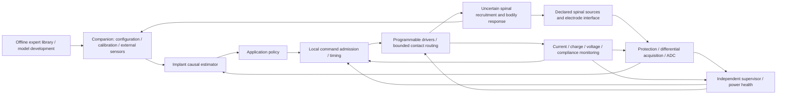

# Stage 1 — proposed SCCI architecture and interface responsibilities

Status: **design proposals and requirements for review, 8 October 2026**. This
document specifies the full-system direction; it does not claim that the
implant, firmware, biological decoder or integrated electronics exist. The
historical single-channel desktop reference is reusable subsystem work, not the
new implant architecture. No component, contact count, pulse prescription,
sampling rate, anatomical dimension or power-transfer method is finalized here.

`S1-ARCH-*` identifies architecture proposals, `S1-MOD-*` identifies module
responsibilities, and `S1-IF-*` identifies interface contracts. A normative
"must" below is a **proposed engineering requirement**, not a statement of
verified performance. Biological assumptions belong in the common Stage 1
assumptions register; the architecture must expose rather than satisfy them by
definition.

## 1. What the complete system is intended to connect

A proposed invasive spinal interface supplies declared electrical observations.
Acquisition and conversion produce timestamped, quality-marked samples. A causal
estimator interprets available information, an application policy proposes an
intervention, and local admission checks convert that proposal into a bounded
electrical plan. Drivers and contact routing deliver current. Independent
measurements assess delivery, and subsequent observations assess the biological
response. The latter two assessments are different: delivering the requested
charge does not establish the requested bodily effect.

The biological blocks in this diagram remain hypotheses or forward models
appropriate to each configuration. A neural observation may encode movement,
sensation, stimulus-evoked recruitment or a mixture; its meaning cannot be
assigned merely because a spinal electrode measured it. Pressure supplied by an
external sensor remains external pressure measurement. Cortical signals are not
part of this SCCI baseline; introducing brain recording would create an
explicitly separate hybrid architecture.

## 2. Access alternatives and target configurations

These are alternatives to compare, not different drawings of an already selected
universal implant. Each has its own observation model, field/recruitment model,
artifact burden, lead map and mechanical assumptions.

| ID | Proposed access | What could justify investigating it | Open links that must remain explicit |
|---|---|---|---|
| **S1-ARCH-01** | Epidural sensing plus epidural stimulation; recording contacts may be separate or time-shared | A shared compartment offers a comparatively consolidated interface. Human ECAP-controlled spinal stimulation supplies a precedent for using a stimulus-evoked response as feedback. | ECAP recruitment feedback is not demonstrated decoding of an expert's spontaneous skill representation. Suitable spontaneous motor or autonomic information, montage, spatial selectivity and artifact recovery for SCCI_RH are unresolved. Sharing contacts requires electrical protection and ownership switching. |
| **S1-ARCH-02** | Intradural, non-penetrating surface recording plus separately placed epidural stimulation | Short animal studies of circumferential surface recording motivate investigation of movement-related and other spinal observations. Keeping recording and stimulation placements distinct avoids transferring evidence between compartments. | Chronic human signal quality, target coverage, anatomical compatibility, stable decoding, selective actuation and simultaneous-use performance are not established for this proposed combined system. The recording array need not be circumferential if the chosen mechanism favors a different surface montage. |
| **S1-ARCH-03** | Penetrating intraspinal recording; stimulation location separately selected | A proposal to investigate more local observations when surface mixtures fail to supply the required information. | Penetration, micromotion, tissue response, channel stability and accessible information require their own evidence and mechanical analysis. Neither neuron resolution nor privileged access to skill is assumed. An intraspinal recording choice does not automatically select intraspinal stimulation. |
| **S1-ARCH-04** | Target-specific distributed recording/stimulation modules, each using a selected access alternative | Allows different applications or anatomical targets to have different lead arrangements and local interfaces instead of forcing all functions onto one array. | Synchronization, intermodule routing, energy, communication, interactions and total implantation burden must be budgeted. A distributed design is not permission to add unlimited contacts or latency-free links. |

The limited evidence anchors are deliberately narrow. Human closed-loop SCS
research has recorded stimulus-evoked compound action potentials for feedback in
chronic-pain treatment; that evidence does not establish consumer skill transfer.
[EVOKE primary trial](https://doi.org/10.1016/S1474-4422(19)30414-4)
The 2026 circumferential surface-recording study reports short-duration animal
recording and decoding observations; it does not establish a chronic human
combined read/write implant.
[El Hadwe et al., primary study](https://www.nature.com/articles/s41467-026-75128-z)
The architecture table's other advantages and risks are proposed trade-study
questions, not additional experimental findings.

**Provisional comparison recommendation:** develop S1-ARCH-02 as the reference
read/decode/write hypothesis while retaining S1-ARCH-01 as the consolidated
alternative and S1-ARCH-03 as a conditional alternative if required information
is absent from surface observations. This is not an architecture freeze.
S1-ARCH-01 may be sufficient for an application whose useful feedback is an
evoked recruitment biomarker; S1-ARCH-02 is not automatically preferable merely
because its sensing is closer to the cord. The final choice must follow the
mechanism's information requirement and target evidence.

Three target configuration records are required before geometry is selected:

| Configuration | Stage 1 obligation |
|---|---|
| Upper-limb/finger motor practice | Name the task, proposed neural observation and accessible actuation target; distinguish a candidate circuit region from an actual vertebral lead position. Establish what expert information and learner calibration would contribute. |
| Lower-limb/whole-limb motor coordination | Perform the same information/actuation analysis independently; do not transfer the previous rhythmic surrogate's channels or dimensions into the implant as established anatomy. |
| Selected physiological function | Name the regulated/triggered/repeated function, actual sensor, proposed pathway, actuator authority and consequence of losing support. Do not inherit the motor configuration's target or assume the physiological state is decoded from spinal potentials. |

These records may select different access alternatives and target regions.
One product family or software platform does not imply one lead location serves
all three. Exact anatomy and the first worked application are review decisions
shared with the capability and mechanism specifications.

## 3. Channel and contact accounting

The symbols below remain unassigned Stage 1 parameters:

- `N_rec_contact`, `N_stim_contact`, `N_ref_contact` and `N_return_contact` count
  physical contacts by intended role. Shared contacts are counted once in the
  physical inventory and explicitly flagged in the role map.
- `N_measurement` counts defined electrical observations, such as differential
  contact pairs or contact-to-reference measurements. It is not necessarily the
  recording-contact count.
- `N_ADC` counts conversion resources and `N_sampled` counts observation streams
  delivered at their specified rates. Acquisition and delivery-monitoring
  conversion resources must be accounted for separately, including any proposed
  sharing and its fault consequences. Multiplexing introduces aperture offsets,
  settling and throughput requirements; it does not create simultaneous samples.
- `N_driver` counts independently programmable stimulation sources.
  `N_simultaneous` counts sources allowed to operate concurrently under a
  particular mode, route and energy budget. Neither equals contact count by
  default.

The measurement montage `M_rec` maps contact potentials to observations. The
route matrix `R_stim(t)` maps source currents to contact currents, including
every intended return and any permitted case electrode. In the ideal planned
network, Kirchhoff current balance applies over all included source/return
ports. Actual leakage and unintended return paths are faults or separately
modeled pathways, not grounds to declare delivered charge balanced.

For contact `j`, the ledger records
`Q_j = integral i_j(t) dt` in coulombs over a specified interval. It must not
infer contact charge solely from a source's commanded waveform if routing
changes, sources share a return, compliance clips, monitoring is unavailable or
leakage matters. Monitoring coverage and uncertainty must be explicit.

Every contact has a configuration-dependent ownership state: recording,
stimulation, return, reference, disconnected or an explicitly analyzed shared
state. Simultaneous connection to sensitive acquisition and an active driver
cannot occur merely because both modules address the same contact ID.

## 4. Module responsibility map

The proposed baseline puts delivery timing and fault admission on the implant.
Companion computation may be used for heavier inference or application policy,
but only if the timing and communication budget demonstrates it is adequate.
The critical loop cannot assume a network or companion responds instantly.
Programmable current control is the proposed electrical baseline; another
output-control topology would need revised plan and compliance interfaces while
retaining measurement of actual delivered current and charge.

| Module ID | Proposed owner | Responsibility and boundary |
|---|---|---|
| **S1-MOD-01** | Electrode/lead interface | Define physical contact IDs, montage, lead/return topology, electrical load assumptions and contact-role permissions. Feedthrough and lead mappings are shared contracts with mechanical design. |
| **S1-MOD-02** | Implant acquisition hardware | Input protection, differential/reference acquisition, gain/filtering and stimulation protection/blanking. Preserve observable voltage meaning and flag saturation; protection is not proven by a block label. |
| **S1-MOD-03** | Implant conversion/time/buffer hardware and firmware | ADC conversion, sample-aperture timestamps, clock/session identity, channel mapping, calibrated sample conversion, buffering and overrun reporting. |
| **S1-MOD-04** | Implant estimator/calibration service | Causal state estimates from permitted observations, declared confidence/quality criteria, model version and calibration context. A predicted state must remain distinguishable from a measured state. |
| **S1-MOD-05** | Implant application policy; companion assistance only if budgeted | Translate estimates, permitted expert representations and learner/plant calibration into intervention proposals. No access to hidden simulation state or unavailable future measurements. |
| **S1-MOD-06** | Implant local admission/sequencer | Validate configuration, route, freshness, timing, uncertainty, command envelope and concurrent-source permissions. Schedule committed plans and coordinate artifact events. Rejected or expired proposals do not become pulses. |
| **S1-MOD-07** | Implant driver/routing hardware | Programmable current delivery and defined contact routing within electrical compliance. Execute admitted plans, report actual driver state and expose an independent disable path. |
| **S1-MOD-08** | Implant measurement/monitor service | Independently observe current and relevant voltages, estimate delivered charge with uncertainty, detect compliance and compare actual delivery with the plan. Independence and failure coverage require later circuit analysis. |
| **S1-MOD-09** | Independent implant supervisor | Supply/clock/watchdog/output-health supervision, fault arbitration, new-plan gating and defined hardware shutdown/fallback requests. It cannot treat its own software flag as proof of physical disconnection. |
| **S1-MOD-10** | Implant power subsystem and, if selected, external transfer unit | Energy storage or declared alternative, energy transfer/charging, rails, sequencing, reserve budgeting and temperature/energy-health observations. No storage or transfer method is assumed free of loss, heat or sensing interference. |
| **S1-MOD-11** | Implant telemetry/security/time synchronization | Authenticated configuration and status transport, clock-domain conversion, packet integrity/replay handling, link leases and firmware-update protocol. It does not bypass local admission. |
| **S1-MOD-12** | Companion and external sensors | Task selection, calibration workflow, user controls, external kinematics/physiological sensing, logs and approved model/configuration distribution. Distinguish external observations from neural measurements. |
| **S1-MOD-13** | Offline expert library/model-development environment | Expert provenance, task representations, training splits, learner/plant identification and policy/model evaluation. Offline access to future data cannot leak into online operation. |

"Implant" here describes an intended allocation, not an implemented package.
If power or processing constraints move a module to the companion, its interface,
latency, link-loss behavior and availability assumptions must be revised before
the trade is accepted. A supervisor claimed independent of the application CPU
needs a defined shared-failure analysis, including common power, clock, sensing
and routing dependencies.

Power topology remains an explicit configuration choice: a rechargeable implanted
store with an external transfer unit, an externally powered implant with a
declared finite buffer, or a primary implanted store with finite service life.
Each option must account for communication/acquisition interference, transfer
interruption, storage limits and the consequence of unavailable energy. None
is selected or assigned a runtime here.

## 5. Symbolic interface contracts

Every payload includes schema/configuration version, origin, sequence or session
identity, validity status and relevant uncertainty. A timestamp identifies the
physical sampling/event time rather than just packet arrival. Integer encoding,
precision, packet lengths and hardware bus selection are Stage 2 work.

| Interface ID | Producer → consumer | Required meaning, units and ownership |
|---|---|---|
| **S1-IF-01** | S1-MOD-13 → S1-MOD-12/05 | Expert representation: task/frame definition, named feature vector with units, provenance, training/calibration dependencies and applicability limits. A neural feature is not an unexplained replay voltage. Offline environment owns provenance; application owns applicability checks. |
| **S1-IF-02** | S1-MOD-12/11 → S1-MOD-06/09 | Versioned configuration: montage/routes, permitted application, estimator/policy identities, calibration validity and symbolic electrical/timing envelopes. Acceptance and activation are local, atomic and logged. Consumer activation requires matching interface versions. |
| **S1-IF-03** | S1-MOD-01 → S1-MOD-02 | Contact voltage waveform in V relative to a named reference; contact/load impedance in Ω or frequency-dependent Ω; offset/common mode in V; contact map and uncertainty. These are declared physical/model inputs, not already decoded intention. |
| **S1-IF-04** | S1-MOD-02 → S1-MOD-03 | Conditioned analog voltage in V, gain/filter calibration, headroom, saturation/protection state and recovery validity. Acquisition owns the analog interpretation; ADC owns quantization and aperture timing. |
| **S1-IF-05** | S1-MOD-03 → S1-MOD-04 | Sample blocks: raw counts and calibrated V/count, contact/montage/channel ID, sample time in ticks with tick period in s, per-channel aperture offsets, session ID, clipping/missing/artifact flags and clock uncertainty in s. Dropped samples remain identifiable. |
| **S1-IF-06** | S1-MOD-04 → S1-MOD-05/06 | Estimated state with individually declared units, estimate time/horizon in s, uncertainty and confidence meaning, observability/validity status and calibration/model ID. Confidence is not automatically a calibrated probability. Implant estimator owns causal availability. |
| **S1-IF-07** | External sensor/S1-MOD-12/11 → S1-MOD-04/05 | External observation with measurement units, origin and calibration, sampling time, clock conversion uncertainty and age in s. Movement uses named frames and units such as m/rad; pressure uses a specified pressure reference and conversion to Pa. Arrival time is not measurement time. |
| **S1-IF-08** | S1-MOD-05 → S1-MOD-06 | Intervention proposal: task objective, predicted response and uncertainty, route/profile reference, lease/deadline and intended electrical quantities. If an application emits a dimensionless action, the calibrated mapping to current/time/routes must be explicit. An absent mapping cannot be supplied silently. |
| **S1-IF-09** | S1-MOD-06 → S1-MOD-07/08/09 | Admitted plan: signed source currents in A, phase intervals/rate timing in s or common-clock ticks, contact/return routing, source concurrency, planned charge in C, limits and execution/expiry identity. Plan admission does not prove actual delivery. |
| **S1-IF-10** | S1-MOD-07/08 → S1-MOD-06/09 and logs | Delivery evidence: measured current in A and voltage in V, integration interval, charge estimate and uncertainty in C, compliance/saturation status, actual route state, sample/clock validity and detection latency in s. Missing measurements produce uncertain delivery, not a zero-current observation. |
| **S1-IF-11** | S1-MOD-06/07/08 → S1-MOD-02/03/04 | Artifact/recovery ledger: planned and actual event times, affected contact/channel map, driver/route state, blanking/protection intervals and recovery-validity observations. Recovery cannot be inferred from pulse end alone. Acquisition owns when usable samples resume. |
| **S1-IF-12** | All health producers ↔ S1-MOD-09; supervisor → S1-MOD-06/07/10 | Fault and transition contract: cause, severity/application context, last trustworthy time, residual-charge knowledge/uncertainty, requested response and observed acknowledgement. Hardware action and its confirmation are separate facts. |
| **S1-IF-13** | S1-MOD-10 → S1-MOD-09/06/11 | Rail V, current A, available/reserve energy J, storage-state estimate with uncertainty, temperature K, transfer/charging state and predicted availability in s. Power owns these estimates; admission owns whether a new plan fits the declared reserve. |
| **S1-IF-14** | S1-MOD-11 ↔ S1-MOD-12 | Telemetry sessions: authenticated identities, allowed message classes, integrity/replay counters, clock mapping and uncertainty, link-quality/lease state, logs and acknowledged configuration. The companion cannot send unchecked immediate driver commands. |
| **S1-IF-15** | S1-MOD-01/02/07/10 ↔ mechanical design | Physical/electrical map: contact/feedthrough count and IDs, insulation/return roles, component and lead envelopes in m, allowable bend/strain/tolerance assumptions, dissipated-power modes in W and thermal boundary assumptions. No geometry is accepted before its electrical map agrees. |

Clock domains need a declared conversion to the implant's monotonic event clock,
with bounded uncertainty and a new session identity after discontinuities.
The common clock covers sampling, route changes, stimulation and delivery
monitoring. Delay compensation uses estimated delays and uncertainty; it cannot
use a simulation's true latency unless explicitly presented as an oracle
comparison.
An independent supervisor cannot detect failure of that clock solely by waiting
for the same clock's next tick. An independent health timebase or another
analyzed mechanism is required; if event timing becomes untrustworthy, the
delivery ledger records that uncertainty rather than assigning precise times.

## 6. Reading while stimulation occurs

"Read/decode/write" is a system capability, not a promise that all samples are
usable during every pulse. Stimulation can invalidate observations through
front-end saturation, switching coupling and electrode polarization. Stage 2
must compare spatial separation, analog protection, scheduled blanking,
time-interleaving, recovery qualification and any proposed artifact subtraction.
Subtraction is an algorithmic hypothesis, not restoration of lost/clipped data.

For each observation stream, define sample cadence `f_s` (Hz), analog/filter
delay `T_AFE` (s), conversion/aperture delay `T_ADC` (s), protected/blanked interval
`T_blank` (s), recovery qualification interval `T_rec` (s), usable-sample mask,
maximum tolerated contiguous gap `T_gap_allow` (s), and estimator validity age
`T_est_allow` (s). Values and limits remain unset. Contact placement alone cannot
set `T_rec` to zero.

The sequencer publishes planned events before execution where possible and
actual/uncertain delivery afterward through S1-IF-11. Acquisition reports what
was really clipped or unavailable. The estimator may predict over a gap only
under a declared tested model, increasing uncertainty and marking prediction
explicitly. It must not substitute the simulated body's hidden state or an
unmarked interpolated clean waveform for unavailable measurements.

A candidate configuration is rejected or revised if the stimulation schedule
leaves insufficient observable data, recovery exceeds the required control
deadline or repeated artifacts prevent distinguishing the intended state.
Lower pulse activity, different routes, separate contacts, another observation
source or a different access architecture are alternatives to evaluate; none
is assumed to solve the gap automatically.

## 7. Proposed operating modes and transition rules

The mode names below are proposed firmware/supervisor states, not clinical
instructions. Modes have application-specific admission envelopes and contact
permissions. Recording quality, output-health status and residual-charge
knowledge accompany the mode; a mode label alone is not proof of safety.

| Mode | Intended activity | Entry and exit obligations |
|---|---|---|
| **Boot / integrity assessment** | Verify executable/configuration identity, clocks, power and monitor availability; establish a new event session | No automatic stimulation restart from stale memory. A previous interrupted phase or unverified route becomes an unresolved-delivery state requiring the specified recovery assessment. |
| **Observe only** | Acquire and log usable neural/external observations with output disabled as designed | Record whether physical disable is confirmed. This is useful for characterization and unassisted probes; it does not imply absence of an effect from earlier stimulation. |
| **Calibration** | Collect bounded, application-specific identification data; optional electrical plans only if separately admitted | Calibration is distinguishable from ordinary operation and from offline training. Estimates include uncertainty and validity context. No automatic broad search of unbounded stimulation space. |
| **Ready / armed** | Hold a validated configuration and qualified observations; no pulse merely because the mode is armed | Admission requires current power, route, observation and monitoring conditions. Commands expire; a previous authorization is not an indefinite lease. |
| **Closed-loop active** | Causal interpretation, admitted intervention and monitored delivery for the selected application | Record actual delivery and feedback. Detect loss of observability, authority, freshness and electrical integrity; application success is not inferred from actuator activity. |
| **Assistance-free probe** | Evaluate retained task performance with new assistance gated off under the task protocol | Keep probe intervals explicit and preserve observations needed to distinguish retention from active assistance. This is not a generic physiological fallback mode. |
| **Degraded / fallback pending** | Gate new proposals or apply a separately justified application fallback while a non-electrical fault is assessed | The fallback and its duration, sensor dependencies, escalation and end conditions must be selected in the application risk analysis. Do not indefinitely repeat the last command by default. |
| **Electrical trip / interrupted delivery** | Request the defined independent output response, preserve the delivery ledger and notify/log | New plans are blocked. Route/rail isolation or controlled discharge behavior must be analyzed electrically; neither a software trip nor commanded symmetry establishes residual charge. |
| **Recovery / requalification** | Assess fault cause, contacts, measurements, configuration and residual-delivery uncertainty | No automatic opposite-polarity correction pulse. Resumption requires the specified condition checks and application authorization; reboot alone is not clearance. |
| **Energy transfer / service** | Perform the selected charging/transfer or update procedure with its own permissions | Whether sensing/stimulation can coexist is an interference, thermal and availability question. If interruption of physiological support is hazardous, service policy must account for that consequence. |

The state machine has two separate obligations: prevent uncontrolled electrical
output and account for harm from losing a beneficial physiological intervention.
"Off" is an electrical command, not a universal medical safe state. An optional
motor-assistance mode and a pressure-support mode cannot inherit the same
indefinite-off or last-command policy without application-specific justification.
The digital model must evaluate the resulting interruption/fallback effects.

### Interrupted phase and fault arbitration

1. **Observation or policy fault while delivery remains healthy:** block new
   plans. Completion of an already admitted phase sequence is an option only
   when timing, power, routing and independent delivery measurements remain
   trustworthy and the application fault policy permits it. It is not an
   unconditional requirement to finish a balancing phase.
2. **Electrical, clock, route or power fault during a phase:** the supervisor
   requests the analyzed hardware response without waiting for an application
   decoder or radio round trip. The response may interrupt the planned charge
   sequence. Record last trustworthy measured charge/time and uncertainty; do
   not declare the interrupted sequence balanced.
3. **Unknown residual charge or polarization:** inhibit new ordinary plans and
   enter requalification/escalation according to the application policy. Do not
   synthesize an automatic opposite pulse from a remembered command: the actual
   route, load, delivered charge and present polarization may differ. A later
   recovery intervention, if ever proposed, requires its own measurement model,
   bounds and authorization; it is not specified here.
4. **Loss of telemetry:** local timing and supervision continue within the
   committed plan's defined permissions. Handling of new proposals, fallback
   support, expiry and notification is application-specific. No indefinite
   remote-command replay or dependency on instant reconnection is allowed.
5. **Reboot/brownout or logging failure:** a new session cannot erase an
   interrupted-delivery condition. A nonvolatile marker, reserve-energy ledger
   or redundant monitor is a candidate implementation to evaluate, not proof
   that every last sample was persisted. Unobserved delivery remains uncertain.

For each fault, the verification plan must distinguish detection time, admission
blocking time, physical output-response time, charge-accounting uncertainty and
functional consequence. Independent monitoring itself needs faults such as
stuck readings, timing loss and shared power failure included in that plan.

## 8. Quantitative work reserved for Stage 2

The architecture must supply inputs for these budgets without assigning
convenient values merely to make the design close:

- Input voltage/offset/common-mode ranges (V), impedance spectra (Ω), expected
  signal band (Hz), noise spectra (V/√Hz), required dynamic range and saturation
  recovery. Determine what biological evidence or declared idealization supplies
  each range.
- Sampling/conversion resources, quantization and usable observations. Raw
  payload rate is `sum_k f_s,k * b_k` bit/s before framing, timestamps, quality
  flags and delivery telemetry. Buffer requirements include the tolerated link
  or processing stall rather than assuming infinite storage.
- End-to-end observation age and command timing: analog/filter, ADC, buffering,
  estimation, communication if used, policy, admission and delivery delays, each
  with jitter/uncertainty (s). Determine which deadlines the mechanism actually
  needs and how artifact gaps change them.
- Per-source and per-contact delivery envelopes: A, V, s, C and any declared
  electrode-area-normalized quantity. Driver compliance includes the chosen
  electrode/load voltage, polarization, routing losses and driver headroom.
  Limits and clinical interpretations are not prescribed in Stage 1.
- Power/energy/thermal accounting: W and J by operating mode, storage or transfer
  efficiency, available reserve, charging interference, heat paths and thermal
  boundary assumptions. The energy of a delivery plan is not just its nominal
  tissue-load power; circuitry and transfer losses must be included.
- Physical port/feedthrough inventory, lead strain/micromotion assumptions,
  insulation and return pathways, component envelopes and package allocation.
  CAD must follow these interfaces rather than supply them retrospectively.

## 9. Stage 1 review decisions and completion evidence

This architecture package is complete for Stage 1 review when:

1. Each selected motor and physiological configuration names the observation,
   actuation target, expert/calibration role, feedback and application-specific
   loss-of-support consequence in the mechanism documents.
2. Every required system function is assigned to S1-MOD-01 through S1-MOD-13 or
   an explicitly added module, with its produced/consumed S1-IF contract.
3. Access alternatives are compared against information, selectivity, artifacts,
   chronic uncertainty and packaging—not just appearance. The recommendation
   is accepted or revised with its unverified biological links preserved.
4. The contact/montage/ADC/source/concurrency counts remain distinct, and every
   physical return path is represented. No previous desktop count or enclosure
   dimension is inherited as an implant requirement.
5. Mode/fault scenarios include simultaneous-use artifacts, stale/ambiguous
   observations, insufficient actuation authority, compliance loss, monitoring
   failure, interrupted phases, link loss and reboot. Function-specific fallback
   remains an open decision where the biological consequence is unknown.
6. Stage 2 receives a named unknown/range owner for every quantitative budget
   input. A missing biological observation or effect is not filled by an
   electrically convenient assumption without being labeled as such.

This package establishes proposed interfaces and decisions to investigate.
Digital integration, device selection, circuit/layout completeness, on-device
execution, chronic implantation and useful biological effects are later and
different forms of evidence.
