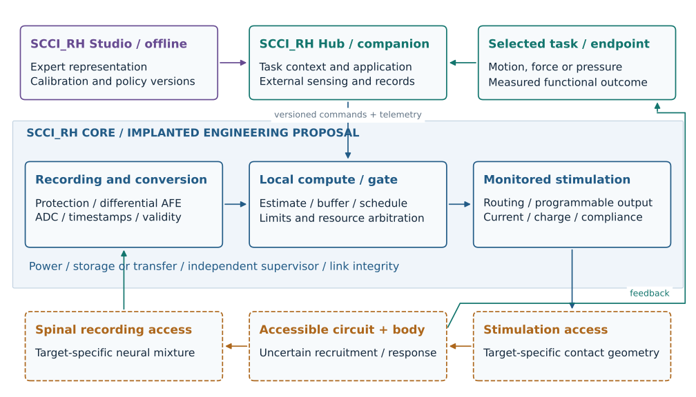

# Project SCCI RH: full-system mechanism specification

Stage 1 / revision 1 / 8 October 2026 / design proposal.

This specification carries the original 28-page hypothesis into a complete
proposed spinal recording, computation and stimulation platform. It defines what
the device would need to do, what biology must supply, and what later digital
work can verify. It is not a completed implant, a tested clinical system or a
demonstration of accelerated human learning.

## Purpose and scope

SCCI_RH proposes an invasive SCCI with target-specific spinal interfaces, an implanted
acquisition and stimulation core, a companion controller and an offline research
environment. It has two application families: expert-informed motor practice and
selected physiological automation. Its eventual digital embodiment includes
native KiCad electronics, embedded logic, engineering CAD, computational
experiments and a supported manuscript in the private repository. AstroSam's
[Mind-Link](https://github.com/sam-astro/Mind-link) inspires that progression from
future idea to inspectable design; it is not biological evidence for SCCI_RH.

The original paper's hypothesis is preserved: useful expert spinal information
could inform interventions that help a different learner during active practice.
The learner must retain a benefit after assistance stops. Physiological automation
means a named response or state controlled through a defined accessible pathway.
These are related applications of a platform, not a claim that one universal
electrode arrangement reads and controls the entire body.

This programme is entirely digital. Future surgery, long-term biocompatibility,
chronic implantation, clinical dosing, manufacturing and human/animal experiments
remain outside its execution scope. Physical and biological constraints remain
inside the argument even when present manufacturing and commercialization are
set aside. Final electronics and CAD are later work packages.

## Three connected levels

| Level | What it represents | Evidence it could provide |
|---|---|---|
| Future biological interface | Task-specific access to spinal information and recruitable pathways | Explicit conditional mechanism; the required biological premises remain testable hypotheses |
| Proposed complete device | Recording front ends, ADC, local processing, programmable outputs, monitoring, power, communications, packaging and companion | Calculations, circuit and firmware models, native design checks, mechanical integration within stated envelopes |
| Computational investigation | Generated neural observations, unknown learner calibration, closed-loop intervention and uncertain response/adaptation | Conditional effects, limitations and failures of the declared model; no human efficacy inference |

The legacy v1.0.0 desktop enclosure, fixed-current circuit and surrogate studies
are subsystem references. Their numerical results are not imported as evidence
for this full-system design.

## System identity and responsibilities

The working names **SCCI_RH Core**, **SCCI_RH Hub** and **SCCI_RH Studio** identify system
responsibilities; they are provisional design labels.

- **SCCI_RH Core:** implanted contact interfaces; differential acquisition/protection;
  conversion and timestamps; buffering and local estimation where feasible;
  the default causal application policy; bounded scheduling, output routing and monitored electrical stimulation;
  independent supervision; power regulation/storage and communication. It owns
  final command admission, timing and fault enforcement.
- **SCCI_RH Hub:** companion sensing and task context; personalized application
  services and any heavier policy computation only where budgets justify them;
  session supervision; operator state and data exchange. External
  sensing can include motion, EMG, force or a physiological variable. A wireless
  link cannot be assumed to supply instantaneous timing or uninterrupted service.
- **SCCI_RH Studio:** offline expert dataset processing, representation learning,
  learner calibration analysis, model studies, versioned policies and audit.
  Heavy training computation must not silently become a prerequisite for a
  timing-critical pulse.
- **Target configuration:** recording location, recording reference/montage,
  stimulation contact geometry and recruitment model appropriate to a named
  application. Distinct cervical, lumbosacral and thoracic configurations can
  share electronics principles without sharing lead placement.

[Architecture and interfaces](architecture-and-interfaces.md) assigns the detailed
owners, units and fault behavior. Contact count, sampled differential channels,
independent drivers and simultaneously permitted output patterns are separate
design variables. None is frozen to the previous eight-contact display.

## Motor mechanism: transfer information, then personalize intervention

During expert performance, record contact voltages together with motion, force,
task events, context and outcome. A decoder/representation learner searches for
repeatable task-related features: for example, relative coordination timing,
response to a perturbation or recruitment structure that helps predict useful
behavior beyond external measurements alone. These candidate features are not
assumed to identify every neuron or every aspect of skill.

Represent the electrode observation as

`y[k] = M(g, r, sigma) q[k] + artifact[k] + noise[k]`.

Here `q` is a declared latent neural population, `M` a geometry/reference/conductivity
dependent forward mapping, and `y` the measured voltage vector. Define the source
units and corresponding transfer units so each product yields volts. This is a reduced
observation model, not a universal inverse of the living cord. Several population
states can yield similar voltages. Increasing processor power cannot restore
information absent from the observations.

Learn `z_E = F(expert samples, external context, task labels)` using declared
training data, then freeze/version it for held-out testing. Independently identify
a learner's response mapping `G_L` from a calibration dataset. The policy proposes

`u_request[k] = pi(z_E, estimated learner state[k], goal, uncertainty, G_L)`.

The core admits a bounded electrical command. Monitored delivered output drives
an uncertain recruitment and musculoskeletal model; its resulting movement and
sensory consequences provide feedback during the learner's active attempt.
Calibration is functional, not anatomical voltage matching. Differences in body,
electrode geometry, task context and available control authority can prevent
successful transfer.

Learning is a separate causal link: assistance may improve practice quality or
appropriate activity pairing, but it can also reduce effort, interfere with
sensory feedback or promote dependence. The model must allow helpful, neutral and
harmful adaptation. A prescribed favorable plasticity coefficient is an
assumption, not a finding. Published spinal rehabilitation and plasticity results
motivate component mechanisms; they do not establish expert-to-novice learning in
healthy consumers. See the primary-source [application audit](application-mechanisms.md).

The comparison must answer two distinct questions: does spinal recording add
useful information beyond external sensing, and does the expert representation
improve retained performance beyond an equally resourced learner-only policy?
The minimum evaluation is a crossed neural/external and expert/learner-only
comparison, plus shuffled timing, miscalibration, delay, low control authority and
an explicitly labelled oracle. Assess assistance-on behavior, assistance-off
retention and transfer to a related task separately.

For a predeclared unassisted criterion, define `T` as practice exposure to reach
and retain it. A conditional acquisition ratio is `T_comparator / T_SCCI_RH`; censored
trials and calibration exposure must be reported. Targets such as 1.5x or 2x remain
hypothetical ambitions. Piano coordination and football footwork remain motivating
consumer scenarios; neither implies transfer of musical understanding, tactical
judgment, visual prediction or all of an expert's skill.

## Physiological mechanism: an endpoint-specific feedback controller

Select a controlled variable and functional endpoint before selecting a lead.
An observation produces a state estimate with uncertainty. A target-specific
policy proposes intervention, the core bounds and monitors electrical delivery,
and an accessible circuit changes the bodily response. Feedback measures whether
the response is useful and whether side effects or conflicting actions occur.

`x_next = f(x, delivered output, disturbance, person-specific parameters)`

`observation = h(x) + sensor error; command = controller(estimate, target)`.

External measurements may be the strongest observation of the target. For a blood
pressure reference, pressure sensing remains external; spinal recording is an
optional recruitment/state biomarker whose incremental value must be tested.
Calling a stimulation-plus-external-feedback mode part of the wider read/write
platform does not mean its particular application requires decoded spontaneous
spinal signals.

Four requested behaviors require different evidence:

| Behavior | Required mechanism | Distinct failure |
|---|---|---|
| Regulate a state | Measurable variable, disturbance estimate and bounded restoring influence | Delay, insufficient authority or excessive response destabilizes regulation |
| Trigger an action | Reliable access to the desired sequence in an appropriate context | Stimulation produces an unwanted action or no useful response |
| Repeat an action | Trigger plus recovery, refractory-state and functional-outcome feedback | Fatigue or changing state makes repetition ineffective |
| Maintain a state or delay a transition | Appropriate support, and selective opposing/transition influence where necessary | Excitatory access to an event cannot by itself postpone that event |

Blood pressure regulation after SCI has direct human spinal stimulation/feedback
evidence and is a strong engineering reference. It does not establish benefit for
healthy people or unrestricted ability to lower pressure. Bladder filling versus
emptying, cough versus sustained breathing, and peripheral sexual responses
versus subjective experience require distinct pathways and endpoints. They remain
visible in the [capability map](capability-map.csv), with their additional premises.

The primary pressure precedent principally regulates systolic pressure. Use that
endpoint as the provisional reference; a mean arterial pressure abstraction needs
an explicit measurement/model conversion. Target configuration records must also
distinguish spinal segments, roots, vertebral levels and actual electrode position.
Neither the old MAP surrogate nor a matching anatomical number supplies that mapping.

## The biological interface is conditional, not magical

SCCI_RH permits an idealized future access technology, but its contract must state:

1. Which signal mixture is available, at what location/reference and with what
   noise, drift, artifacts and information loss.
2. Which circuit effects can be recruited, their selectivity, latency, variability,
   saturation and unintended effects. An electrical command does not uniquely
   specify a neuron or guarantee inhibition.
3. Which measurable task components are sufficiently observable and reachable.
   Hidden states and unreachable desired outputs must produce an explicit failure.
4. What remains a human learning/physiology hypothesis even with adequate access.
5. What chronic stability is assumed for a future application and what evidence
   would be needed to replace that assumption.

Read and write paths also interact. Stimulation can saturate the recording front
end, alter spontaneous activity or interfere with useful sensory input. The design
must count blanking/recovery time, quantify lost observations and detect estimator
uncertainty. Perfect simultaneous recording is not a free premise. Proprioceptive
interference is a documented concern in human locomotor stimulation
([Formento et al.](https://www.nature.com/articles/s41593-018-0262-6)).

## Engineering commitments and unresolved choices

[Requirements](requirements.csv) makes the full-device functions reviewable.
[Assumptions](assumptions.csv) separates biological hypotheses, engineering
idealizations and unresolved choices. Stage 2 assigns numerical operating
envelopes and closes acquisition, throughput, latency, stimulation/compliance,
energy, thermal and mechanical budgets. Stage 1 intentionally supplies symbolic
contracts instead of inventing implant-ready voltages or contact counts.

The main unresolved decisions are the first motor task and anatomy, the first
physiological endpoint, the recording access arrangement, and the compute/power
partition after budgets are calculated. The present recommendation is a
lower-limb coordination reference, a pressure-regulation reference, and a
dual-access recording/stimulation architecture to compare against alternatives.
This is a reasoned starting proposal for review, not a frozen design or proof of
consumer feasibility. The application audit explains the tradeoffs and preserves
the cervical/piano and other physiological variants.

## Completion claim for this stage

Stage 1 is complete when the two mechanism chains, full module responsibilities,
architecture alternatives, capability map, assumptions, requirements and staged
verification are coherent and inspectable. Register/link checks and visual review
can establish specification consistency. They cannot establish retained human
learning, a working implant, anatomical selectivity or chronic compatibility.

The next stage turns the chosen reference configurations into numerical budgets
and resolves whether the proposed signal and control interfaces close. A budget
failure should change the architecture or capability claim before detailed CAD or
board routing.
