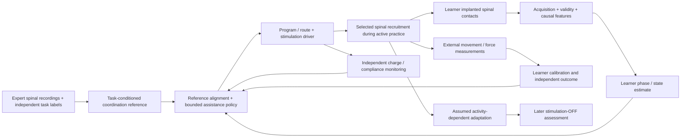
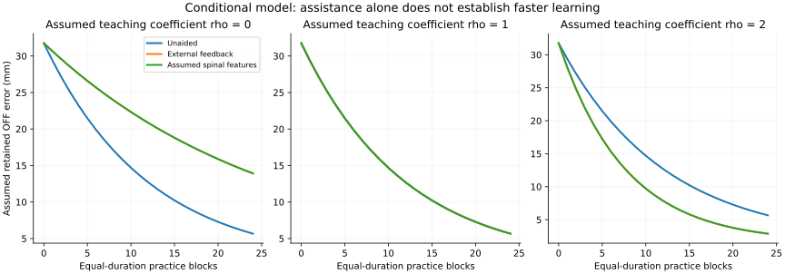
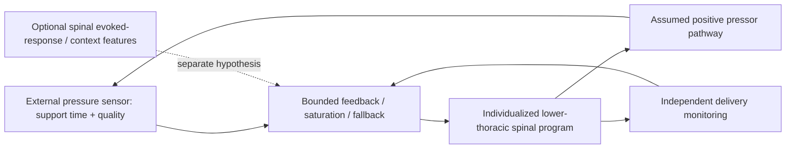

# Project SCCI RH: conditional SCCI mechanism and design baseline

13 October 2026. **Conditional concept v1 specified and simulated; detailed
electronics, target firmware and populated CAD remain unfinished.** This is the
future-interface design requested for Project SCCI RH. Its premises need to be
defensible, not already demonstrated together in a human experiment.

## The intended system

An implanted spinal interface records useful task-related activity, interprets
it computationally and selectively stimulates learner-specific pathways while
observing delivered action and bodily response. The two proposed applications
are expert-informed motor practice and feedback over a selected physiological
function. AstroSam's [Mind-Link](https://github.com/sam-astro/Mind-link) is the
inspiration for giving an ambitious concept an inspectable engineering body.
The complete SCCI_RH deliverable is digital: theory, editable electronics/firmware,
populated CAD, an illustrated paper and a professional private repository.
Video and website work remain parked.

The original 28-page hypothesis paper already permits conditional reasoning.
Its pp.11-13, 17 and 24-26 distinguish plausible causal access, retained learning,
selected physiological regulation and measured results. The new
[motor review](conditional-concept/motor-evidence.md) revisits eight primary
research anchors; the [physiology review](conditional-concept/physiology-evidence.md)
adds six anchors including a noninvasive comparator explicitly labelled as such.
Their sample sizes and access/sensing distinctions are recorded separately.
They are a focused narrative review, not a pooled meta-analysis.

## What changed in the approach

The original overhaul plan, commit `380266f`, allowed a declared biological
interface. Stage 2's `39747dc` required internally consistent electrical/timing
authority while keeping unknown biology as assumptions. At `526b854`, the Stage
3 finish line became tied to outstanding conservative prediction/delivery
qualification. Subsequent studies expanded the checks. They produced valuable
negative findings, but those checks should not become prerequisites for designing
a different, explicitly conditional future interface.

The [historical qualification verdict](stage3-verdict.md) and
[source-bound exit review](exit-review.md) retain their original all-withheld
results. The present package does not retune their gates, alter frozen data,
reuse a no-dose observer as a validated active observer, or claim that a new
normalized actuator is the current circuit. These are two distinct questions:

- **Qualification study:** what can the conservative implemented assumptions
  authorize? Its selected investigation is complete, with no active benefit.
- **Conditional concept:** if stated, biologically coherent interfaces exist,
  what mechanism and engineering design could use them? This v1 now provides
  the mechanism, finite illustrative results and detailed-design handoff.

## Motor mode: expert-informed, learner-specific practice

The expert contributes a representation of a successful component: timing,
coordination or context, aligned to the learner's body and task. The learner
continues to attempt the movement. Separately calibrated programs assist reachable
directions; the sign of a task correction is not the sign of electrical
excitation/inhibition. Independent movement sensing and charge monitoring close
different parts of the feedback loop. An expert voltage waveform is never
replayed as a skill.

In a theoretical user session, a learner selects a bounded drill and an expert
reference in the companion application. Individual calibration identifies the
learner's usable signals and reachable corrections. During active attempts,
the implant estimates timing and applies limited, learner-specific assistance;
independent measurements update the session record. Later OFF probes show
whether the learner acquired anything beyond temporary help. Piano fingering or
football coordination would need their own task representation, anatomical lead
configuration and outcome measures; the cyclic surrogate is one explanatory
component of that broader vision.

The principal assumptions are: useful causally available spinal state features;
a transferable task representation; useful selective learner-specific actuation;
and a favorable adaptation response during practice. Animal recording,
human movement assistance and contingent plasticity/recovery experiments give
mechanistic reasons to explore these premises. They do not establish the combined
healthy consumer capability. See the [15-entry assumption ledger](conditional-concept/assumption-ledger.csv)
for evidence anchors, adopted values, engineering duties and failure consequences.

### What the finite new model shows

The [scenario package](../../experiments/stage3/conditional-concept/README.md)
implements a two-coordinate cyclic primitive with synthetic spinal phase
features, causal decoding, a measured learner estimate, local stimulation
programs, delay and an explicitly assumed learning law. Its
[protocol](../../experiments/stage3/conditional-concept/protocol.md) was written
before first scoring. It is a new explanatory model, not a validated human
digital twin or the historical contact-voltage/circuit pilot.

Across 128 scenarios and 3,072 practice blocks, ON assistance lowers first-practice
pooled movement error from 31.756 mm unaided to about 16.16 mm. Favorable assumed
teaching produces lower final OFF error, about 2.884 versus 5.667 mm. The same ON
assistance with neutral teaching gives equal OFF learning; guidance dependence
or adverse coupling gives worse retained outcomes. The favorable threshold
comparison is seven versus 10-11 practice blocks, with calibration/probe/washout
time reported separately. These are consequences of the chosen assumptions,
not estimates of human training time or a measured acquisition multiplier.

The learning identity makes the hypothesis visible:

`Delta theta = eta [(theta* - theta) + (rho - 1) projection(stim_response)]`.

Thus rho=1 cancels assistance's contribution to OFF learning exactly; a useful
positive additional term must exist for acceleration in this model. The study
does not discover that term from neural data. Equal-information expert external
and spinal-labelled references give identical results; the assumed live spinal
features show no useful advantage over external sensing in this simple task.
No unique expert information or healthy skill transfer is established.

The model deliberately exposes unavailable neural features, late information,
changed gain, missing recruitment and timing mismatch. Some predictable-task
cases tolerate delay; timing mismatch is not universally harmful under every
learning law. The results are retained without tuning them to a preferred story.

## Physiological mode: selected pressure support

The 2025 implant study supplies a direct human precedent for external pressure
feedback through spinal stimulation after SCI. The future consumer extension
requires its own indication and beneficial response; a healthy-user gain is not
assumed from injured participants. [Phillips et al.](https://www.nature.com/articles/s41591-025-03614-w)

The existing [pressure model](pressure-model.md) supplies the second conditional
mechanism without another large simulation programme. It represents delayed
activation and pressure response, independently observed pressure, finite
nonnegative authority, disturbances, calibration, sensor faults and withdrawal
tails. Its [saved results](results-and-interpretation.md) include both reduced
pressure error and significant recovery overshoot; reduced error alone does not
make the controller acceptable for real use.

For a constant deficit D and positive monotone response G*R(u), a necessary
static condition is `0 <= D <= G*R(1)`. Targets outside that range cannot be
recovered by controller tuning. Withdrawing a pressor input removes added drive;
it does not create active authority to lower arbitrary hypertension.

External pressure is the primary observed state. Optional spinal context or
evoked-response sensing is an additional explicit assumption, not a measured
spinal blood-pressure decoder. The full platform remains bidirectional; each
application states which recorded signals it actually uses.

## Physical identity and immediate design work

The provisional platform uses intradural surface recording and separate epidural
stimulation leads, with target-specific motor and lower-thoracic pressure
configurations. This separates useful recording placement from recruitment
placement. Long-term combined human operation remains a future premise. Initial
modes are exclusive; a shared core does not imply one lead arrangement handles
both anatomy targets simultaneously.

The [engineering handoff](conditional-concept/engineering-handoff.md) retains the
Stage 2 baseline of 16 differential streams at 4 ksample/s and two physical
stimulation sources. Sixteen abstract model features are not those sixteen raw
streams. The normalized command must become an identified route/profile with
an electrical envelope; native acquisition, routing, monitoring, power and target
execution must earn their own requirements. Current component power and monitor
precision findings take precedence over old optimistic allocations.

Next is the first complete native circuit slice: protected recording inputs,
bounded current driver/routing, monitoring and independent inhibit, with firmware
interfaces and a revised power ledger. Then actual boards/components determine
the populated CAD assembly. There is no need for another general neuroscience
qualification sweep before those design steps.

## Finite closure and remaining claims

Conditional concept v1 closes with: traceable premises, both causal mechanisms,
permitted controller information, fixed finite comparisons, ON/OFF separation,
reproducible results and explicit engineering interfaces. Those deliverables now
exist. Positive human efficacy, a uniquely useful expert neural code and validated
healthy learning speed remain hypotheses, not prerequisites for completing the
digital concept design. Detailed electronics, firmware, populated CAD and the
final integrated manuscript/release are still required to finish Project SCCI RH.
