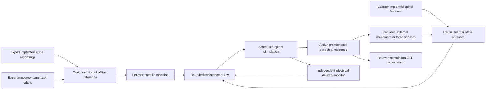

# Motor evidence and a conditional expert-informed SCCI mechanism

13 October 2026. Focused primary-source review for Project SCCI RH's digital future
concept. This document permits biologically defensible assumptions that have not
yet been demonstrated. Evidence motivates those assumptions; it does not turn
them into measured properties of a healthy learner.

## The decision this review supports

SCCI_RH can now design an implanted spinal **record -> interpret -> learner-specific
stimulate -> observe -> adapt** system around a bounded movement component.
The proposed benefit is better practice that may improve subsequent unassisted
performance. The transferable object is a task-conditioned coordination
representation, not an expert voltage waveform or a complete skill.

The original 28-page paper already makes this conditional argument on pp.11-13
and identifies the untested conjunction on pp.12 and 25. Its experiments are
research precedents, not SCCI_RH measurements. The earlier
[evidence-to-design revision](../evidence-to-design-revision.md) and
[source audit](../../stage1/source-audit.csv) remain useful. A requirement to
demonstrate the complete biological conjunction before designing the future
concept would impose a stricter completion standard than that paper or the
user's clarified scope requires.

## Eight primary research anchors

Sources were revisited for this revision, with access depth stated below.
Cohorts are separate; neither channels nor experimental sessions are counted as
additional subjects. Reported clinical scores, decoder accuracy and animal
recovery percentages are **not** coefficients for the new synthetic learner.

| ID and primary report | Sample, access and measurement | Actual result relevant to SCCI_RH | What SCCI_RH may infer, and the remaining limit |
|---|---|---|---|
| E-M01: [El Hadwe et al., 2026](https://www.nature.com/articles/s41467-026-75128-z) | 15 rats overall; movement-decoding subset 5. Intradural circumferential surface arrays, short-term implantation up to 3 days. Neural field features paired with externally tracked hindlimb kinematics. | A pooled bidirectional recurrent decoder predicted movement features; short-term spinal recordings contain useful movement-related information. | Assume a future causal decoder can estimate a selected phase/state. The published offline analysis does not establish prospective human intent, expert-specific skill information, or chronic consumer operation. |
| E-M02: [Fan et al., 2023](https://advanced.onlinelibrary.wiley.com/doi/10.1002/advs.202303377) | Penetrating hyperflexible arrays in mouse ventral horn. Nine-week recording assessment: 5 mice, L1-L2; wheel-running decoding: 2 mice, L3. Spikes/LFP plus external motion labels. | Longitudinal recording and movement decoding were feasible in these animal experiments. | Supports treating chronic spinal acquisition as an engineering research direction. Does not validate a nonpenetrating human array, indefinite stable channels, or a decoder for fine finger expertise. These are different access arrangements. |
| E-M03: [Mussa-Ivaldi, Giszter and Bizzi, 1994](https://pubmed.ncbi.nlm.nih.gov/8052615/) | Spinalized frogs; intraspinal stimulation at two sites and measurement of hindlimb endpoint force. The primary abstract was checked; the total animal count was not independently verified in this revision. | Combined stimulation produced approximately additive force-field outputs in the tested preparation. | Motivates a small task-specific primitive space. Does not establish a universal human primitive library, exact superposition during voluntary behavior, or a shared electrode-to-primitive map across people. |
| E-M04: [Rowald et al., 2022](https://www.nature.com/articles/s41591-021-01663-5) | 3 people with complete sensorimotor paralysis. Personalized epidural paddle targeting lumbosacral dorsal roots; activity-specific stimulation programs. | Programs supported multiple trunk/leg activities; anatomy and recruitment informed lead/program design. | Supports individualized spatial and temporal recruitment rather than raw replay. Clinical restoration under stimulation does not establish healthy athletic enhancement or expert-to-novice learning. |
| E-M05: [de Freitas et al., 2026](https://www.nature.com/articles/s41591-026-04435-1) | 7 people with chronic post-stroke hemiparesis; two unilateral 8-contact cervical epidural leads, external stimulator, 4 weeks. External EMG, force, kinematics and clinical assessments. | Immediate assistance and within-trial OFF improvements were observed. Hand/finger movement improved in 3/7 with residual connectivity. One-month-post-explant outcomes were lower than week-4 ON outcomes; maximal benefit required continued stimulation. | Strong rationale for learner-specific recruitment and separate ON/OFF scoring. This was not spinal recording, formal healthy skill training, or proof that all assisted improvement becomes durable learning. |
| E-M06: [Nishimura et al., 2013](https://pmc.ncbi.nlm.nih.gov/articles/PMC4079851/) | 2 monkeys; 19 conditioning sessions, 15 cortical-cell/spinal-site pairs. **Cortical recording** triggered cervical intraspinal stimulation; EMG assessed output effects. | Connection strength changed with timing. Some changes lasted days; many reverted. In this protocol, spike-stimulus delays of 12-25 ms strengthened output effects; 50 ms or more did not. | Supports timing-sensitive plasticity, including absent/adverse effects. This is a hybrid brain-spine mechanism, not spinal-only expert transfer. Those delays are protocol-specific, not a universal SCCI_RH timing window. |
| E-M07: [McPherson et al., 2015](https://pmc.ncbi.nlm.nih.gov/articles/PMC4593107/) | 24 cervical-contusion rats: activity-linked stimulation plus training 9, open-loop stimulation plus training 6, training alone 9. **Forelimb EMG** triggered intraspinal stimulation. Groups were impairment-matched, not randomized. | Activity-linked treatment improved reaching recovery; benefit persisted during 3 stimulation-free weeks with continued daily retraining. The roughly doubled endpoint was recovery relative to comparators. | Supports a possible lasting effect of contingent practice. Does not establish its precise synaptic mechanism, spinal-recording triggers, a healthy learning-speed multiplier, or expert information as the cause of benefit. |
| E-M08: [Formento et al., 2018](https://pmc.ncbi.nlm.nih.gov/articles/PMC6268129/) | Computational/preclinical work and 3 people with SCI. Two participants could perform the baseline passive-movement detection task. Epidural stimulation, peripheral responses, movement perception and locomotion were examined. | Continuous stimulation could disrupt proprioception; temporal/spatial strategies were developed to preserve useful sensory information. | Assistance has a sensory cost that may reduce learning. Does not imply every pattern abolishes perception, nor provide a fitted penalty for a healthy consumer. Preserve adverse and no-benefit scenarios. |

Access note: full publisher or author-manuscript methods/results were available
for E-M01, E-M02 and E-M05-E-M08. E-M04 was checked through the publisher abstract
and accessible extended-data descriptions, rather than assuming access to its
subscription main text. E-M03 is limited to its primary abstract here. The
original source audit contains broader evidence; this focused review does not
claim to repeat every literature search or analyze participant-level datasets.

## Proposed biological assumptions

These are **conditional premises**, not findings attributed to the papers above.
The project may deliberately study the favorable case while reporting what
happens when each premise weakens or fails.

| Premise | Defensible reason to investigate it | Decisive uncertainty and design consequence |
|---|---|---|
| M-A01: A selected task has causally available, useful spinal phase/state features in the expert and learner. | E-M01/E-M02 make useful spinal measurements plausible. A future causal decoder need not reproduce their offline methods. | Signals might reflect consequences too late to guide intervention. Specify feature support time, availability time, uncertainty and task context; include a delayed/unavailable-feature case. |
| M-A02: An expert's successful task component can be represented in a compact space and aligned to the learner's body. | E-M03 motivates modular outputs; E-M04/E-M05 motivate individualized recruitment. | Cross-person alignment may fail or add nothing over an external demonstration. Use a learned/calibrated mapping, not matching contact numbers or voltages. A scalar demonstrator represents only one selected component. |
| M-A03: Learner-specific stimulation can make a bounded correction in a useful task-space direction while the learner remains actively engaged. | Human assistive effects make selective influence plausible. | Reachable directions, gains and sensory effects differ by state/person. Treat the local response map as assumed until measured. Restrict the task to reachable corrections; preserve saturation and wrong-direction cases. |
| M-A04: Some well-timed assisted practice can increase retained learning beyond equal unaided practice. | Timing-dependent plasticity and retained rehabilitation effects provide a coherent route. | Injury recovery does not establish healthy acquisition. Explicitly assume a plasticity law, sweep positive/zero/negative effects and assistance dependence, and assess OFF retention/transfer after practice. |
| M-A05: Expert spinal information may contain a useful predictive/context feature unavailable to the chosen external sensors. | Recording information and causal intervention are compatible components. | Its incremental value is undemonstrated. A synthetic extra feature is stipulated information, not a discovered neural code. Equal-information external and neural-labelled inputs must receive equal treatment. |
| M-A06: Future acquisition, stimulation and packaging can sustain the declared operating envelope. | Animal chronic recording and implanted clinical stimulation motivate further development. | No cited study validates SCCI_RH's combined chronic consumer implant. Declare contact geometry, signal quality, artifact recovery, delivered-action precision and power/lifetime assumptions separately. Native electronic or CAD completion cannot validate this biological premise. |

M-A04 is the principal undemonstrated learning assumption. It is allowed to be a
favorable design premise; it should not be disguised as a fitted result or
assigned an empirical probability. A conditional learning advantage can be
reported if it actually follows from the declared model. The corresponding
negative or zero-effect regimes give that conclusion practical meaning.

## Concrete mechanism that can be engineered now

1. **Build an offline expert reference.** Pair implanted expert spinal recordings
   with task phase, posture, measured movement/force and success labels. Extract a
   task-conditioned representation of successful timing or coordination. In the
   digital demonstration these recordings/features are synthetic, explicitly
   implementing M-A01/M-A02; no human neural dataset is implied.
2. **Calibrate the learner.** Estimate which contact/program combinations change
   the selected movement component, their delays and their state-dependent
   response. Transform the expert reference into the learner's task coordinates.
   The demonstration may instantiate this map as an assumption under M-A03.
3. **Assist active attempts.** A causal learner state estimate and the reference
   select a bounded, phase-dependent program. The learner still generates the
   attempt; assistance is limited or faded to avoid replacing useful practice.
4. **Observe delivered action and outcome.** Electrical monitoring records what
   was delivered. Independent movement/force sensing assesses its functional
   consequence. A commanded pulse, a measured charge and a beneficial biological
   response remain distinct quantities.
5. **Update and assess learning.** A declared plasticity model updates the
   simulated learner. Practice scores include assistance; delayed OFF scores
   exclude it. Compare learner-only practice, externally informed assistance,
   expert-informed assistance and misaligned/timing controls under equal exposure.

The diagram below is the proposed information flow, not evidence that every
arrow has already been implemented or biologically validated.

An offline expert spinal reference does not by itself demonstrate live learner
neural decoding. If a simulation uses external learner sensing, identify it as
that configuration. It can still investigate an expert-spinal-informed
stimulation concept; the full future architecture retains its separate
implanted learner recording path and its explicit acquisition assumption.

## Requirements passed to modelling and engineering

- **Biological authority:** positive/negative task-space corrections require
  separately calibrated reachable recruitment directions. A negative scalar
  command is not proof of neural inhibition; biphasic electrical polarity is not
  a biological control axis. If the required direction is unavailable, reduce
  the task, withdraw assistance or abstain.
- **Recording interface:** expose acquisition support time, packet availability,
  channel/feature provenance, uncertainty, saturation/blanking and calibration
  identity. Recordings unavailable during stimulation cannot be silently reused
  as fresh intent. External fallback has its own stated sensor and delay budget.
- **Stimulation interface:** use explicit contact/program selection, bounded
  amplitude/timing and independently observed delivery. The new conditional
  study may assume improved future delivery precision; the current monitoring
  design does not inherit that precision merely because a model uses it.
- **Modelling:** separate immediate execution from retained learner state; vary
  timing, response gain, assistance dependence and signed plasticity. A toy
  scalar state can explain a mechanism without pretending to be a digital twin
  of piano performance or football footwork.
- **Information comparisons:** match calibration time, task labels, future
  instructions and external sensor resources. Report the assumed extra context
  explicitly. Identical information should give identical results irrespective
  of whether its input is labelled neural or external.
- **Numerical provenance:** chosen learning rates, noise, delays, gains,
  proficiency thresholds and numbers of practice sessions are illustrative
  scenario choices unless independently fitted. The cited studies do not
  determine 1.5x, 2x or another human acquisition multiplier.
- **Physical identity:** select task/site-specific leads and show where
  recording, stimulation, routing, processing, power and external sensors sit.
  Cervical fine-movement and lumbosacral locomotor concepts need different
  anatomical targeting. One attractive enclosure cannot establish coverage of
  both, and chronic recording/stimulation remains an explicit future premise.

The finite Stage 3 outcome is therefore a defensible conditional mechanism and
its design requirements, with sensitivity and counterexamples. Earlier
conservative zero-assistance results remain valid for their declared assumptions;
they do not prohibit a separately labelled future operating scenario. A future
expert-informed system may improve a bounded component of learning under the
chosen premises without claiming whole-skill transfer or established healthy
human efficacy.
