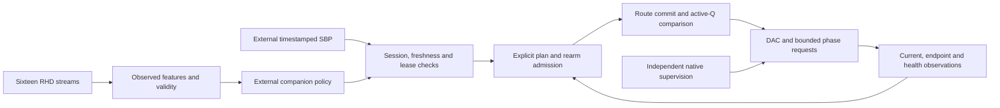

# Actual nRF5340 firmware

**14 October 2026 · SCCI_RH-S4-FIRMWARE-01 · digital target implementation**

This package turns the previously proposed processor role into a C/Zephyr
application for the nRF5340 application core. It connects acquisition, observed
health, route verification, explicit pulse plans and the isolated companion
interface. It preserves SCCI_RH's ambitious SCCI concept while recording exactly
which parts are implemented and which remain conditional.

The intended motor application is expert-informed, learner-specific assistance
during practice, evaluated separately in assistance-OFF retention trials. The
physiological application is calibrated regulation of one selected function,
using external measured pressure and target-specific stimulation authority.
The firmware does not establish useful spinal decoding, cross-person voltage
transfer, retained learning or universal bodily control.

## Implemented mechanism

The companion consumes measured feature/health records and supplies qualified
plans. Its learner-specific or physiological mapping remains a declared external
policy responsibility. Accepted communication is necessary input, rather than
proof of a correct biological intervention. The processor's local admission
checks can reject a plan without replacing independent native supervision.

The [application](../../firmware/nrf5340/app/) links the
[production policy core](../../firmware/nrf5340/core/README.md). The backend owns
real peripheral registers and buffers; the core owns mode, identity, freshness,
lease and event-state admission. The host tests compile this same core unchanged.
The supported SDK build target supplies startup/linker support, while the custom
carrier's electrical design remains separate from the physical development kit.

## Acquisition profile and observations

| Path | Implemented allocation | Interpretation boundary |
|---|---|---|
| ADS8688 raw ADC | 16 MHz SPIM4; 40 clocks per transfer; nominal 100 us opportunities, 10k aggregate ceiling; eight taps at 1.25k/s before polling gaps | Hardware channel tag, configuration epoch and timestamps improve digital identity; actual throughput and analog precision remain unmeasured |
| RHD2216 | 4 MHz SPIM1; nineteen words per nominal 1 ms frame; sixteen streams; at least 8 us allocated per word | OBSERVE-mode acquisition, actual aperture brackets and missed-frame validity; no physical uniform-rate qualification |
| RHD bandwidth | Selected 20…300 Hz configuration, signed amplifier data, optional DSP filter disabled | A declared commissioning setting, rather than a validated spinal biomarker band |
| Charge endpoints | 8 MHz SPIM2; simultaneous requested CNV, serialized independent CS reads | Event, phase and reset identities retain attribution; aperture skew and delivered-charge precision remain unearned |
| Sideband | Parallel load of 32 bits through four proposed SN74LVC165A devices | A sampled digital state, rather than proof of actual analog switch position or continuous fault history |

The two polling schedules do not establish simultaneous continuous rates.
Nineteen RHD words at the minimum 8 us allocation occupy at least 152 us, already
longer than a 100 us raw opportunity; a 32-bit health snapshot adds delay. The
backend retains actual brackets and missed-slot/frame counters instead of
inventing missing samples or claiming an uninterrupted scheduled history.
The endpoint backend retains baseline, first-tail and second-tail pairs. It
does not implement the earlier sixteen-capture event schedule or convert those
fewer observations into a phase-charge precision certificate.

This deliberately bounded backend does not claim the earlier transport study's
450k aggregate raw conversion schedule or Stage 2's 4k neural frame rate. The
40-clock tagged format replaces the historical 32-bit format in this implemented
profile. A mismatch or missed transaction invalidates history instead of silently
assigning a favorable channel. Short current transients, the ADS8688's typical
15 kHz filter and the lower current-tap rate prevent a new peak/charge guarantee.

The RHD's fast-settle and startup discard are commissioning actions. The selected
10 ms discarded interval is a heuristic, not an observed recovery qualification.
The former fixed 100 ms post-stimulation recovery shorthand is likewise
insufficient: electrode, amplifier and filter recovery need actual qualification.
A record's valid mask establishes the exercised digital transport conditions,
not neural usefulness or freedom from stimulation artifact. Recording is
inhibited while the stimulation path is armed in this profile.
Features are absolute-value EMA summaries in ADC counts. Telemetry includes the
first support time, latest update time, transport mask and `analog_qualified=0`;
the feature mask clears outside OBSERVE or after 100 ms without an update. The
EMA's older history is preserved in its support description. These features are
inputs to an external individualized policy, rather than a learned expert
decoder or evidence of a stimulation response.

## Mode and plan admission

The modes are exclusive: OBSERVE, MOTOR, PRESSURE and DIAGNOSTIC. OBSERVE and
DIAGNOSTIC cannot admit pulse events. MOTOR leases last at most 250 ms, PRESSURE
leases 3 s and diagnostic capture 100 ms. A currently accepted packet does not
create a lease or clear an inhibition by itself.

An accepted event plan names the current configuration epoch, event identity,
source mask, two contacts, amplitudes, phase duration, gap and OFF-trial flag.
The implemented ceilings are 3,000 microamperes and 200 microseconds per phase.
Both-source demand on one contact is rejected. Event starts must be at least
2,778 microseconds apart, and the interphase gap is at least 200 microseconds
plus the observed quiet and inactive-timer requirements.

The older illustrative pressure burst at 0, 2 and 4 ms does not fit that event
spacing and is not implemented by this profile. The companion must issue events
within the implemented limits; there is no hidden autonomous burst generator.
An OFF trial retains its event identity while requesting no output. Firmware
completion therefore does not imply a completed retained-learning experiment.

## Startup, explicit recovery and active readback

Boot holds requests low and leaves software inhibition set. Configuration
requires a new nonzero epoch and completed interface readback. A known valid
conversion follows before rearm admission. Rail, reset, watchdog, recording
blank observation, power, monitor and raw-configuration health are treated as
observations, rather than inferred from the processor's own intent.

An explicit recovery request first qualifies pre-monitor health and quiet, then
requests monitor-latch rearm while the system is still inhibited. It waits for
actual monitor permits before the separate fault-reset and supervisor-rearm
steps. This preserves the startup ordering that avoids monitor/ARM deadlock.
Monitor, supervisor, route and phase rearms remain distinct. A fault is never
cleared repeatedly by a background retry loop.

The backend shifts a complete fresh route candidate immediately before its
dedicated preload and commit. It then reads all eight active Q bits, compares
both addresses and only then emits the fresh acknowledgement and route-rearm
edges. Candidate serial return is not substituted for active-address readback.
The DAC and sideband share the candidate shift clock, so earlier candidate
contents cannot be trusted after intervening bus traffic. Exclusive ownership
prevents sideband GPIO clocks from colliding with an active SPIM3 transaction.

Each phase separately requires quiet/inactive-timer observations, stable
direction and explicit rearm. A normally completed first phase can progress to
the second after its gap and observed readiness. An interruption never schedules
an automatic balancing phase. Unknown interrupted integrator history remains
unqualified; processor reset or explicit recovery cannot make erased dose
history known.

## Hardware deadline and stale-input behavior

A TIMER compare publishes an allocated DPPI event to both GPIOTE request-clear
tasks and hardware timestamp capture. The backend uses the SDK's connection
allocator rather than assuming a channel is free; allocation failure inhibits.
The backend retains the hardware event timestamp for normal phase completion. The
core rejects a late software poll as interruption rather than backdating a
normal end. Peripheral request clear is separate from the native driver's two
duration limiters, independent watchdog and guard authority.

This is an implemented register-level shutdown path, not a measured propagation
time or proof of zero residual electrode current. GPIO command state, analog
switch state, stored charge and physical isolation remain different quantities.
All required native supply and supervision assumptions remain in force.

The 56-byte SBP parser checks exact schema, CRC32, trusted session, calibration,
forward sequence, strictly newer oldest support, timestamp order, finite values,
sanity ranges and clock uncertainty. The oldest possible support must be at most
two seconds old. A missing packet ages naturally; recent arrival cannot make an
old measurement fresh. Invalid input clears previous support and leaves sticky
inhibition. New valid support requires separate explicit rearm.

The implemented fallback is immediate digital stop when a required lease or
support expires. The transport study's hold/ramp alternatives remain comparisons,
rather than a selected clinical policy. Digital stop does not imply instantaneous
reversal of delayed physiological effects. CRC is not implemented authentication;
truthful sensor timestamps, calibration and the configured clock bound remain
explicit assumptions.

## Carrier and evidence boundary

The [46-GPIO map](nrf5340-pin-map.csv) assigns dedicated SPIM4 pins, independent
ADC chip selects, shared endpoint CNV and a common driver-rearm fanout. P0.00/01
remain reserved for the low-frequency crystal; NFC must be disabled for P0.02/03.
The custom carrier adds four SN74LVC165A devices: active-address bits 0…7,
health/status bits 8…25 and sentinel bits 26…31 equal to 0x29. The sentinel rejects
the exercised disconnected/all-zero/all-one streams, but cannot establish that
every health bit is truthful or fresh.

Those carrier additions are specified dependencies for the next consolidated
PCB. They are not already present in the seven native circuit packages. The
development kit's conflicting attached devices also prevent treating a linked
DK-target image as a completed SCCI_RH board. The
[primary review](nrf5340-component-and-peripheral-review.md) records exact
manufacturer and installed SDK evidence.
The [image attribution](../../firmware/nrf5340/THIRD_PARTY_LICENSES.md) retains
notices for linked SDK/runtime components alongside SCCI_RH's original source.

The [saved host tests](../../firmware/nrf5340/runtime-tests.json) currently report
75 finite scenarios and 713 assertions against the compiled production core.
They exercise startup, staged recovery, both-source phases, health interruption,
OFF trials, route/limit rejection, late endpoints, sticky faults, leases,
packet faults/freshness, sample epochs, queue overflow and timestamp wrap.
The 432-byte core struct includes its sixteen 16-byte fault records. The final
pristine linked image uses **53,616 bytes of flash and 98,000 bytes of RAM**.
Its actual application map provides **1 MiB flash and 448 KiB RAM**, rather than
treating all 512 KiB of physical SoC RAM as available; this board layout reserves
64 KiB. The independent image audit checks the actual sections and capacities.
The lower-rate image does not link the full future models from the earlier
404,992-byte architectural allocation. Its smaller linked image size therefore
does not establish deployment of those models or the high-rate proposal.

The [target build helper](../../scripts/build_nrf5340.py) builds the actual
application with the installed SDK. The
[build receipt](../../provenance/stage4-nrf5340-build.json) binds the source,
compiler, target and artifact identities. The
[independent auditor](../../scripts/verify_nrf5340.py) checks the saved image
and pin/resource evidence; its
[receipt](../../provenance/stage4-nrf5340-verification.json) is distinct from
the host-policy test report. The published
[ELF](../../firmware/nrf5340/artifacts/scci_rh.elf),
[HEX](../../firmware/nrf5340/artifacts/scci_rh.hex),
[binary](../../firmware/nrf5340/artifacts/scci_rh.bin) and
[map](../../firmware/nrf5340/artifacts/scci_rh.map) make the linked result inspectable.

Target linking, finite host execution and source-bound audits can close this
digital firmware package. They do not establish physical peripheral throughput,
analog settling, implant packaging, sensor truth, clinical efficacy or improved
skill acquisition. The next Stage 4 package integrates the processor/carrier and
all seven circuit slices into a populated PCB, followed by populated CAD and
the final illustrated research paper.
