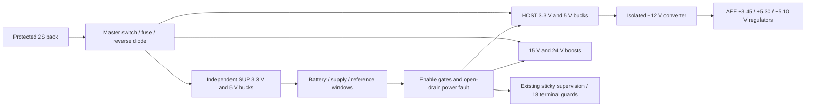

# Power and quantitative budget — completed digital reference

**14 October 2026 — Project SCCI RH Stage 4, bounded package 2.**

This package gives the proposed spinal recording–interpretation–stimulation–
feedback system actual native power circuits and an explicit resource budget.
It preserves both expert-informed retained motor learning and target-specific
physiological regulation as the conditional research mechanisms. Powering an
electrical reference does not establish either biological outcome.

## Selected architecture

The [editable KiCad design](../../electronics/stage4/power/README.md) contains
**156 components, 449 checked pins and 15 sheets**, with zero unexcluded ERC
violations. The battery is a protected **Tenergy AT31004** 2S pack, nominal
7.4 V, 2.6 Ah, 19.24 Wh. Its 67 × 37 × 21 mm, 99 g identity is a deliberate
reference-design allocation, rather than a miniature implant battery. The
manufacturer-compatible TLP-2000 charger is offboard; no onboard charging or
charging while connected is implemented.

Three TPS62160 bucks supply SUP_3V3, SUP_5 and HOST_3V3. A TPS62130A supplies
HOST_5; two LT8330 converters produce HOST_15 and VH_24. The TMR 3-0522 creates
a floating ±12 V island, followed by two TPS7A4901 positive regulators and one
TPS7A3001 negative regulator. These generate the revised recording rails while
retaining their historical net names. The isolated common is **AFEAGND** and
has no passive wire to host ground.

The [component review](power-component-review.md) gives manufacturer pins,
supporting networks, package conditions and limits. The [32-wire power plan](power-wiring.csv)
joins actual native ports in the six separate circuit packages. Consolidated
hierarchy and PCB routing remain the final Stage 4 package.

## Startup, reference qualification and shutdown

The physical master supplies the two independent supervisor bucks. An external
`PWR_REQUEST` input, normally low, can be connected to SUP_3V3 through the bench
control header to request operation. It does not require a powered host MCU to
start itself. Battery/supervisor windows and a hardware startup hold qualify
HOST_ENABLE. HOST_5 power-good then enables the two boosts; it is combined with
HOST_ENABLE so a disabled converter's stale/open-drain PG cannot grant output.
The isolated converter's remote pin is left open as specified; it is not a TTL
input, and its input energy comes from HOST_5.

Two additional TPS3700 windows observe the existing monitor's physical 4.096 V
reference and 2.048 V buffered midpoint. They qualify `POWER_RUN_OK` after
HOST startup. They never gate HOST_ENABLE itself, avoiding a startup loop.
Their gross windows detect selected reference failures; they do not earn the
much narrower gain/offset/4% dose-precision allocations.

A **SN74LVC1G07 open-drain output** connects `PWR_FAULT_N` to the existing
supervisor's `GUARD_FAULT_N` net at U100 pin 10. Request loss, battery/supply
failure, HOST_5 PG loss or reference-window failure therefore consumes global
arm through the existing asynchronous interlock. Healthy switches are commanded
off even if supply capacitors remain charged. Restored power can restart rails;
it cannot generate the separate monitor/global/phase rearm commands.

Disabling a boost stops switching but leaves the battery–inductor–diode–output
path. HOST_15/VH_24 can consequently remain near the input voltage rather than
fall to zero. The master can remove the source, while stored energy still
persists. Supply-enable signals are not substitutes for terminal disconnects.
Physical propagation, brownout logic and welded switches retain their stated
limits. A 6.4 V terminal-voltage calculation is not guaranteed cold-start
permission: the battery window's nominal UV release is 6.6 V, with tolerance
and hysteresis explicitly audited.

## Quantitative result and design consequences

The [budget dossier](power-budget.md) and [reproducible studies](../../electronics/stage4/power-study/README.md)
audit existing IC supply pins, the new power/control circuits and 423 populated
capacitors. Separate stages account for useful loads, regulator/module losses,
input diode, pulse peaks, reservoirs, startup energy, source resistance, memory
and buses.

- The conditional restricted-active allocation is **2.615 W** at nominal battery
  voltage. At 80% of rated pack energy, the corresponding runtime is **5.886 h**.
  These use declared load ceilings and efficiency assumptions, not measurements.
- The 30 µF effective 24 V bank supports the selected finite aligned-source
  droop calculation. Small-capacitance, source-resistance and rapid-charge
  witnesses retain their rejected results; a fuse rating is not a current clamp.
- Full ±2.5% AFE regulator accuracy can leave actual rails outside qualification
  windows. The design supports quiescent feedback-resistor selection; a
  characterized ±0.5% operating-rail condition passes the selected study. It
  remains an explicit assumption, rather than a factory or full-temperature
  guarantee. A rejected rail keeps stimulation inhibited.
- The historical one-cell/100 mA/compact thermal allocation is superseded.
  None of the selected 5–50 K/W lumped thermal cases meets the 2 K allocation.
  The reference cannot be silently placed inside the earlier compact CAD
  envelope or presented as a thermally qualified implanted consumer product.
- The existing two ADS8866 devices provide 200k aggregate conversions/s,
  below the 450k monitor contract. Continuous framed 4 kHz raw data also exceeds
  the 1 Mbit/s service. The next transport package must add/revise acquisition
  hardware or rates and preserve sample/endpoint identities.

The sizeable reference supplies inspectable electronics for the digital project.
The future consumer implant needs a materially lower-power implementation and
appropriate battery/package integration. That is a concrete engineering
requirement of the future concept; this package does not invent a miniaturized
ASIC or use biological uncertainty to postpone the present digital deliverable.

## Verification and handoff

Native pin/pad/netlist checks, saved MCP inspection, all 15 rendered pages,
independent budget KCL/energy audits, 256 gate input combinations, 12 sequencing
histories, five measured-window corner groups and the combined 134-wire plan
are reproducible. The sequence adapter is ideal valid-supply logic; converter
stability, ripple/EMI, input inrush, physical thermal and medical isolation are
not falsely relabeled as passed tests.

This completes package 2 within the agreed digital scope. **Next: monitoring
transport and companion interfaces**, including the observed ADC-rate mismatch,
shared conversion/endpoint scheduling, pressure freshness and diagnostics.
Target firmware and the consolidated populated PCB follow. Stage 5 must use
actual revised package/component identities for CAD, and Stage 6 integrates the
paper and private repository release. Video and website remain parked.
