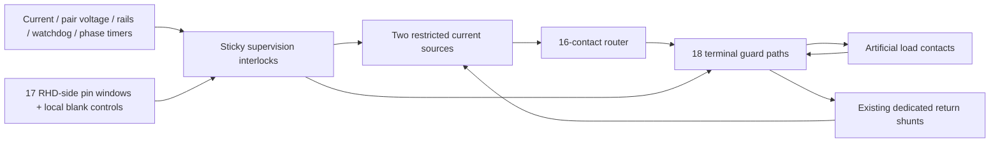

# Independent shutdown and supervision — completed digital slice

**14 October 2026 — Project SCCI RH Stage 4, bounded package 1.**

This package supplies the proposed invasive spinal interface with independent
electronic interruption and deliberate rearming. It connects the four prior
native circuit packages through an audited wiring plan. It preserves the main
research direction: expert-informed, learner-specific practice and retained
learning; target-specific physiological regulation with feedback. Those future
biological mechanisms remain the explicitly conditional Stage 3 baseline.

## Mechanism and actual topology

The actual terminal interposer connects router **J7 pins 1–18** to supervision
**J100 pins 1–18**, then five **TMUX7412FRRPR** packages carry the 16 contacts and
two dedicated returns to **J101**. Protected S pins face the external load; D
pins face the existing router/monitor. Two unused switch channels are grounded
and disabled. No duplicate current shunt is inserted. All 18 selectors use one
global enable, which is high only when at least one source has an admitted phase.
A source or global fault consumes the global arm and removes both sources.

The [native KiCad sources](../../electronics/stage4/supervision/README.md) include
actual component pin maps, footprints, BOM, netlists, reviewed sheets and
unexcluded ERC. The [wiring CSV](supervision-wiring.csv) is a checked integration
plan for separate packages; the consolidated hierarchy and routed PCB belong
to the final Stage 4 package.

## Startup, phase admission and fault recovery

1. Independent supervisor supplies and observed host/recording rails qualify
   after hardware startup holds. The recording island keeps its own ground.
2. A valid falling heartbeat edge sets a separate “heartbeat seen” latch.
   Watchdog startup alone cannot stand in for executed control.
3. Physical sense health permits explicit rearm of the existing current-monitor
   latches. These pre-monitor outputs exclude global arm/monitor permit, avoiding
   a circular startup dependency.
4. With both current windows quiet, requests/RUN/timers low and health restored,
   explicit `FAULT_RESET` clears duration faults. A later raw `SUP_REARM` clocks
   global arm. Neither a rising health level nor a request synthesizes this clock.
5. Route commit/verification/rearm and phase rearm follow their existing distinct
   contracts. Fresh raw requests trigger both the original and secondary timers.
   Output requires the actual main RUN, secondary timer, route lock, monitor
   permit, arm and physical health simultaneously.
6. Request end consumes the source block. A fault clears arm asynchronously.
   Health restoration alone never restarts the interrupted phase. Interrupted
   charge remains uncertain; no forced balancing overrides an electrical fault.

The [control contract](supervision-control-contract.md) gives the exact stable
equations, raw latch clocks, finite histories and independently audited native
gate connections. The actual monitor's historical `CHx_EXT_SUP_OK` port connects
to the new **`CHx_MON_SUP_OK`**, while the driver's identically named historical
port connects to **`CHx_EXT_SUP_OK`**. These are deliberately different nets.

## Defensible assumptions and concrete revisions

| Premise / revision | Why it is usable here | Limit retained |
|---|---|---|
| Healthy second one-shot, separate RSET/oscillator | Provides a distinct cutoff for a stuck primary timer | Common rails/triggers, simultaneous failures and undefined ramps remain. |
| Healthy body-facing terminal switches | A real protected switch can interrupt the external path | Command/state disagreement, welded devices, leakage, capacitive coupling and stored charge remain. |
| Finite 5 µs switch / 20 µs detector envelopes | Explicit assumptions enable an inspectable interruption calculation | Assembled worst-case transient bounds are unearned. |
| Observed recording-pin voltage plus local blank controls | Gives physical voltage observations beyond a remote GPIO command | A welded switch can still pass an AC artifact while resting voltage looks valid. |
| Revised AFE rails +3.45/+5.30/−5.10 V | Gives selected monitors/device supply limits explicit margin | Generation, regulation, peaks and heat are next; historical nominal labels remain. |
| Provisional 200 µs quiet allocation, wait for actual qualification | Accommodates finite secondary duration and observed quiet dwell | The old 100 µs phase gap is unearned; elapsed time alone cannot admit a phase. |

The [component review](supervision-component-review.md) distinguishes primary
manufacturer limits from allocations. The [analog study](../../electronics/stage4/supervision-study/README.md)
retains finite threshold, loading, timing, interruption and residual-energy
results. The shared reference and current sensor remain common failure points;
no independent reference-health circuit is invented in the control model.

## Package exit and next work

Completion means inspectable native circuits, actual pin/footprint identities,
checked upstream wiring, finite event/analog evidence, reproducible read-only
audits and explicit unresolved assumptions. It does not require a fabricated
device, demonstrated biological decoding or proof against every possible fault.
Stage 3 is not reopened to finish this electronics package.

The next bounded package is **power and the complete quantitative budget**:
select battery/regulation/isolated supplies, generate revised AFE and supervisor
rails, implement startup/shutdown/reference responsibilities, then recalculate
actual component/peak power, heat, runtime, buses and memory. Monitoring transport,
nRF5340 firmware and the consolidated populated PCB follow; Stage 5 builds the
populated CAD assembly. The [remaining-work plan](remaining-work.md) owns these
four packages. Video and website work remain parked.
