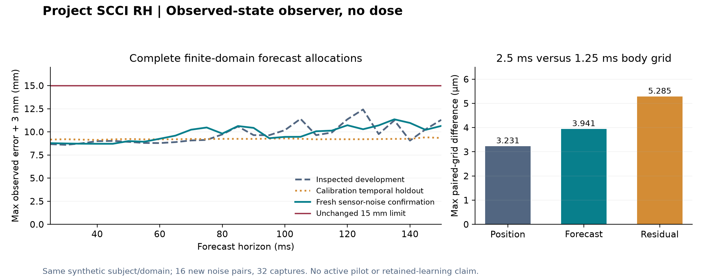

# Observed-state observer: bounded no-dose confirmation

This standalone Stage 3 study tests a ten-state causal position observer with
one measured-data calibration prior. The independently predeclared confirmation
passed its finite forecast arithmetic: **11.353736 mm maximum allocation within
the unchanged 15 mm budget**, across all 16 fresh sensor-noise pairs and both
body-integration grids. This package preserves the original frozen evidence;
it does **not** replace Project SCCI RH's authoritative predictor or isolated pilot.

| Evidence group | Complete captures meeting every horizon budget | Largest allocation |
| --- | ---: | ---: |
| Previously inspected development drift records | 16 / 16 | 12.418841 mm |
| Temporal calibration holdouts | 8 / 8 | 9.409502 mm |
| Predeclared fresh sensor-noise confirmation, two grids | 32 / 32 | 11.353736 mm |

An allocation is the maximum absolute observed coordinate residual plus the
unchanged 3 mm label allowance. Confirmation retains all 550 current supports,
all 26 horizons from 25 to 150 ms, and both coordinates: 915,200 residuals.
No declared support was unavailable, no capture was dropped, and no gate or
method setting was adjusted after the outcome.



The figure uses the saved summaries. Rebuild it with `python
experiments/stage3/observed-state-observer/build_figure.py` in the repository's
locked plotting environment. Plotting is separate from the frozen experiment.

## Mechanism and the claim it supports

The state has two positions and eight voluntary harmonic coefficients. Delayed
measured external positions update the state at their physical support; the
known instruction and an explicit **60 ms synthetic plant prior** propagate it
through direction reversals and future horizons. A common prior and uncertain
coefficient drift are learned from measured calibration only: 64 s fit exposure
and 32 s temporal holdout, from the existing 96 s corpus. Private learner
family, scale, gain, theta and future achieved position never select runtime
parameters or forecasts.

The state summarizes the **whole accepted trial prefix**, which is more
information than the old stateless 75 ms history. It uses ten means and 55
unique covariance entries; the common measured prior/drift adds 101 learned
scalar entries. The Python implementation stores all 100 covariance entries.
Its deterministic transition cache alone can hold 1,638,400 bytes of float64
payload, exceeding the proposed 512 KB target RAM before Python overhead. This
is a desktop study, with no MCU memory or timing claim.

Confirmation independence is **sensor noise only**. Subject seed 2, four scales,
the known cue and the finite learning-law alternatives were fixed. Four named
families reduce to two distinct no-dose equations. This is not new-subject,
human or biological validation. Two 3 s captures per noise ID share exactly the
same actual sensor-noise array, with 2.5 ms and 1.25 ms body grids. Across pairs,
all 16 IDs and arrays are new and distinct. The largest grid differences were
3.231031 micrometers in observed position, 3.941148 micrometers in forecasts and
5.284652 micrometers in residuals; no horizon budget decision changed. Agreement
between two grids does not establish continuum or biological truth.

There is **no dose, pilot/runtime replacement, neural increment, expert transfer,
assistance or retained-learning result** here. The unchanged 25 mm combined
correction gate was not tested. A later active pilot must review a genuine
pre-dose forecast freeze and pending-response monitoring, or causal whole-prefix
response correction with uncertainty. Stimulation-contaminated positions must
not silently enter an unassisted observer.

## Verify the evidence

Use Python 3.12.14 and the exact [dependency pins](requirements-lock.txt). From
the repository root:

```text
python -m pip install -r experiments/stage3/observed-state-observer/requirements-lock.txt
python experiments/stage3/observed-state-observer/verify_study.py
```

The default verifies every package file and all 21 bound `src/scci_rh` source hashes,
then constructs a disposable study root with the original `tmp/` filenames. It
copies only the verified source text, runs the **exact frozen** independent
equation/causality/noise check and both saved-data auditors, and compares their
semantic results with the originals. It checks all counts, decisions, findings,
identities and witnesses. Only `elapsed_wall_seconds` is ignored; dependency
versions are enforced, not silently ignored. Floating comparisons use the
declared 2e-8 relative / 1e-11 meter absolute tolerance, with 1e-18 absolute for
squared-meter covariance fields in the wrapper's audit comparison. The original
frozen producer's optional full reproduction uses its declared generic 1e-11
absolute tolerance for all numeric fields, including covariance diagnostics.
Neither comparison makes covariance a hard error bound; the empirical maximum
gate remains separate. Windows/Linux JSON newline differences are
handled by parsing the scratch audit output. Frozen original bytes, including
CRLF receipts, remain exact and are never rewritten.

An optional full reproduction regenerates the **same frozen pairs** in scratch;
it is not another independent-noise experiment:

```text
python experiments/stage3/observed-state-observer/verify_study.py --reproduce
```

The 21 source files bound at generation are immutable. Later added files are
reported and excluded from scratch; they cannot influence this reproduction.
If a bound file changes or is removed, use `--source-root PATH` with a checkout
containing the original bytes. The approved algorithm is not rewritten for
packaging.

## Inspect the frozen record

All 37 original files are under [frozen/](frozen/). Start with:

- [Method and calibration protocol](frozen/observer-protocol-12oct.md),
  [implementation](frozen/observed_state_observer_12oct.py), and
  [measured-data freeze receipt](frozen/observer-method-freeze-12oct.json).
- [Independent dynamics, causality and noise checks](frozen/observer-independent-check-12oct.json).
- [Development findings and integration boundary](frozen/observer-findings-next-integration-12oct.md),
  [development summary](frozen/observer-development-summary-12oct.json), and
  [saved-data audit](frozen/observer-saved-data-audit-12oct.json).
- [Predeclared confirmation protocol](frozen/observer-confirmation-protocol-12oct.md),
  [producer/evaluator](frozen/observer-confirmation-12oct.py),
  [immutable preflight](frozen/observer-confirmation-freeze-12oct.json), and
  [independent review saved before generation](frozen/observer-confirmation-root-review-12oct.md).
- [Confirmation summary](frozen/observer-confirmation-summary-12oct.json),
  [saved-data audit](frozen/observer-confirmation-saved-audit-12oct.json), and
  [complete handoff](frozen/observer-confirmation-handoff-12oct.md).

The raw record has one development gzip and sixteen confirmation pair gzips;
each confirmation segment is about 2.25 MB. They retain all measured targets,
forecasts, residuals, covariance diagnostics and witnesses. Producer-only truth
and the shared actual noise are marked separately and used only by the audit.
[artifact-manifest.json](artifact-manifest.json) binds all package files except
itself. The initial unapproved preflight draft is deliberately excluded.
