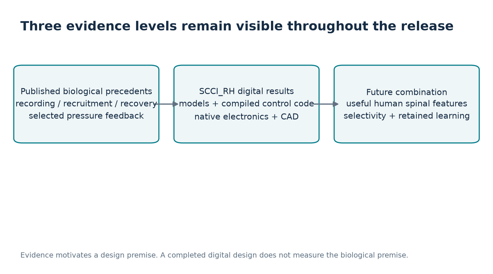
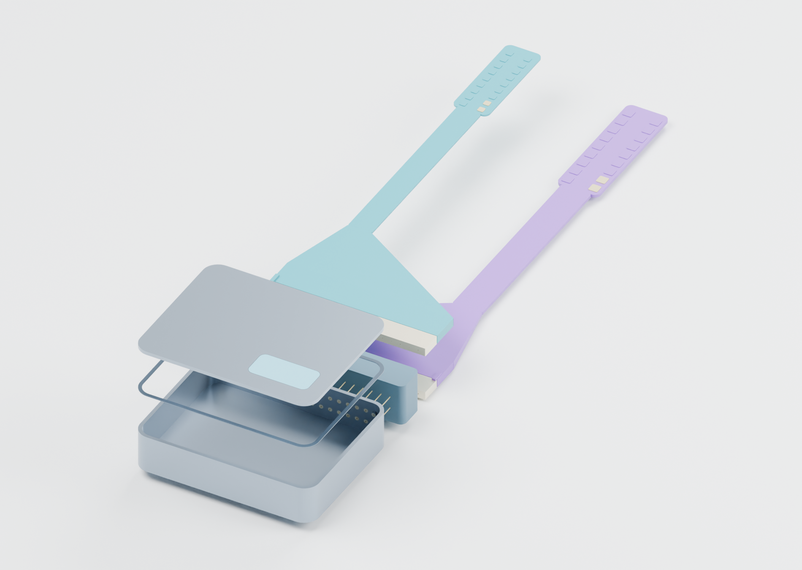

# Project SCCI RH: a conditional spinal cord-computer interface for expert-informed practice and physiological feedback

## Abstract

Project SCCI RH investigates an invasive spinal cord-computer interface (SCCI) that combines recording, computational interpretation, selective stimulation and independently observed feedback. Its two application families are expert-informed motor practice with retained stimulation-OFF learning, and sustained regulation of a selected physiological function. The central research question is conditional: if useful spinal information and selective learner-specific or function-specific recruitment are available, what architecture could use them, and which parts can a digital engineering project substantiate?

This work integrates a focused primary-source review, explicit biological premises, computational studies, native electronics, compiled firmware, mechanical CAD and reproducible verification. Published animal and human studies support individual links, while the proposed healthy-consumer combination remains unestablished. A preserved conservative investigation withholds every intervention. A separate 128-scenario model demonstrates how the assumed learning mechanism determines retained outcomes. The final integration replay executes the unchanged production C admission and phase-state code through declared companion and body adapters: 114,426 repeated assertions cover 28 finite scenario groups. These assertions measure software behavior, rather than biological certainty.

The engineered reference comprises eight routed KiCad boards with 1,296 fitted component positions, an application-core ARM image, independent supervision and a full-scale FreeCAD assembly. A separate 36-port future implanted-interface concept expresses the proposed contact and lead architecture. Native geometry, electrical connectivity, artifact identity and finite software behavior have source-bound evidence. Analog performance, physical timing, chronic implanted heat, miniaturization, useful human decoding and accelerated healthy learning remain explicit assumptions or qualification tasks. The contribution is an inspectable, integrated digital design and a precise account of what would have to be true for its future applications to work.

## 1. Purpose, scope and contribution

### 1.1 Research question and project identity

The spinal cord participates in movement, sensation, reflexes and selected autonomic pathways. It therefore offers several possible interfaces between computation and bodily function. The useful question is more specific than whether a computer could control the body: which state is observable at a particular access site, which intervention is reachable through a particular pathway, and whether closing that loop serves a defined functional outcome.

SCCI_RH asks two linked questions. First, could an expert's task-related spinal observations inform a learner-specific practice policy that improves later unassisted performance? Second, could a measured physiological state drive repeated, bounded spinal interventions that maintain a selected response? A shared electronic architecture can support both investigations, while recording sites, stimulation placements, calibration and outcome measures remain application-specific. Exclusive software modes do not by themselves make one anatomical lead arrangement suitable for both tasks.

The project is entirely digital. It contains original engineering artifacts and computational experiments, with no original human or animal experiment. A useful digital result may be positive, negative or conditional. An abstaining controller can reveal a missing permission; a favorable simulation can reveal an assumption on which benefit depends. Neither outcome alone settles future biological feasibility.

### 1.2 Inspiration and original contribution

AstroSam's Mind-Link is the direct inspiration for expressing a future neural interface through circuit boards, firmware, visualization, connectors and a designed physical body. Its official repository includes PCB development files, fabrication references, firmware, visualization and printable parts, and describes a proof of concept. This audit verified that repository; it does not claim a fresh verification of every statement in the linked video. [R18]

SCCI_RH contributes its own spinal problem formulation, two application mechanisms, premises and comparison rules, quantitative studies, electrical architecture, bounded runtime, eight-board reference integration, contact mapping and mechanical designs. It does not claim to have invented spinal interfaces. The original 28-page hypothesis paper is retained as a starting research map. This manuscript consolidates later design decisions and distinguishes historical allocations from implemented behavior.

| Evidence class | Meaning in this manuscript | Example |
|---|---|---|
| Published evidence | A result in the cited original research, with its population and access method | Movement-related animal spinal recordings |
| Design premise | A stated condition adopted to investigate the future combination | Useful causal human spinal features during the selected task |
| Digital result | A reproducible result of specified code, calculations or saved native geometry | Production-core admission rejects a stale pressure packet |
| Engineering proposal | A chosen implementation or allocation that still needs qualification | Titanium/ceramic package and target-specific leads |
| Future hypothesis | An outcome requiring new evidence | Faster healthy motor acquisition retained without stimulation |

## 2. Biological rationale and the missing conjunction

### 2.1 Information available at spinal pathways

Spinal measurements can contain afferent, descending, local-circuit and movement-related activity. Their mixture depends on anatomy, electrode placement, reference, movement, tissue interface and recording method. An electrode count is consequently different from a count of independently useful state variables. Recorded correlation with a labeled movement also differs from causal prediction of a future action during assistance.

Recent animal work motivates the possibility of useful access. Circumferential and conformable interfaces have recorded movement-related spinal activity; chronic mouse experiments and bidirectional circumferential platforms provide complementary recording and stimulation precedents. Their species, preparations and analysis tasks matter. They do not establish a universal human intent decoder or a code transferable between people. [R01][R02][R03]

One source-quality detail requires clarification: R01 labels 21.29% as uniform chance across eight classes, whose uniform chance would be 12.5%; its listed majority class is 215/1010, approximately 21.29%. SCCI_RH does not adopt that baseline or independently reanalyze the source data. The recording precedent and its limits remain separate from that wording issue. [R01]

The proposed baseline separates intradural surface recording from epidural stimulation. This is an architectural choice, rather than a demonstrated chronic human combination. It permits recording access and recruitment access to be evaluated separately. The 16-stream allocation is a finite engineering starting point. Its usefulness depends on the information at the selected contacts and on validity during the relevant time windows.

### 2.2 Selective recruitment and individualized action

Mechanistic stimulation models connect electrode placement, afferent recruitment and motor output. Human work shows that individualized spatial and temporal stimulation programs can support selected activities after injury. These results motivate calibrating a local response map instead of assigning an expert's voltage directly to a learner's electrodes. [R04][R05]

Upper-limb stimulation after stroke supplies a different feasibility precedent, with a different condition, anatomy and outcome. It motivates investigation of task-specific assistance without proving healthy skill acquisition or the proposed expert-to-learner pathway. SCCI_RH therefore treats lower-limb coordination as a quantitative reference case, while piano and sport remain application families requiring separate representations and access configurations. [R06]

Electrical polarity, recruitment and task-space correction are distinct concepts. A program that produces a negative task-space correction need not electrically inhibit a pathway. The learner-specific response map must identify reachable directions and context dependence. Missing authority, gain drift or an unobserved change in recruitment can invalidate a previously plausible correction.

### 2.3 Plasticity, recovery and retained skill

Contingent stimulation and conditioning studies show that activity-dependent change can outlast a stimulation session under particular conditions. Examples include EMG-triggered spinal stimulation during recovery in rats, cortical-spike-triggered spinal pairing in nonhuman primates, and peripheral H-reflex conditioning in people with incomplete injury. Their triggers and targets are different. Recovery and conditioning are informative precedents for adaptation; they do not supply a measured healthy learning multiplier. [R07][R08][R09]

The distinction between spinal-only and hybrid systems is essential. A brain-spine interface that decodes cortical activity and commands spinal stimulation demonstrates a hybrid chain. It supports the broader idea of computation bridging neural pathways, while requiring brain recording that the main SCCI_RH concept does not assume. Cortically triggered plasticity likewise belongs to a hybrid precedent. [R08][R11]

Preserving sensory information also matters. Stimulation can alter proprioceptive signaling, so more delivered input need not imply a better learning environment. SCCI_RH carries interference, dependence and adverse adaptation as alternatives rather than treating stimulation as an automatically beneficial teaching signal. [R10]

### 2.4 Function-specific physiological control

Targeted spinal stimulation and external pressure feedback have supported hemodynamic regulation after spinal cord injury. The experimental baroreflex and subsequent implanted human platform provide a particularly relevant causal precedent for selected physiological feedback. This is stronger support for a function-specific pressure loop than for generalized body automation. [R12][R13]

Evoked-response feedback in implanted pain systems demonstrates another useful measurement distinction: an electrically evoked compound action potential can report aspects of recruitment, while functional outcomes require their own assessment. A recruitment signal is not automatically a blood-pressure, bladder-state or motor-skill measurement. [R14]

An implanted epidural bladder pilot supplies a separate target-specific comparator. Its storage and voiding programmes were user-switched; autonomous neural fullness decoding was not demonstrated. The consented, implanted and long-term follow-up cohorts differ and are recorded separately in Appendix C. [R15]

Force primitives and spinal circuit recovery studies help explain why structured task components and circuit-specific interventions are reasonable research directions. They do not establish a detachable expert skill representation. The final combination still requires useful observations, calibrated intervention authority, stable delivery, appropriate feedback and beneficial adaptation to coexist. [R16][R17]

## 3. Proposed consumer mechanisms

### 3.1 Expert-informed motor practice

A theoretical learner selects a bounded task and an expert reference in a companion environment. The expert record includes independent task labels, performance quality and context. An alignment procedure extracts a coordination target that can be compared with the learner's movement. The learner then performs their own calibration and active attempts. Their useful spinal observations and independent movement measurements support state estimation; the expert supplies a reference rather than a replacement nervous system.

During practice, a calibrated policy selects a permitted intervention only when its observations, response map and timing remain usable. Delivered current, charge and compliance are monitored separately from requested action. Independent movement sensing records what actually happened. Later stimulation-OFF probes test whether anything persisted beyond assistance. Retention and transfer to a different task condition are separate endpoints.

The proposed experience is therefore: select a drill, establish a learner-specific baseline, align a qualified reference, practice with bounded feedback, and assess unassisted retention. A complex skill such as piano or football would require several task components, contextual decisions and sensory strategies. Demonstrating a cyclic component cannot establish transfer of that complete skill. The project nevertheless retains the broader vision: a future platform could support several calibrated modules if their information and recruitment requirements can be met.

### 3.2 Sustained physiological influence

The physiological user case selects one state and one accessible causal pathway. In the reference mechanism, an external sensor supplies systolic pressure with support time, arrival time and quality. A companion policy requests bounded support through an individually calibrated spinal pressor program. The controller continues to observe pressure, while electrical supervision independently observes the output chain.

The actuator has positive pressor authority in the model. Reducing its command withdraws added drive; it does not create an independent ability to lower arbitrary high pressure. Activation and response can persist after current ends. Sensor faults, unreachable targets, gain changes and delayed withdrawal therefore require explicit behavior. A stop can reduce further electrical exposure while still leaving a physiological tail.

The main SCCI platform remains bidirectional, although pressure feedback in this application is external. Optional spinal context or evoked-response features could improve a future controller only after their information value is demonstrated. A general spinal blood-pressure decoder is not assumed. Healthy-consumer benefit and a useful indication would require separate evidence from the injury-related precedents.

### 3.3 Premises that allow the future concept to progress

| Premise | Why it is reasonable to investigate | What would invalidate the adopted use |
|---|---|---|
| Useful spinal task features | Published recording precedents and known pathway roles | Absent, noncausal or insufficiently specific features |
| Aligned expert representation | Structured task components and independent labels | A reference that adds no useful information or mismatches the learner |
| Learner-specific recruitment | Individualized stimulation and response calibration | Missing direction, changed gain or unacceptable collateral response |
| Beneficial adaptation | Activity-dependent change in selected studies | Equal OFF learning, dependence, adverse adaptation or failed transfer |
| Selected physiological authority | Targeted pressor feedback after SCI | Unreachable response, wrong sign, unstable context or unacceptable tail |
| Usable implanted engineering | A finite circuit, runtime and interface architecture | Inadequate signal quality, heat, delivery precision or chronic interface behavior |

These premises need defensible mechanisms and explicit consequences. Their absence from a combined demonstration does not make the concept impossible. Their adoption also does not make the desired capability a measured result. SCCI_RH's models are designed to expose where the conclusion changes when a premise changes.

## 4. Mathematical framework and information permissions

### 4.1 Observation, support and availability

Let x be a task state, c the recording configuration and a the stimulation artifact. A local observation model is

`y_k = H_c x(t_support,k) + a_k + epsilon_k`.

The controller can use y only after its arrival time. It must retain the original physical support time. A newly received packet containing old data remains old. The model separates known task instruction, measured achieved movement, estimated state and private simulation state. Future samples and held-out labels are excluded from controller inputs.

For a proposed action at time t, a causal estimate can be written as `x_hat(t | information available by t)`. Its age and uncertainty are part of admission. A predictable cue may permit bounded prediction of a task component; it does not supply knowledge of the learner's future achieved movement. Equal-information comparisons are necessary to distinguish neural value from an assigned advantage in latency, noise or available history.

### 4.2 Expert alignment and reachable correction

The expert contributes a context-conditioned reference r_E. A mapping A produces a learner-aligned reference r_L, while a separately identified local response map B relates permitted interventions to task-space effects. An illustrative policy chooses a bounded action that reduces predicted error, subject to reachability, context and uncertainty:

`u_k = argmin over u in U_valid of ||r_L - x_hat - B u||^2 + lambda ||u||^2`.

This expression states the design problem; it is not a claim that a universal neural inverse exists. In the conditional study, the implemented local policy uses an identified inverse and clipping. The stimulation program, contact route, amplitude and timing must remain tied to that calibration identity. Unreachable error components require abstention or a revised task, rather than a larger command by default.

### 4.3 Assistance and retained learning

The conditional motor study represents a two-coordinate cyclic component. Voluntary performance is parameterized by theta, stimulation adds a task-space response, and practice updates theta. The implemented update separates residual movement error from an assumed teaching contribution:

`Delta theta = eta [projection(residual) + rho projection(stimulation response)]`.

For the chosen model this is equivalent to

`Delta theta = eta [(theta_target - theta) + (rho - 1) projection(stimulation response)]`.

The identity is checked against the numerical implementation. At rho = 1, assistance's extra contribution to OFF learning cancels exactly. A favorable rho can accelerate the modeled OFF outcome; an adverse rho can produce dependence or worse retention even with good ON execution. The study varies rho as a premise. It does not estimate it from expert recordings or human training data.

### 4.4 Pressure dynamics and authority

The historical pressure model uses delayed normalized dose d, a recruitment threshold h, activation x_a and added pressure z:

`r(t) = max(0, d(t-L) - h) / (1-h)`.

`dx_a/dt = (r - x_a) / tau_a; dz/dt = (G x_a - z) / tau_p`.

`SBP(t) = P0 - D(t) + z(t)`.

Its delays, gains, time constants and release behavior are selected inputs. The newer integrated replay uses a separate declared lumped plant and a simple companion policy. The two studies have distinct protocols and results. Neither identifies a human dose-response curve.

For a monotone positive response, a necessary static condition is `0 <= deficit <= maximum added pressure`. Delays, saturation and withdrawal make that condition insufficient for dynamic performance. A lower pressure error accompanied by excessive recovery overshoot remains an important failure mode.

### 4.5 Electrical and resource constraints

For each phase, charge is `Q_phase = integral i(t) dt`; for a constant-current example it reduces to `I times phase duration`. A command must also fit compliance, reservoir energy, route availability, return health and source service time. Nominal biphasic symmetry does not prove zero residual charge in an interrupted or nonlinear electrode system.

Timestamp freshness, plan leases and local phase timing have different responsibilities. A plan can be computationally valid yet arrive too late. A fast SPI wire allocation does not certify execution time, artifact recovery or electrode behavior. Similarly, conditional runtime is `usable battery energy / allocated input power`, while a lumped heat estimate is `dissipation times thermal resistance`. Those arithmetic relations expose design obligations; they do not replace physical measurements.

## 5. Study design and preserved results

### 5.1 Conservative qualification investigation

The historical conservative investigation is retained unchanged. Its observer, teacher, response-domain and delivery gates were developed to prevent an intervention from borrowing unavailable information or unearned precision. The final frozen-observer replay contains 32 one-practice trials and 64 pulse-free OFF assessments. Every nonzero candidate is withheld. The independently evaluated candidates fail one or more actual-response, learning-interaction and whole-vector conditions.

This result is a useful limit of that selected implementation. It establishes no delivered assistance or retained advantage. A separate no-dose observer confirmation covers 32 captures under finite synthetic subject/model assumptions; it does not qualify the observer during stimulation or transform the all-withheld study into a positive intervention result. Preserving that distinction is necessary for a traceable research project.

The conditional concept answers another question: what mechanism could operate if a useful future interface is adopted explicitly? It keeps the conservative failures intact and supplies a separate model, source identity and protocol. Completing that design does not require tuning the historical gates until they admit a pulse.

### 5.2 Conditional motor study

The Stage 3 conditional study contains 128 scenarios and 3,072 practice blocks. A 5 ms integration step, 25 ms policy frames, 24 practice blocks, explicit sensor delays and a local stimulation response form the finite setup. The controller receives causal observations and calibrated estimates. Six checks include equal-information equivalence, absent-feature fallback, no-authority abstention and the learning identity.

The principal result is the separation of execution and retention. Across four nominal seeds, expert-plus-external assistance reduces first-practice error from approximately 31.756 mm to 16.16 mm. Favorable assumed teaching gives final OFF error of approximately 2.884 mm, compared with 5.667 mm unassisted. At neutral rho = 1, final OFF learning is equal. Adverse teaching produces worse retained error.

| Assumed rho | Unassisted final OFF, mm | Expert/external final OFF, mm | Conditional live-spinal final OFF, mm |
|---|---:|---:|---:|
| -1 | 5.667 | 37.626 | 37.641 |
| 0 | 5.667 | 13.918 | 13.919 |
| 1 | 5.667 | 5.667 | 5.667 |
| 2 | 5.667 | 2.884 | 2.884 |

These are four-seed means in one chosen model family, rather than population estimates. The reference labeled expert-spinal and the equal-information expert-external reference give identical results. In this simple predictable task, the assumed live spinal features establish no useful unique advantage over external state sensing. Additional information must be demonstrated through matched comparisons, rather than inferred from a neural label.

The favorable threshold example takes seven practice blocks with assistance versus ten or eleven in unassisted comparisons. Calibration, OFF probes and washout consume additional time and are reported separately. These figures support a conditional mechanism illustration, not a 1.5x or 2x human acquisition claim. The model also retains absent features, altered gain, no recruitment and timing mismatch cases.

### 5.3 Historical pressure study

The historical pressure study models an external pressure waveform, causal extraction, packet timing, calibration, bounded whole-frame delivery, sensor faults and withdrawal tails. Its nominal example uses a 420 s simulated protocol with a stand-like disturbance. Those coordinates are chosen for model investigation and do not prescribe a target pressure or stimulation program.

For nominal seed 0, feedback lowers evaluation RMSE from 22.743 to 8.478 mmHg. Recovery overshoot rises from essentially zero to 25.363 mmHg. Reporting the error reduction without the overshoot would hide a central control consequence. Fault and sensitivity studies retain weak or reversed authority, sensor problems, stale data, changed recruitment and stop/hold/ramp trade-offs.

Dense stimulation in this branch does not qualify continuous neural recording. Its primary functional observation is external pressure. The historical three-profile, 120 Hz schedule is also distinct from the lower-rate implemented target profile and the separate Stage 6 replay adapter. The paper reports each at its actual scope.

## 6. Reference electrical architecture

### 6.1 Two-source, 36-port organization

The body interface allocates 18 recording-side connections and 18 stimulation-side connections. Recording uses 16 inputs, a shared reference and a current-bounded bias connection. Stimulation uses 16 selectable contacts and two dedicated returns. The can is not implicitly a return, and recording bias is not a stimulation return. Two physical current sources can be routed among the selected contacts; contact count does not multiply the number of independently regulated sources.

The electrical reference separates recording/protection, current generation, contact routing, independent supervision, power, monitoring/transport and the controller carrier. The integrated master contains 80 sheets, 1,298 component positions, 1,296 fitted positions and 4,781 pin identities. The 258 harness rows preserve endpoint identity and distinguish host, recording and companion return domains.

| Native board | Main responsibility | Important boundary |
|---|---|---|
| Recording front end | Protected RHD2216 input and acquisition interface | Noise, artifacts and real recording quality remain unmeasured |
| Current driver | Two bounded programmable current sources | Compliance and physical phase accuracy require measurement |
| Contact router | Addressed contact selection and route permission | Commanded selection differs from verified terminal behavior |
| Monitoring cell | Current, phase-charge and compliance observations | Analog accuracy and reset/recovery limits remain explicit |
| Supervision | Independent timers, watchdog, terminal guards and inhibit | Physical latency and single-fault behavior are unqualified |
| Power | Host, supervisor and isolated recording rails | Conversion, pack behavior and compact heat remain conditional |
| Monitoring transport | Separate raw observation and companion link | Actual service differs from early optimistic allocations |
| Controller carrier | BT40F/nRF5340 and observation chain | Saved image is linked, with no physical execution |

### 6.2 Independent shutdown and delivered-output observation

The design distinguishes a requested waveform, local admitted command, electrical delivery and bodily response. Independent supervision can inhibit output when observed conditions fail. Dedicated phase timers, a watchdog, terminal guards, route/readback checks and deliberate rearm responsibilities reduce reliance on one software decision. Their native schematics and finite studies document the intended behavior.

The reference includes 18 terminal guards, two independent phase-supervisor paths and a common driver rearm that remains separate from the supervisor outputs. During integration, two earlier harness rows that would have joined driven rearm outputs were explicitly superseded. Observation headers replace ambiguous bare-component endpoints. The current native hierarchy preserves both the original source packages and the integrated correction.

A separate converter is useful for monitoring, while independence also requires a shutdown path, thresholds, timing, reset behavior and fault visibility. The monitoring studies retain bias, settling and cancellation failures. They do not earn a universal phase-charge accuracy claim. The final digital integration uses simulated observation values to exercise code; it supplies no new analog measurement.

### 6.3 Native connectivity and layout evidence

The eight native boards contain 21,039 trace segments, 2,335 vias and 32 mounting holes. Saved ERC/DRC records contain zero findings, missing connections, schematic parity issues or ignored checks within their declared scope. Independent electrical integration checks 9,540 assertions; the populated-board audit checks 14,273. These are concrete native-source and consistency results.

The selected four-layer process includes ordinary and fine vias. Five controller lands intersect drilled vias and require a filled/capped assembly process. The corrected watchdog footprint follows the manufacturer's lead-row geometry. These requirements are preserved in the fabrication notes; no manufacturer process qualification is claimed.

## 7. Implemented firmware and resource reconciliation

### 7.1 Actual target image and host execution

The application uses an nRF5340 application-core target and a BT40F carrier configuration. The original v2.0.0 ELF, HEX, BIN, map and configuration remain preserved and independently cross-checked: 53,648-byte flash LOAD and 98,000-byte RAM address extents within the 458,752-byte linker allocation. These extents differ from physical application-core RAM and from earlier architecture reservations.

The carrier configuration uses the manufacturer's 11 pF HFXO load setting. The image is compiled and linked, with no flashing or physical target execution. Host tests execute the shared production core. They exercise actual C control logic, while clocks, GPIO, SPI, analog observations and peripheral timing remain separate evidence responsibilities.

The 17 October follow-up review confirmed a UART scheduling defect: normal telemetry could interrupt a partly transmitted raw frame. The additive current application under firmware/nrf5340/uart-revision retains queue ownership until the complete frame is sent. Its compiled actual-callback regression exercises 1,172 finite scenarios; the historical callback fails 334 and the corrected callback passes all 1,172. A fresh carrier build and independent image audit accompany that revision. The production policy core, pins and native boards are unchanged. These host and linkage checks do not execute a physical UART.

### 7.2 Observation and stimulation are separated in the current target

The implemented profile retains nominal 100 microsecond raw-monitor opportunities and 1 ms recording frames, with known polling gaps. It does not implement the historical 450 kword/s monitoring and 4 ksample/s neural allocation. The current target acquires neural data in OBSERVE mode and inhibits recording while stimulation is armed. Feature quality remains analog-unqualified, and stale or out-of-mode features cannot silently become valid neural feedback.

Consequently, simultaneous live spinal-feature feedback during MOTOR is a future integration requirement. The Stage 6 host replay makes its synthetic companion feature adapter explicit. It does not claim that the target presently closes the neural decoder loop during stimulation. This distinction preserves a coherent future mechanism while describing the actual implementation accurately.

### 7.3 Superseded allocations and current values

| Quantity | Earlier architecture/study | Current reference or actual evidence |
|---|---|---|
| Neural acquisition | 16 streams at 4 ksample/s allocation | Nominal 1 ms target frames; mode and polling limitations retained |
| Raw output observation | 450 kword/s reservation | Dedicated transport design and lower-rate target opportunities |
| Radio | Future network/telemetry allocation | Current image uses wired interfaces; no implemented radio image |
| Pressure train | Historical three profiles at 120 Hz | Separate Stage 6 adapter uses 40 Hz events; no equivalence claim |
| Original application memory | Architecture reservation | Preserved v2.0.0 image: 53,648-byte flash / 98,000-byte RAM extents; current UART revision carries its own image audit |
| Input power/runtime | Earlier additive ledgers | Latest conditional 3.154150 W / 4.879920 h |

The purpose of this table is to make design evolution inspectable. Earlier studies remain reproducible records of their own inputs. A later successful build or board route does not retrospectively validate an earlier capacity assumption.

### 7.4 Power, heat and communication

The final additive allocation limits HOST_3V3 to 160 mA and estimates 3.154150 W active battery input. With the selected 15.392 Wh usable-energy assumption, the quotient is 4.879920 h. This is a conditional allocation, with no measured battery runtime. Converter behavior, duty cycle, temperature, aging and cutoff can change it.

The preserved compact thermal investigation fails the chosen temperature-rise allocation under its declared lumped sensitivities. The current larger input-power ledger does not resolve that failure. Reference-chassis packaging supports digital inspection; chronic implanted heat requires a different integrated implementation and a qualified thermal account. The future can cannot simply contain the eight existing boards.

Continuous raw export exceeds selected link capacity in relevant historical cases. Bounded diagnostic bursts, processed features and packet freshness therefore have explicit modes and queues. CRC and format checks detect certain data errors; they do not constitute cryptographic authentication. The future connected-consumer architecture still needs a defined trust, update and privacy design.

## 8. Integrated digital replay

### 8.1 Executed path and adapter boundaries

Stage 6 compiles the unchanged production C runtime behind a narrow host replay bridge. The companion side supplies declared causal synthetic feature observations, encoded pressure packets, plans and modeled observations. Motor features are Python arrays; only the pressure packets use the production C packet parser. The runtime performs admission, route/readback, lease and phase-state work. Accepted/completed events feed a separately declared response adapter. Sensor feedback then informs the next companion decision. The body and learning laws remain conditional models.

The replay supplies an illustrative 40 Hz, 200 microsecond event adapter bounded by the reference command limits. Its normalized-action-to-current and recruitment relation is an unmeasured calibration premise. A numerical command in the motor model is not a measured current or a clinical waveform prescription. The test records electrical-code execution separately from the modeled bodily result.

All 36 logical body functions are traced to the existing electrical and mechanical boundary. Recording ports map to the recording connector. Stimulation contacts and returns map to the post-guard supervision connector, preserving independent inhibit before the body interface. Directly mapping the future lead to unguarded router output would bypass the intended architecture and is not the released mapping.

### 8.2 Finite results

The replay passes 114,426 repeated software assertions across 28 scenario groups. It completes 5,184 modeled motor events and 1,200 pressure events. These counts describe exercised software paths and finite model events; their magnitude is not a confidence estimate for physical or biological performance.

| New replay motor arm | First ON error, mm | Final OFF error, mm | Admitted events |
|---|---:|---:|---:|
| Unassisted | 31.414 | 5.605 | 0 |
| Neutral teaching | 16.668 | 5.605 | 1,728 |
| Favorable teaching | 16.668 | 2.897 | 1,728 |
| Adverse teaching | 16.668 | 34.845 | 1,728 |

Each arm has 24 blocks, 48 s of practice, 24 s of common probes and 48 s of common washout. The integrated example uses its own fixed protocol and model adapter; these values are distinct from the four-seed Stage 3 means. OFF probes remain hard-OFF, and post-washout modeled activation is checked below 1e-18 before display rounding. The favorable and adverse outcomes expose the assumed teaching law rather than measuring its value in a person.

The separate pressure replay uses causal external packets and an illustrative positive-gain plant. Disturbed RMSE is 11.871 mmHg versus 20 mmHg unassisted. Recovery reaches approximately 129.999 mmHg against the selected 120 mmHg target, an approximately 10 mmHg overshoot. These are simulation coordinates. The result illustrates both feedback benefit and residual response; it does not qualify the controller or a target pressure.

### 8.3 Fault evidence and remaining integration work

Thirteen compiled-core boundary/fault cases, four separate independent-supervisor cases and six companion feature-validity cases exercise declared boundaries. The core catalogue includes a successful OFF trial as well as fault cases. Cases address invalid/stale data, lost permission, inappropriate plans, route/readback and independent inhibit responsibilities. They are finite software cases under the saved harness, rather than an exhaustive hardware fault campaign.

The detailed report records source hashes, scenario results, conditions and expected outcomes. The shared production core remains unchanged from the frozen engineering baseline. Its execution on a host does not establish target interrupt latency, analog monitoring precision, signal integrity, recovery artifacts or physical shutdown performance. Those boundaries are carried into the release claim register.

## 9. Mechanical identity, assembly and package interfaces

### 9.1 Full-scale reference assembly

The full-scale chassis is 600 x 310 x 240 mm overall including feet, before local cable-grommet protrusions. Two unequal bays and four tiers package the eight actual populated boards at 1:1 scale. Thirty-two original mounting axes have individual insulating standoffs and upper/lower screws. Covers and removable trays support inspection after power and plugs are disconnected.

The combined FreeCAD entry document contains 260 physical objects: the 170-object reference assembly and 90 mating/passive interface pieces. Construction dependencies remain in the native tree. Reference source geometry contains 1,830 constituent solids, including 1,668 original populated-board solids and 162 mechanical parts. Separate STLs and native source preserve inspection and reuse.

All 14 declared reference clearance gates pass. Eight board-to-own-tray minima are 8.615 mm against an 8 mm requirement. Five upper-tray gaps are 27.845 mm and the tightest is 24.785 mm, against 20 mm requirements. These are nominal geometric distances, with mounting contacts checked separately.

### 9.2 Future implanted-interface concept

The separate future can/header envelope is 60 x 58 x 14 mm before leads. It contains 230 physical solids and six explicitly separate internal allocations. Thirty-six individual feedthroughs connect two keyed lead interfaces, strain relief and separate distal recording/stimulation arrays. Proposed titanium, ceramic, platinum-iridium and polymer roles express a materials strategy, without material or chronic-interface qualification.

The can does not contain scaled copies of the eight boards. A redesigned integrated electronic implementation, energy storage, thermal solution and qualified interface would be required. The RF window and antenna reservation belong to the future concept; the current firmware has no radio image. Anatomical fit and target-specific lead placement also remain separate design tasks.

### 9.3 Electrical-to-mechanical continuity

The harness work supplies 83 nominal mating housings, 525 terminal positions, 258 original logical wiring rows and 47 shared branch nodes. The contact bridge maps 16 recording inputs, reference and bias to the actual recording connector; 16 protected stimulation contacts and two returns reach the post-guard boundary. Shared logical rows do not imply that multiple wires can be crimped into one terminal without a specified splice.

Cable centerlines are zero-volume, unsmoothed planning annotations. Bend and slack allowances guide space allocation, while wire gauge, locking, packed loom geometry and cut lengths remain unqualified. Rails and closed covers serve a stationary bench reference. Load, shock, fastener torque, fatigue, leakage and anatomical suitability are outside the native fit evidence.

## 10. Verification, corrections and traceability

### 10.1 Evidence hierarchy

The release separates checks that recompute a result from checks that bind a previously executed result to exact source files. Portable verification can inspect schemas, contracts, native object inventories, electrical identities and artifact hashes. It cannot emulate an analog measurement or silently claim a fresh FreeCAD/KiCad operation. Saved native inspections retain their executed source and input bindings.

Stage 5's final reference inspection explicitly reuses four completed machine-written source/STEP phases. A separately completed constituent-solid search evaluates all 14 clearance queries with 1,727 exact BRep pair distances and conservative pruning of 1,317 other pairs. The completion driver freshly reopens all 170 parts, verifies full queried-solid coverage, reproduces nearest-pair distances and checks material interference. The original interrupted whole-compound run is not recorded as a completed pass.

| Verification layer | Concrete evidence | Practical limit |
|---|---|---|
| Scientific source audit | Original research, access method, population, claim and limitation | Narrative selection; no pooled efficacy estimate |
| Computational mechanisms | Frozen inputs, protocols, raw/summary data and checks | Chosen model families and parameters |
| Production software | Host execution of unchanged core; linked target artifacts | Target peripherals and physical timing unexecuted |
| Electrical integration | Native ERC/DRC, parity, source/harness identity | No measured noise, dose or EMC qualification |
| Mechanical integration | Native/STEP comparisons, validity, fit and material checks | Nominal geometry; no physical qualification |
| Release integrity | Baseline preservation, Git-blob hashes, clean checkout and CI | Identity and finite reproducibility do not validate biology |

### 10.2 Corrections that materially improved the design

The record includes concrete corrections rather than an assertion of initial perfection. Electrical integration separates independently driven rearm outputs, adds observation headers, corrects a watchdog land pattern and preserves the mixed-ground/shift-tail correction. Resource work retains impossible ADC/link schedules and compact thermal failures, with later target behavior stated separately.

Independent mechanical review found four feedthrough bores that stopped short of a rounded inner shoulder. Their approximately 0.216 mm pin-to-can separation missed the chosen 0.75 mm allocation. Extending the bores and sleeves preserves all 36 port positions and yields a minimum of approximately 0.75 mm within the declared numerical tolerance. A separate envelope check was corrected to include the feet in the full 240 mm height. These are geometric corrections, not dielectric or physical test results.

The combined assembly is separately reopened and compared with its sources: all 260 objects remain valid, with zero residual in the recorded metrics and vertex coordinates. The portable mechanical checkpoint passes 12,996 checks. Its source preservation and byte/canonical hash policies distinguish raw execution records, line-ending-normalized text and actual binary CAD files.

### 10.3 Claims and requirements

The current Stage 6 trace links requirements to actual evidence and remaining conditions without rewriting older stage-status tables. A claim that needs human spinal observability, selective recruitment, healthy retained learning or chronic implanted operation remains conditional even if its software and CAD entries are complete. Digital closure refers to delivery of the specified artifacts and finite checks.

This distinction also governs the word independent. Source-independent checkers and separate processes can reduce one implementation's blind spots. AI-assisted checks are still AI-assisted engineering work. They are not institutional approval, licensed design review or a statistically independent biological replication.

## 11. Reproducibility and release structure

The frozen Stage 1-5 engineering baseline is commit 736015848cf581df66488bf53aa6360152eb767b. Stage 6 adds integration, evidence synthesis, the manuscript, defence material and release checks. Prior native sources, studies, results and workflows remain protected; only approved current entry and citation/manifest files evolve. The original synced hypothesis paper remains read-only.

A full Git clone at the v2.0.1 tag is the authoritative reproducibility entry. Git history is required for baseline and committed-blob checks. A source ZIP is a convenient exchange archive, with the absence of its .git history stated explicitly. The manuscript, mechanical review, source archive and release checksum list provide separate inspection paths.

The main entry guides readers from the paper to mechanisms, native KiCad, firmware, FreeCAD assemblies and results. Stage 6's portable release verifier binds references, manuscript source, figures, final PDF, actual visual review, integration reports and preserved baseline content. Native CAD regeneration requires the installed application runtimes. The project uses available free tools; optional commercial/student tools are not prerequisites for reproducing the released evidence.

The author conceived and steered Project SCCI RH and its application goals. AI assistance was used substantially for literature synthesis, mathematics, code, design generation, verification and writing. The contribution record identifies that assistance and avoids inventing experiments, personal fabrication experience or institutional endorsement. The defence guide supports the author's own understanding and future explanation of the work.

## 12. Discussion and next research decisions

### 12.1 What the project establishes

SCCI_RH establishes an integrated digital account of a proposed SCCI. It shows how a future information/actuation premise can lead to testable policies, how assistance and retention can diverge, how selected physiological feedback creates authority and withdrawal constraints, and how those mechanisms map to inspectable engineering interfaces. It provides an actual routed reference, a bounded production core, linked image artifacts and a coherent mechanical body.

The new integrated replay reduces the gap between a diagram and executable control semantics. It also exposes a current implementation boundary: live spinal acquisition during motor stimulation is not implemented. That boundary is useful design information. It prevents a synthetic feature generator or successful host test from being presented as an operating implanted decoder.

### 12.2 Highest-value next tests

The next biological decision is whether a selected recording configuration provides useful causal task information beyond matched external sensing. That requires a target-specific dataset, independent labels, held-out contexts, artifact handling and comparisons with equal information/resources. A recording result that only labels already completed movements would not by itself establish prospective intervention value.

The next motor-learning decision is whether a calibrated intervention changes retained unassisted learning rather than only ON error. A useful experiment would separate expert-reference value, live-state sensing, active effort, delivered response, exposure and stimulation-OFF assessment. Transfer and delayed retention should be predeclared. Neutral and adverse outcomes remain informative.

For physiological feedback, the next decision concerns the identified function, authority range and response/withdrawal behavior. Sensor quality and disturbance recovery must be evaluated alongside average tracking error. A target outside the reachable set or an unacceptable delayed tail requires a different policy or mechanism.

For engineering, the priority sequence is measured recording/recovery, physical output and shutdown timing, calibrated dose observation, signal/power integrity, then a redesigned compact integrated implementation with thermal closure. These are subsequent empirical and design tasks. They do not prevent a coherent conditional digital release, but they prevent a claim of a functioning implant or a validated consumer capability.

### 12.3 Broader vision

The long-term vision remains broader than the reference cyclic task and pressure model. Future task modules could address selected coordination, sensory or autonomic functions if each has useful information, reachable intervention and a worthwhile outcome. The common architecture supplies a language for those modules: observation, interpretation, calibrated action, independently observed delivery and response, and retained or sustained functional evaluation.

The central contribution is therefore a defensible bridge from an ambitious idea to inspectable reasoning and engineering. The project leaves its biological assumptions visible, preserves negative results and provides concrete artifacts that can be questioned, reproduced and improved.

## Appendix A. Artifact and evidence guide

| Artifact | Repository entry | What a reviewer can inspect |
|---|---|---|
| Current project entry | START_HERE.md | Reading order, tools and authoritative paths |
| Scientific premises | docs/stage6/evidence-review.md | Verified primary claims, access methods and limits |
| Requirements and claims | docs/stage6/requirements-claims-trace.csv | Evidence classification and remaining conditions |
| Original mechanism/studies | docs/stage3/conditional-concept.md and experiments/stage3 | Protocols, model equations, preserved negative and conditional results |
| Integrated replay | docs/stage6/integration-verification.md | Compiled-core path, adapters, fault cases and outputs |
| Native electronics | electronics/stage4/integrated-pcb/BOARD_INDEX.md | Eight saved routed boards and full hierarchy |
| Target image | firmware/nrf5340/uart-revision | Current corrected application, ELF/HEX/BIN and regression audit |
| Native mechanical package | cad/stage5/README.md | Combined assembly, future interface, mating and source CAD |
| Mechanical review | cad/stage5/drawings/SCCI_RH_Stage5_Mechanical_Review.pdf | Six dimensioned and illustrated sheets |
| Release/defence | docs/stage6 | Contributions, limits, reproducibility and explanation guide |

Paths in this table are relative to the repository root. Historical v1.0.0 material remains a separate subsystem reference. A file's continued presence is not an assertion that every historical number is the current implemented specification.

## Appendix B. Proposed falsification and acceptance questions

| Question | Evidence that would strengthen the proposal | Outcome requiring revision |
|---|---|---|
| Does spinal recording add useful information? | Causal held-out improvement over matched external inputs | Redundant, late or unstable features |
| Can the expert reference transfer? | Benefit after learner alignment versus equal-information references | No incremental value or harmful context mismatch |
| Is the learner intervention reachable? | Stable calibrated local response with bounded uncertainty | Missing direction, sign change or excessive collateral effect |
| Does assistance improve learning? | Better delayed OFF retention at matched exposure | Equal/worse retention despite good ON execution |
| Can the pressure pathway regulate the selected state? | Identified authority with acceptable disturbance and recovery behavior | Unreachable target, wrong sign or unacceptable withdrawal tail |
| Does the physical device implement the digital contract? | Measured signals, dose, timing, shutdown and target execution | Artifact, precision, deadline or independent-inhibit failures |
| Can the future package be integrated? | Qualified miniaturized electronics and thermal/interface evidence | Insufficient space, energy, heat or chronic performance |

These questions define the next evidence needed. They are not claimed to have been answered by this digital release.

## Appendix C. Primary-source population and access register

These study cohorts and access methods are kept distinct. A count is not a success probability, and datasets, follow-up subsets and preparation types must not be pooled. Full supported claims, limits and access depth remain in the verified reference register.

| ID | Population / preparation | Access and signal |
|---|---|---|
| R01 | 15 rats overall; motor-decoding subset 5; 3 acute pigs. | Intradural circumferential surface recording; external movement/stimulus labels. |
| R02 | 5 mice for nine-week recording; separate movement-decoding experiment in 2 mice. | Penetrating ventral-horn electrodes; L1-L2 recording cohort and L3 decoding experiment. |
| R03 | 16 acute rats; separate 6 passive dummy implants; human cadaver feasibility. | Circumferential rat epidural recording/stimulation; cadaver method includes durotomy and intradural passage. |
| R04 | Rat computational field/axon models and in-vivo experiments; total cohort not independently established here. | Lumbosacral epidural electrical stimulation and motor/physiological observations. |
| R05 | 3 participants with complete sensorimotor paralysis. | Personalized lumbosacral epidural paddle and activity-specific stimulation; no spinal recording decoder. |
| R06 | 7 post-stroke participants; 4-week implant period; finger improvement in 3 with residual connectivity. | Two unilateral cervical epidural leads; external stimulator, EMG, movement and clinical assessments. |
| R07 | 24 injured rats: 9 activity-dependent, 6 open-loop, 9 retraining-only; impairment-matched, not randomized. | Forelimb EMG triggered intraspinal stimulation below cervical contusion. |
| R08 | 2 monkeys; 19 conditioning sessions and 15 cell/site pairs are repeated observations. | Cortical spikes triggered cervical intraspinal stimulation: hybrid brain-spine access. |
| R09 | 13 people with SCI: 9 conditioning, 4 measurement controls; 6/9 conditioned successfully. | Surface tibial-nerve stimulation and soleus EMG, rather than implanted spinal access. |
| R10 | 3 SCI participants plus computational/preclinical experiments; some sensory tasks had smaller subsets. | Epidural stimulation, proprioceptive assessment, peripheral responses and locomotion. |
| R11 | 1 participant with chronic tetraplegia; repeated home/rehabilitation observations. | Implanted cortical recording controlled spinal epidural stimulation. |
| R12 | Multiple rodent experiments; 3 nonhuman primates; human proof of concept in 1 participant. | Lower-thoracic targeted EES and measured pressure feedback; human MSNA is peripheral nerve recording. |
| R13 | 14 implanted participants across 4 staged trials; analysis subsets differ; 1479 survey respondents are separate. | Lower-thoracic epidural stimulation; external Finometer pressure feedback and PID adjustment. |
| R14 | 134 randomized chronic-pain participants, 67/arm; 125 analyzed at 3 months and 118 at 12 months. | Epidural evoked compound action potentials controlled stimulation amplitude. |
| R15 | 4 consented; 3 implanted; 2 completed 12-month follow-up; 1 achieved high sustained voiding efficiency. | Lumbosacral epidural programs, cystometry and external physiological assessment; user-switched home modes. |
| R16 | Spinalized frogs; animal count not independently established from accessible abstract. | Paired intraspinal stimulation sites and hindlimb endpoint-force measurement. |
| R17 | 9 humans in rehabilitation observations; separate mouse cohorts vary by experiment. | Human EES/rehabilitation observations plus mouse molecular, circuit and causal perturbation studies. |
| R18 | No functional implanted human BCI validation established by reviewed repository. | Repository README/tree, firmware, PCB/Gerber, visualizer and print-file structure. |

## References

The numbered R01-R18 references below are generated from the verified Stage 6 reference register. Source-specific population, sensing, stimulation and inference limits are recorded in the accompanying evidence review. Access depth varies by source and is stated there; the review is a focused narrative synthesis rather than a systematic meta-analysis.
